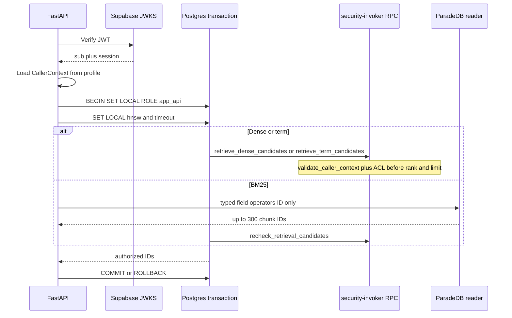

# Hybrid retrieval contract

Single source for versioned Hybrid channel profiles. Packet 2 freezes dense,
BM25, term, HNSW, and authorization foundations. RRF, temporal factors, rerank,
MMR, coverage/refusal, and cache TTLs are listed as **not selected** until their
owning packet measures them on development/qualification data. Holdout is never
used for tuning.

Related: [ARABIC_NORMALIZATION.md](./ARABIC_NORMALIZATION.md) ·
[BM25_PROJECTION_CONTRACT.md](./BM25_PROJECTION_CONTRACT.md) ·
[QUALITY_TARGETS.md](../QUALITY_TARGETS.md) ·
[IDENTITY_PROPAGATION.md](../security/IDENTITY_PROPAGATION.md) ·
[phase-04 evidence](../development/phase-04-hybrid-rag-evidence.md)

## Protocol



Direct/pooled SQL does not inherit JWT identity. Caller IDs passed into RPCs
are **server-derived** and rechecked against live `profiles` and
`authorization_version`. PostgREST/anon/authenticated/`service_role` are not
granted retrieval EXECUTE.

## Frozen Packet 2 values

Every row records unit, source/baseline, allowed range, selected value,
dataset/config version, metric evidence, owner, rollback, and review trigger.

| Tunable | Unit | Source / baseline | Allowed range | Selected | Dataset / config | Evidence | Owner | Rollback | Review trigger |
| --- | --- | --- | --- | --- | --- | --- | --- | --- | --- |
| Dense candidate cap | IDs / query | Plan Packet 2 / skill | 1–100 | **100** | `phase4-dataset-v1` (not ingested) | SQL `LEAST(..., 100)` plus fixture clamp | retrieval | 100 | Packet 4 fusion |
| BM25 scan cap | IDs | Plan: 300 over 3 pages | 1–300 | **300** one top-N (no keyset) | `bm25_v1` | Typed queries; keyset not qualified on pg_search 0.25.2 | retrieval | 300 | If pin qualifies stable cursors |
| BM25 authorized survivors | IDs | Plan | 1–75 | **75** | `bm25_v1` | Recheck `LIMIT 75` | retrieval | 75 | Packet 4 |
| Term candidate cap | IDs | Plan | 1–30 | **30** | identifier-rules-v1 | SQL clamp | retrieval | 30 | Packet 6 calibration |
| Exact fallback row cap | authorized rows | Plan | ≤10,000 | **10,000** | `app.retrieval_exact_row_cap()` | Hard count, not planner estimate | retrieval | 10,000 | Envelope change |
| `hnsw.iterative_scan` | enum | pgvector 0.8 default `off` | `off` / `relaxed_order` / `strict_order` | **strict_order** | pgvector 0.8.0 local | Does **not** make HNSW exact | retrieval | `strict_order` | pgvector major bump |
| `hnsw.ef_search` low/medium/high | integer | pgvector default **40** | 4–1000 | **40 / 80 / 120** | seeded fixture | Fixture ANN IDs matched exact top-5 | retrieval | 40 | Packet 6 on development set |
| `hnsw.max_scan_tuples` | tuples (approx) | pgvector default 20,000 | ≥1 | **8000 / 16000 / 20000** | seeded fixture | Approximate visit bound, not a hard cap | retrieval | 20000 | Underfill vs exact oracle |
| `hnsw.scan_mem_multiplier` | × `work_mem` | pgvector default 1 | 1–1000 | **2** | pgvector 0.8 docs | Scales `work_mem` only | retrieval | 1 | Memory pressure |
| Retrieval `work_mem` | bytes | `app_api` role 8MB | bounded | **32MB** SET LOCAL | role timeouts Packet 2 | Transaction-local | retrieval | 8MB | Pool OOM |
| Statement timeout | ms | Hybrid p95 2s first evidence; `app_api` 15s | < 15s role default | **8000** | QT-LAT-001 | SET LOCAL | retrieval | 8000 | Latency miss |
| Trigram threshold | similarity | pg_trgm default 0.3 | 0–1 | **0.3** | pg_trgm | SET LOCAL `pg_trgm.similarity_threshold` | retrieval | 0.3 | Packet 6 |
| Vector opclass | — | ADR embedding | cosine | **`vector_cosine_ops` 1024** | ADR-embedding-model-dimension | HNSW index | retrieval | cosine | New embedding ADR |
| Arabic normalizer | version | Phase 2 | `arabic_norm_v1` only | **arabic_norm_v1** | parity fixtures | Byte-identical core/SQL/ParadeDB | retrieval | none | Second normalizer forbidden |
| BM25 tokenizer | — | Phase 2 pin | unicode_words, no stemmer | **`pdb.unicode_words`** | pg_search 0.25.2 | No English stemmer on Arabic | retrieval | unicode_words | Ablation packet |
| BM25 field order | priority | Plan | title > heading/alias > body | **title, heading, alias, body** | `bm25_v1` | Separate parameterized field queries | retrieval | same | Packet 4 boosts |
| BM25 operators | enum | ParadeDB match/phrase | `\|\|\|` `&&&` `###` | typed only; **no `pdb.parse`** | contract tests | Injection text stays a bound parameter | retrieval | typed | Pin change |
| Fallback `bm25_unavailable` | reason | Plan | enum | recorded, dense+term continue | Packet 2 | ParadeDB error or missing index | retrieval | same | Packet 4 coverage |
| Fallback `weak_evidence` | reason | Plan exact bound | enum | exact refused when count > 10k | Packet 2 | No unbounded seq scan | retrieval | same | Envelope change |

## Not selected (later packets)

| Tunable | Owner packet | Status |
| --- | --- | --- |
| RRF `k` (plan-fixed 60) | 4 | not applied |
| Channel weights / variant max-not-sum | 4 | not applied |
| UTC temporal policies | 4 | not applied |
| OpenAI rerank pool / model / schema | 5 | not applied |
| MMR / quotas / parent expansion | 5 | not applied |
| Coverage / refusal thresholds | 6 | not applied |
| Cache keys / TTLs | 4–6 | not applied |

## Authorization negatives

Zero rows for missing, forged, disabled, stale `authorization_version`,
cross-scope (member vs restricted without ACL), stale current-version,
soft-deleted chunks, `service_role` EXECUTE, and PostgREST/anon RPC calls.
Table-owner (superuser) connections still run `validate_caller_context` inside
the invoker function; NULL caller IDs return no rows.

## Citations

Dense/term/BM25 adapters return **canonical chunk IDs** only. Citation display
must read `document_chunks.raw_text`. BM25 `body_search` and
`search_normalized` are search forms and must not be shown as evidence.

## Verification

```powershell
uv run pytest tests/unit/test_hybrid_retrieval_foundations.py tests/contract/test_hybrid_retrieval.py -q
uv run python scripts/ci/check_migrations.py
```

## Rollback

Drop forward migration `20260814130000_hybrid_retrieval_v1.sql` via a later
expand/contract migration. ParadeDB index rebuild is derived
(`infra/paradedb/migrations/20260814130000_bm25_search_index.sql`).
