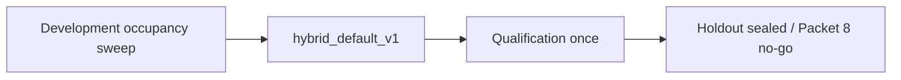

# Hybrid tuning

**Owning phase:** 4. Packet 6 froze coverage/refusal thresholds on development
occupancy features, then confirmed them once on qualification. Holdout stays
sealed. `rrf_k=60` and equal channel weights were **not** retuned.

Related: [HYBRID_RETRIEVAL_CONTRACT.md](./HYBRID_RETRIEVAL_CONTRACT.md) ·
[COVERAGE_CALIBRATION.md](../evaluation/COVERAGE_CALIBRATION.md) ·
[COVERAGE_QUALIFICATION.md](../evaluation/COVERAGE_QUALIFICATION.md) ·
[PROHIBITED_V1_METHODS.md](./PROHIBITED_V1_METHODS.md) ·
[RERANK_COUNTERFACTUAL.md](../evaluation/RERANK_COUNTERFACTUAL.md) ·
[PHASE4_FREEZE.md](../evaluation/PHASE4_FREEZE.md) ·
[PHASE4_HOLDOUT.md](../evaluation/PHASE4_HOLDOUT.md) ·
[phase-04 evidence](../development/phase-04-hybrid-rag-evidence.md)

## Freeze

| Field | Value |
| --- | --- |
| Profile id | `hybrid_default_v1` |
| Artifact | `packages/core/src/smart_rag_core/retrieval/frozen/hybrid_default_v1.json` |
| SHA-256 | `37343b15449600a4e756e7f72b9282cf709713019e033fe470a9b91fa21f0ec0` |
| Rollback id | `hybrid_packet5_v1` (signals only; not a live runtime profile) |
| Coverage threshold | `0.65` for every labeled query class |
| Unequal channel weights | not selected |
| Channel depths / rerank skip | Packet 5 values retained |

## Rejected candidates

Occupancy-loss minima below `0.65` are occupancy artifacts (single-channel
`support_confidence=0.60`, one gold link versus a two- or three-unit
minimum). Freezing them would allow single-channel answers without rerank
and would let a one-unit relationship score pass. They are recorded in
[COVERAGE_CALIBRATION.md](../evaluation/COVERAGE_CALIBRATION.md) and were
**not** written into `hybrid_default_v1`. No unequal-weight RRF candidate
was evaluated.

## Leakage control

`load_tuning_cases()` returns development cases only. Qualification is a
separate one-shot script that does not sweep. Packet 8 freeze also stays
holdout-blind and refuses to run when holdout access is enabled.

[PHASE4_FREEZE.md](../evaluation/PHASE4_FREEZE.md)
[docs index](../README.md)

## Probe15 pool and search text

`hybrid_long_document_v4` keeps `rerank_pool_size` at 20. It pins 10 dense
heads and 5 BM25 heads, then fills the remaining slots in fused order.
`hybrid_long_document_v3` remains the rollback. Retrieval embeds the
question sentences in the same batch as the full message and merges those
dense lists by reciprocal rank. BM25 scans the question sentence first.
See [ADR-probe15-retrieval-and-release-repair.md](../adr/ADR-probe15-retrieval-and-release-repair.md).
