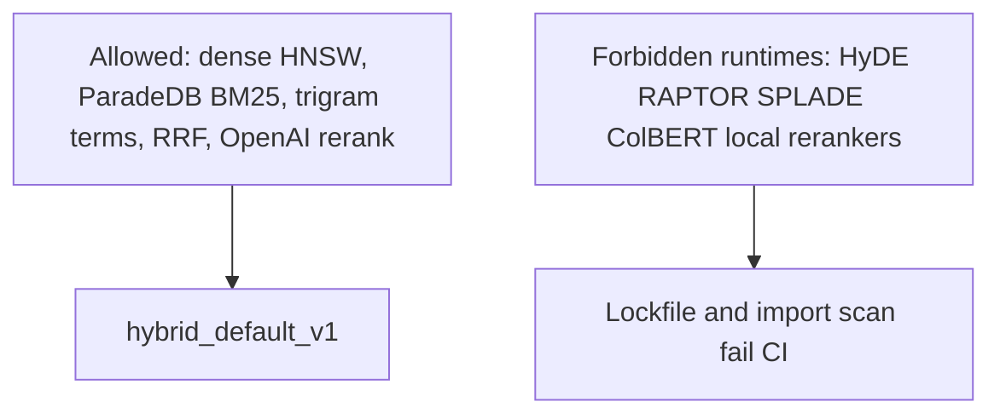

# Prohibited v1 retrieval methods

Phase 4 Hybrid v1 does not install or partially implement HyDE, RAPTOR, SPLADE,
ColBERT, FlashRank, sentence-transformers local rerankers, or learned-to-rank
runtimes. Extension points stay interfaces only until a later ADR and held-out
evidence promote a method.

Related: [HYBRID_RETRIEVAL_CONTRACT.md](./HYBRID_RETRIEVAL_CONTRACT.md) ·
[HYBRID_TUNING.md](./HYBRID_TUNING.md) ·
[phase-04 evidence](../development/phase-04-hybrid-rag-evidence.md)

The scanner lives in `smart_rag_core.retrieval.prohibited`. It matches exact
`uv.lock` package names and word-bounded `pyproject.toml` dependency names.
Python imports of `colbert`, `flashrank`, `hyde`, `ragatouille`, `raptor`,
`sentence_transformers`, and `splade` fail the Packet 6 unit test.

Promotion of a prohibited method requires an ADR, user approval, and held-out
evidence. It is not a Packet 6 or Packet 7 change.

[docs index](../README.md)
