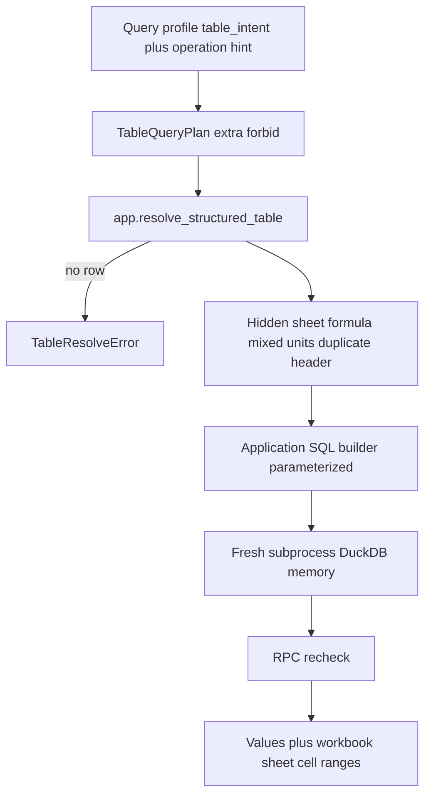
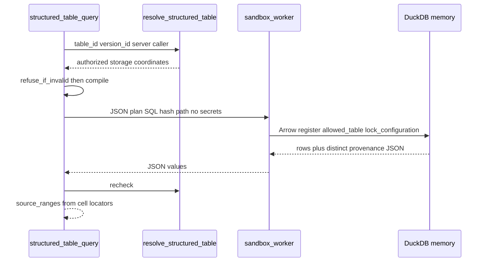

# Structured-table query contract

Deterministic CSV/XLSX calculation over authorized Parquet artifacts. Ordinary
spreadsheet cell or prose lookup stays Hybrid. The answer model may quote these
values and must never recalculate them.

Related: [HYBRID_RETRIEVAL_CONTRACT.md](./HYBRID_RETRIEVAL_CONTRACT.md) ·
[IDENTITY_PROPAGATION.md](../security/IDENTITY_PROPAGATION.md) ·
[INGESTION_LIMITS.md](../ingestion/INGESTION_LIMITS.md) ·
[ADR-parser-isolation.md](../adr/ADR-parser-isolation.md) ·
[phase-04 evidence](../development/phase-04-hybrid-rag-evidence.md)

## Binding

`should_bind_structured_table` is true only when the query profile has
`table_intent` and an operation hint in
`{filter, sort, group, sum, count, average, min, max, comparison}`. Catalog
discovery is not used. A `TableQueryPlan` without those operations is rejected
as ordinary lookup.

## Data flow





## Pins and isolation

| Item | Value | Source |
| --- | --- | --- |
| DuckDB | `1.2.1` | `packages/core` plus Phase 3 table artifacts |
| PyArrow | `19.0.1` | same |
| Connect | `:memory:` `enable_external_access=false` autoinstall/autoload/unsigned/community extensions false | [DuckDB securing overview](https://duckdb.org/docs/current/operations_manual/securing_duckdb/overview.html) retrieved 2026-08-14 |
| Lock | `SET lock_configuration=true` after register | [lock_configuration](https://duckdb.org/docs/current/operations_manual/securing_duckdb/securing_extensions.html) |
| Read path | PyArrow `read_table` then `connection.register("allowed_table", arrow)` | DuckDB 1.2.1 `read_parquet` is blocked when external access is false |
| Process | New `python -m smart_rag_core.tables.sandbox_worker` every call; never reused | Packet 7 |
| Secrets | Worker env strips KEY/SECRET/TOKEN/PASSWORD/JWT/OPENAI/SUPABASE/LANGSMITH/DATABASE_URL/POSTGRES | Packet 7 |
| Deadline | 3.0s communicate, terminate, 0.5s kill grace | Packet 7 |
| Memory/temp/threads | `64MB` / `32MB` / 1 | DuckDB settings; not a hostile sandbox by themselves |
| Output | 1000 rows, 1 MiB JSON, 100k scanned-row LIMIT | Packet 7 |
| Timezone | `SET TimeZone='UTC'` | Packet 7 |
| POSIX rlimit | `RLIMIT_AS` 2048MiB virtual (`TABLE_WORKER_ADDRESS_SPACE_MIB`) and `RLIMIT_CPU` 4s (`TABLE_STATEMENT_DEADLINE_SECONDS+1`) on the worker process (`python -m smart_rag_core.tables.sandbox_worker` / `main()`), not the parent API or pytest process | 512MiB VAS is below Arrow/DuckDB library maps; DuckDB `memory_limit` stays 64MB. Windows has no `setrlimit` |

DuckDB settings are defense in depth. Isolation is the combination of process
boundary, catalog hash, exact path equality, Arrow register (no SQL path),
blocked-token SQL, configuration lock, and parent deadline/kill.

## Authorization

`app.resolve_structured_table` is `SECURITY INVOKER`, `REVOKE ALL FROM PUBLIC`,
`GRANT EXECUTE TO app_api` only. It returns no row when caller context is
invalid, the document or version is deleted, the version is not current, or
`caller_can_read_document` is false. Client and model paths never participate.
The local sandbox file is `{content_hash_sha256}.parquet` under a server root.

## Plan and result

`TableQueryPlan` forbids extra fields, SQL, paths, globs, and URI-shaped
predicate values. Identifiers are internal column ids. Values are positional
`?` parameters. Results include table/version/document ids, Parquet SHA-256,
schema `table_parquet_v1`, workbook, sheet, exact cell/range labels from
`__provenance_json`, operation, predicates, grouping, units, row counts, null
policy `skip`, and rounding `decimal-as-text`.

## Refusals

| Code | When |
| --- | --- |
| `hidden_sheet_policy` | Hidden sheet or hidden column |
| `missing_formula_cache` | Numeric aggregation over a formula column |
| `unsupported_formula_or_type` | Sum/avg/min/max over a non-numeric column |
| `mixed_units_or_currency` | More than one unit or currency, or plan units mismatch |
| `duplicate_header_reference` | Requested id matches a duplicated original header |
| `missing_cell_provenance` | Matching rows have no usable locator JSON |
| `ordinary lookup stays Hybrid` | Plan has no filter/sort/group/aggregation/comparison |

Non-finite results fail closed as `non_finite_result`. Over-limit output fails
closed. Timeout is `statement_deadline`.

## Failure modes

- HTTP/S3/`ATTACH`/`COPY`/`INSTALL`/`LOAD`/pragma SQL is rejected before DuckDB
  runs. A `read_parquet` of another local file still fails because external
  access is disabled.
- A replaced Parquet file fails the catalog SHA-256 check.
- A symlink whose resolved path is not the authorized path fails
  `artifact_path_mismatch`.
- Hung workers are terminated then killed. The process is discarded.
- POSIX rlimits apply only in the worker process (`main()`), not the parent
  API or in-process pytest payload calls. Windows has no `setrlimit`; rely
  on DuckDB `memory_limit` plus the parent deadline.

## Verification

```powershell
uv run pytest tests/unit/test_structured_table.py tests/contract/test_structured_table.py -q
uv run python scripts/ci/check_migrations.py
```

## Rollback

Drop forward via a later expand/contract migration that `CREATE OR REPLACE`
the resolver to a no-op `RETURN;` and `REVOKE` `app_api`. Runtime rollback is
to keep ordinary spreadsheet lookup on Hybrid and not bind
`structured_table_query`.
