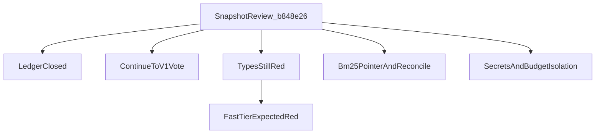

# Close-out: Phases 1–5 implementation review

Status of findings from
[2026-08-16-phases-01-05-implementation-review.md](./2026-08-16-phases-01-05-implementation-review.md).
That file remains the snapshot at `b848e26`. This file records what the
same-day housekeeping change proved, what stayed a standing constraint, and
what is still unverified. It does **not** authorize Phase 6, production v1,
a Hybrid Pilot, bulk graph onboarding, or real company content.

Related: [QUALITY_TARGETS.md](../QUALITY_TARGETS.md) ·
[PYRIGHT_BASELINE.md](../development/PYRIGHT_BASELINE.md) ·
[ADR-hybrid-pilot-release-cut.md](../adr/ADR-hybrid-pilot-release-cut.md) ·
[docs index](../README.md)

## Honest labels (unchanged)

- Engineering-complete for a local demo. Not launch-complete.
- Continue toward production v1 with **15** labeled `graph_mapping`
  documents; bulk onboarding blocked; holdout sealed.
- Not production v1. Not a `0.x Hybrid Pilot`.

## Finding status

| ID | Snapshot finding | Close-out |
| --- | --- | --- |
| P1-1 | Phase 4 wrapper / plan todos / QT-P8 ledger stale | **Closed.** Phase 4 wrapper `status: complete`; Packet 9 `[x]`; plan todos 1–5 `completed`, 6–11 `pending`; QT-CAP-005-P8 / 006-P8 `accepted` 2026-08-16. |
| P1-2 | Real company content prohibited | **Standing.** Deny-by-default unchanged. |
| P1-3 | Packet 9 checkbox unchecked | **Closed** with P1-1. |
| P1-4 | Hybrid metrics easy to over-claim | **Standing.** Docs quote synthetic + identity-rerank + sealed holdout. Packet 9 numbers were not re-run. |
| P1-5 | Graph envelope is 15 documents | **Standing.** Advertised cap remains 15; Phase 1 2,000 / 200,000 rows stay aspiration. |
| P1-6 | Combined +10 pp must not use CoverageSlice fixtures | **Standing for Phase 6.** Not implemented here. |
| P1-7 | Full-repo Pyright ~612 vs Phase 1 zero | **Policy recorded; types still red.** Re-measured **882** errors (Pyright 1.1.411, strict). See below. |
| P2-1 | Hybrid Pilot votes never recorded | **Closed.** Vote: continue toward production v1 with reduced GraphRAG. Not a 0.x Hybrid Pilot. |
| P2-4 | BM25 outbox can remain `processing` | **Closed in code.** Lease-aware `app.claim_bm25_reconcile_job`; verify failure never fabricates Hybrid Ready. |
| P2-5 | Table eval Parquet artifacts missing | **Open.** Not in this close-out. |
| P2-6 | `current_version_id` only set by eval driver | **Closed for graph-ineligible.** `app.finalize_hybrid_ready` now sets the pointer. Graph-eligible replacements still wait for Phase 5 CAS. |
| P2-7 | Envelope header strip mandatory | **Keep.** Mapping tests already present; not weakened. |
| P2-8 | Graph budget isolation flakes on dirty local DB | **Closed in test.** Fixture truncates all `app.budget_reservations` then seeds leftover ingest spend. |
| P2-9 | Query graph and frontend remain scaffolds | **Open / planned.** Phase 6 / 8. |
| P2-10 | Privileged-secret scan false-positive on `storage_admin` | **Closed.** `WorkerSettings` no longer declares the Storage Admin field; isolated loader in `privileged_storage.py`. |
| P2-11 | Risk register stale | **Closed.** R-03 records envelope reduced, rebuild still unmeasured. |
| P3-1 | QT-CAP-005-P8 / 006-P8 pending after `okay push` | **Closed** with P1-1. |

## P1-7 types tier (still red)

The types gate is an honest failing budget, not a green waiver.

- `types` remains in `FAST_TIERS`.
- `[tool.pyright]` still includes `tests`. Strict mode unchanged.
- No `|| true`. No dated waiver.
- Ratchet: `scripts/ci/check_pyright_baseline.py` fails only if the error
  count **increases** above 882. Matching 882 is not a types pass.
- `python -m pyright` still runs afterward and **fails while any error
  remains**.
- Therefore `uv run python scripts/check.py --tier types` and
  `--tier fast` are **expected to exit 1** until the count is 0.

| Field | Snapshot review | Close-out measure |
| --- | --- | --- |
| Errors | ~612 (Phase 5 Packet 1; not re-run from that commit) | **882** |
| Files analyzed | unverified here | 414 |
| Pyright | unverified here | 1.1.411, strict, local Windows |
| Remote GitHub Actions | not run | **still not run** |

Canonical write-up: [PYRIGHT_BASELINE.md](../development/PYRIGHT_BASELINE.md).
Machine-readable copy: `scripts/ci/pyright_baseline.json`.

## P2-6 residual

Graph-ineligible Hybrid Ready now writes `documents.current_version_id`.
The first **graph-eligible** replacement stays non-current until
`switch_graph_document_version` CAS. That CAS was not weakened.

`packages/core/src/smart_rag_core/generated/database.ts` still omits
`claim_bm25_reconcile_job`. Local `supabase gen types` connected to port
5432 instead of 54322, so types were not overwritten. Python calls the RPC
directly. Other environments still need migration
`20260816160000_bm25_reconcile_and_ineligible_pointer_v1.sql` applied.

## Still open (not this close-out)

- Table Parquet eval artifacts / QT-LAT-006 (P2-5).
- Live OpenAI rerank counterfactual on Packet 9 (identity rerank was used).
- Independently SME-sealed holdout; do not open the synthetic holdout.
- Combined fusion, SSE, query agent (Phase 6).
- Driving Pyright from 882 to 0.
- Remote CI conclusion for the types / fast tiers.

## Recommended close-out checklist

The snapshot review's seven housekeeping items:

1. Phase 4 wrapper complete — **done**.
2. Packet 9 checked; evidence `accepted` — **done**.
3. Plan index todos 1–5 completed, 6 pending — **done**.
4. QT-CAP-005-P8 / 006-P8 accepted 2026-08-16 — **done**.
5. Hybrid Pilot vote recorded — **done** (continue toward v1, reduced GraphRAG).
6. Risk register refreshed — **done**.
7. Pyright policy agreed — **done as a red gate plus ratchet**; debt unpaid.

Optional items from the snapshot remain optional: table Parquet artifacts;
live OpenAI rerank counterfactual.

## Verification in this close-out

Inspected in-repo (not a full re-run of Packet 9 / LightRAG / Compose):

- Phase 4 wrapper `status: complete`; Packet 9 `[x]`.
- Plan index todos 1–5 `completed`, 6–11 `pending`.
- `finalize_hybrid_ready` graph-ineligible branch sets `current_version_id`.
- `types` commands in `scripts/check.py` run the ratchet then `python -m pyright`.
- `pyproject.toml` `[tool.pyright].include` still lists `tests`.

Remote GitHub Actions, live ParadeDB verify-fail, and full `uv run pyright`
were **not** re-run in this close-out write-up. Those commands were reported
by the implementing slices; treat remote CI as unverified.

[docs index](../README.md)
