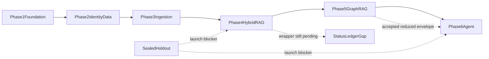
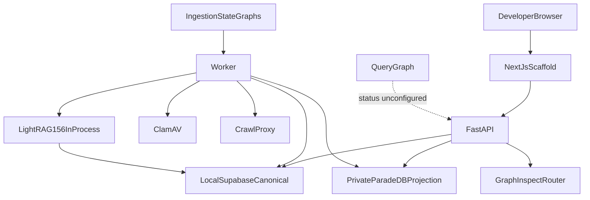
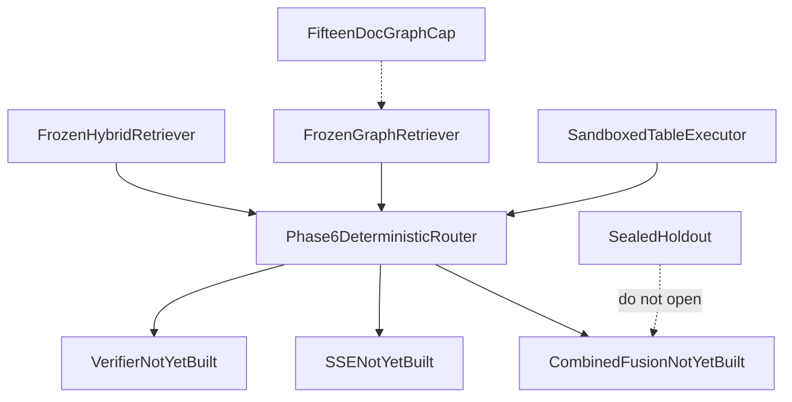

# Review: Phases 1–5 implementation (Foundation through GraphRAG)

This review scores **what was built** against the canonical plan, packet evidence, and repository state at HEAD `b848e26` (2026-08-16). It is not a production-readiness certificate and does not authorize Phase 6 until the ledger items in [Recommended close-out](#recommended-close-out-before-phase-6) are accepted.

Related: [plan index](../../.cursor/plans/hybrid-graph-rag_ab5281ef.plan.md) · [global contracts](../../.cursor/plans/hybrid-graph-rag/00-global-contracts.md) · [2026-08-12 plan review](./2026-08-12-hybrid-graph-rag-plan-review.md) · [same-day close-out](./2026-08-16-phases-01-05-closeout.md) · [QUALITY_TARGETS.md](../QUALITY_TARGETS.md) · [docs index](../README.md)

This file is the snapshot at `b848e26`. Finding status after housekeeping is in the [close-out](./2026-08-16-phases-01-05-closeout.md), not rewritten here.

## Executive verdict

Phases 1–5 delivered a **real local platform**, not a scaffold: uv/pnpm monorepo, local Supabase + private ParadeDB, leased ingestion through verified `Hybrid Ready`, a three-channel Hybrid retriever with live open-split ranked-ID numbers, and a pinned LightRAG GraphRAG stack that treats vendor graph output as leads resolved to canonical passages.

That delivery is **engineering-complete for a demo**, **not launch-complete**. The honest label is:

- **May continue into Phase 6** (query agent, Combined fusion, SSE, budgets) on the frozen Hybrid profile and GraphRetriever contracts.
- **Must not** call this production v1, a Hybrid Pilot, or a 2,000-document GraphRAG launch.
- **Must not** send real company content to OpenAI, LangSmith, managed Supabase, or Vercel until the provider matrix is `verified`.
- **Must not** bulk-onboard graph documents. The advertised GraphRAG envelope is **15 labeled `graph_mapping` documents**, source-chunk capacity unverified, bulk onboarding blocked.

The largest process defect **at snapshot time** is a **stale completion ledger**: Phase 5 is marked complete while Phase 4’s wrapper, Packet 9 checkbox, evidence frontmatter, and the canonical plan todos still say pending. Combined with a full-repo Pyright regression (~612 errors recorded during Phase 5 Packet 1 versus Phase 1’s zero-error close), the paper trail no longer matches the code. Same-day housekeeping closed the ledger and recorded an 882-error types baseline; types remain red. See the [close-out](./2026-08-16-phases-01-05-closeout.md).



## Method and sources

This review compared:

1. Phase wrappers `Done when` gates in `.cursor/plans/hybrid-graph-rag/01` through `05`.
2. Packet evidence: [phase-01](../development/phase-01-foundation-evidence.md), [phase-02](../development/phase-02-identity-data-evidence.md), [phase-03](../development/phase-03-ingestion-evidence.md), [phase-04](../development/phase-04-hybrid-rag-evidence.md), [phase-05](../development/phase-05-graphrag-evidence.md).
3. Accepted ADRs, especially [ADR-phase4-engineering-close.md](../adr/ADR-phase4-engineering-close.md), [ADR-hybrid-pilot-release-cut.md](../adr/ADR-hybrid-pilot-release-cut.md), [ADR-graph-source-identity-envelope.md](../adr/ADR-graph-source-identity-envelope.md).
4. Repository layout, 45 forward migrations, 127 pytest modules, query-graph scaffold, frontend shell, and git history 2026-08-12 through 2026-08-16.

This review **did not** re-run the live Compose, ClamAV, ParadeDB, OpenAI bake-off, ranked-ID, or LightRAG qualification suites. Numbers below are taken from dated evidence unless marked `re-inspected`.

## Status ledger (re-inspected)

| Artifact | Recorded status | What that actually means |
| --- | --- | --- |
| Phase 1 wrapper | `complete` (accepted 2026-08-12; audit-clean 2026-08-13) | Foundation is accepted. |
| Phase 2 wrapper | `complete` (accepted 2026-08-13) | Schema/RLS/Auth/Storage accepted; managed OIDC/KMS deferred. |
| Phase 3 wrapper | `complete` (accepted by “implement Phase 4” on 2026-08-14) | Ingestion accepted; real-content still prohibited. |
| Phase 4 wrapper | `pending`; Packet 9 checkbox **unchecked** | Code and Packet 9 evidence exist; administrative close was never written. |
| Phase 4 evidence frontmatter | `pending` | Same gap. |
| [ADR-phase4-engineering-close.md](../adr/ADR-phase4-engineering-close.md) | `accepted` 2026-08-15 | SME holdout waived for **engineering** close only. |
| Phase 5 wrapper | `complete` 2026-08-16 (`okay push`) | Reduced envelope accepted; Combined quality explicitly not claimed. |
| Plan index todos | Phase 3/4 `pending`, Phase 5 `completed` | Index contradicts wrappers 3 and 5. |
| `QUALITY_TARGETS` QT-CAP-005-P8 / 006-P8 | `pending user acceptance` | Stale: Phase 5 acceptance already recorded. |
| Hybrid Pilot checkpoints | votes due 2026-08-22 and 2026-11-07 | Phase 5 already started; calendar checkpoints were not re-voted. |

**Finding P1-1.** Close the ledger before Phase 6 packet 1. Leaving Phase 4 `pending` while Phase 5 is `complete` will cause the next model run to reload the wrong prerequisite story.

## Scorecard

| Area | Rating | One-line assessment |
| --- | --- | --- |
| Foundation / monorepo | Strong | Exact workspace, lockfiles, private Compose, hard CI, honest health. |
| Identity / RLS / JWKS | Strong | Typed server-derived identity; managed rollover proven; hosted Auth throttle still unverified. |
| Ingestion | Strong locally | Hybrid Ready after BM25 verify; Graph Pending/Ineligible split; real corpus still blocked. |
| Hybrid retrieval | Strong engineering / weak launch | Live open-split Recall@K passed; holdout sealed; live eval used identity rerank, not OpenAI rerank. |
| GraphRAG | Strong infrastructure / reduced product | Pin, envelope, resolver, single-writer, inspection bounds; 15-doc advertised envelope; live extraction P/R unverified. |
| Grounding invariant | Strong | BM25 snippets and LightRAG prose are not evidence; resolvers recheck ACL/current/deletion. |
| Evaluation hygiene | Strong process / synthetic labels | Splits sealed; occupancy rejected as Recall@K; corpus is `synthetic_provisional`. |
| Types / quality gates | Regressed | Phase 1 close had Pyright 0; Phase 5 Packet 1 recorded ~612 full-repo errors. |
| Frontend / query agent | Intentionally absent | Scaffold only; Phase 6/8 ownership. |
| Production / staging | Not started | Phases 9–11. Do not infer managed proof from local Docker. |

## What exists in the repository (re-inspected)



Present and load-bearing:

- Four Python members (`smart-rag-core`, `smart-rag-agents`, `smart-rag-backend`, `smart-rag-worker`) plus Next.js App Router shell.
- 45 expand-only Supabase migrations covering identity, jobs, Hybrid RPCs, glossary, tables, and LightRAG maps/workspaces.
- Private ParadeDB projection, split Valkey, crawl proxy, parser sandbox image.
- `HybridRetriever.retrieve` returning authorized canonical IDs and locators.
- `GraphRetriever` / indexer protocols; LightRAG confined to core adapters.
- Graph inspect and entity-rule HTTP surfaces; glossary import; ingestion status/crawl.
- 127 pytest modules across unit/contract (security, RLS, BM25, Hybrid, graph, crawl, ClamAV).

Intentionally not present (Phase 6+):

- Query LangGraph is still the Phase 1 `unconfigured` marker (`apps/agents/src/smart_rag_agents/query/graph.py`).
- Frontend still says auth/chat/retrieval are not implemented.
- No Combined fusion, SSE query stream, reserve-once chat budgets, or Stitch UX.

## Phase 1 — Foundation

**Plan status:** complete. **Evidence:** accepted 2026-08-12, audit-clean 2026-08-13.

### Proven

- Signed `QUALITY_TARGETS.md` from provisional global-contract numbers (user message `approved`).
- Dated Hybrid Pilot framework with production-label prohibition.
- Exact uv/pnpm workspace, one lockfile each, one `langgraph.json`, non-root Dockerfiles, import-boundary tests.
- Local Compose: API, worker, frontend, ParadeDB/`pg_search`, split Valkey, crawl-proxy; `dev.ps1` / `verify-local.ps1`.
- ParadeDB licensing/availability and same-host TLS ADRs before Compose omissions.
- Fast CI: format, lint, types (at close), unit/contract, docs/Mermaid, OpenAPI snapshot, migration policy, Gitleaks, pip-audit/pnpm audit.
- Remote CI green on `2f4f3ec` (main run `31692522152`).

### Unverified then, still later-phase

- BM25 full-envelope RAM/rebuild (Phase 4/9).
- Graph maintenance reserve dollar amount (formula only until a measured rebuild).
- AWS-free local path is proven; managed topology is not.

### Findings

- **P2-1.** Hybrid Pilot calendar votes (2026-08-22 / 2026-11-07) were never recorded, yet Phase 5 proceeded. The framework ADR is still valid; the checkpoint votes are stale.
- Phase 1 quality bar (Pyright 0, no `|| true`) is the right memory of “done.” Later phases drifted from that bar.

## Phase 2 — Identity and data

**Plan status:** complete. **Evidence:** accepted 2026-08-13.

### Proven

- Local pgvector **0.8.0** + iterative scan; managed project `qsjivtwtmlmtksufqjik` pgvector **0.8.2**. No `pg_search` on managed Supabase.
- Byte-identical `arabic_norm_v1` across SQL, core, and ParadeDB.
- ParadeDB pin: digest `sha256:dca046b8…883bb`, `pg_search` 0.25.2, private reader/writer roles.
- Live embedding bake-off: winner `text-embedding-3-large` @ **1024**, cosine, `vector`. Slice disjoint from launch holdout.
- Expand/contract migrations, deterministic double-reset schema fingerprints, generated types.
- Typed identity RPCs (no session-GUC identity on the transaction pool); company-visible vs restricted ACL; graph-eligibility CHECK.
- Asymmetric JWKS; managed standby→active→retired rollover without HS256 fallback.
- Isolated Auth Admin and Storage Admin boundaries; runtime `service_role` absent from general containers.
- Hash-chained audit foundation; connection-budget math documented under 70% of the selected local inventory.

### Unverified / deferred (honest)

- AWS Secrets Manager + GitHub OIDC one-shot migrations (Phase 10).
- KMS / S3 Object Lock audit anchors (Phase 10).
- Hosted Supabase Auth rate-limit enforcement (local Auth does not prove it).
- Full-envelope HNSW RAM ≥16 GB / 60% working-set gate before bulk embed.
- Managed leaked-password protection was disabled at the 2026-08-13 read-only inventory.

### Findings

- **P2-2.** Embedding Recall@10 = 1.0 on a 22-query slice is selection evidence, not Hybrid quality. Do not cite it as QT-EVAL-006.
- **P2-3.** Several Phase 1 ADR backlog rows (graph-eligibility isolation, grounding, structured-table, workload isolation) remain `planned` even though behavior exists in schema/docs. Either write the ADRs or point the index at the canonical docs so Phase 6 does not re-litigate settled contracts.

## Phase 3 — Ingestion

**Plan status:** complete. **Evidence:** accepted 2026-08-14 (implicit: start Phase 4).

### Proven

- Deny-by-default external-processing packet; real company content **prohibited** until provider rows are `verified`.
- Leased `SKIP LOCKED` jobs, heartbeats, dead-letter replay, spend admission, graph-handoff pause at 50 pending index jobs.
- Postgres checkpointer (`langgraph-checkpoint-postgres==3.1.2`) added in the gap close-out; crash resume without duplicate ledger rows.
- ClamAV pin + live EICAR; Storage quarantine→promote saga; 24h never-finalized cleanup.
- Crawl proxy: DNS/private-IP/redirect/peer-IP fail-closed (live overlay ports).
- No-secret parser sandbox; OCR scanned PDF through Tesseract in the rebuilt image.
- Structure-aware chunking, exact/fuzzy dedup provenance, typed Parquet manifests.
- `Hybrid Ready` only after ParadeDB ID/hash/index-version/sample-query verify.
- Graph-eligible → exactly one `Graph Pending` job; restricted → `Graph Ineligible`.
- Graph-eligible version replacement stays non-current until Phase 5 pointer flip.
- Developer-host throughput: text parse→chunk→mock-embed ≫ 500 pages/h; OCR sandbox 1,670 pages/h vs QT-ING-002 ≥100. Projection lag 1.005 s on that synthetic drive.

### Unverified

- Named-client DPA/ZDR/region console values.
- Live OpenAI embeddings on the ingestion path (Hybrid Ready E2E used mock embeddings + `ContentClass.SYNTHETIC`).
- Queue fairness, CPU/RAM/IO peaks, 1e6-chunk BM25 lag (Phase 9).
- Production must not ship `docker-compose.packet8.yml` host overlays (`:13310`, `:54329`, `:18080`).

### Findings

- **P1-2.** Governance still correctly blocks real corpus. Phase 6 answering will tempt “just one real PDF.” That is still a stop route until `provider_settings_verified` flips.
- **P2-4.** Packet 9 later recorded BM25 outbox rows that can remain `processing` after a successful ParadeDB upsert. Dense+term still retrieved; Hybrid Ready must not be advertised from a stuck outbox in operations. Add a reconcile/alert before any demo with more than the eval sidecar.
- Throughput numbers are **this Windows host, mock embed**. They do not satisfy launch-hardware QT-ING-*.

## Phase 4 — Hybrid RAG

**Plan status:** wrapper `pending`. **Engineering ADR:** accepted. **Launch holdout:** sealed no-go.

This is the phase whose **paper status and code status disagree**.

### Proven (engineering)

- 405-case synthetic corpus; 216/77/112 split hashes; holdout loaders fail closed; embedding slice disjoint.
- Owner/admin glossary import; alias cycle/conflict rejection; private values redacted from errors.
- Dense 100 / BM25 75 / term 30; union 205; BM25 scan cap 300; batched Supabase recheck.
- Byte-identical Arabic projection/query forms reused from Phase 2.
- Max-per-variant RRF (`rrf_k=60`, equal weights frozen); UTC temporal policies; section-coverage full-summary refusal; negation without confident inversion; media limitation notice.
- OpenAI structured rerank contract with set-equality validation and RRF fallback (unit/contract). Counterfactual catalog published.
- Coverage threshold 0.65 all classes; prohibited v1 methods documented.
- DuckDB OS-isolated table path with workbook/sheet/cell provenance (Packet 7). No HTTP table route (correct).
- Packet 8 freeze: `hybrid_default_v1` SHA-256 `def45b691e64707d07d3c7ea47f45eb1b23b5d2d2546c37a19a514f316c5940c`; launch_decision=`no_go`; holdout_opened=`false`.
- Packet 9 live ranked-ID on Phase-4-owned open splits (identity rerank, live embeddings):

| Split | Cases (recall) | Recall@10 | Exact-code@5 | Alias@10 | Locator | First-evidence p95 | ACL leaks |
| --- | ---: | ---: | ---: | ---: | ---: | ---: | ---: |
| development | 157 (112) | 0.902 | 1.000 | 1.000 | 1.000 | 785 ms | 0 |
| qualification | 55 (38) | 0.868 | 1.000 | 1.000 | 1.000 | 601 ms | 0 |

Gates: Recall@10 ≥0.85, code@5 ≥0.98, alias@10 ≥0.95, locator ≥0.98, first evidence ≤2 s. Qualification ran once after two development repairs (current-version pointer; `as_of` dates). Frozen profile was not retuned.

### Not proven (launch / Packet 9 honesty)

- Independently SME-sealed holdout (QT-HOLD-001). Opening the synthetic holdout to print a number remains forbidden.
- First-answer-token / completion p95 and answer faithfulness (Phase 6/9).
- Citation **assembler** completeness (locator correctness ≠ citation completeness).
- Structured-table labeled p95: 11/4 table cases dispatched; `execute_compiled_query` ran **0** times because `{case_id}.parquet` was not materialized.
- Live OpenAI rerank: Packet 9 used identity rerank (`rerank_call_count=0`). The rerank **code** exists; the ranked-ID numbers do not include it.
- Embedding USD cost: harness reported `cost=null`.
- Arabic mixed misses remain on both open splits (`p4-arabic_mixed-*`). Do not treat 0.868 qualification Recall@10 as multilingual headroom.

### Findings

- **P1-3.** Check Phase 4 Packet 9, set wrapper `status: complete` with an explicit engineering-complete note, and update evidence frontmatter. Phase 5 already consumed this work.
- **P1-4.** Do not tell Phase 6 that “Hybrid Recall@10 passed” without the qualifiers: synthetic labels, identity rerank, compact markdown corpus, sidecar-mapped UUIDs, holdout sealed.
- **P2-5.** Materialize table Parquet eval artifacts or record table p95 as `not_run` in QUALITY_TARGETS measure-in Phase 6/9. The current Packet 9 table lane is a silent miss.
- **P2-6.** First live run scored Recall@10 **0.0** until `documents.current_version_id` was set after Hybrid Ready. That bug is fixed for the eval driver; confirm the production ingestion finalize path always sets the pointer for graph-ineligible versions (graph-eligible waits for Phase 5 CAS).

## Phase 5 — GraphRAG

**Plan status:** complete 2026-08-16. **Product envelope:** reduced.

### Proven

- Immutable pin `lightrag-hku==1.5.6`, wheel SHA-256 `81b8aa8b…e457`, `PGTableGraphStorage` only, no AGE.
- Vendor identical-content collapse reproduced (`duplicate_kind=content_hash`). Production inserts use `<<smart-rag-graph-source:graph_source_envelope_v1:{document_version_id}>>`. Canonical Hybrid chunks stay unenveloped; mapping strips the header.
- Runtime attach without DDL (`app_lightrag`); bootstrap is a controlled job with schema fingerprint `76f10dcd…77dc`.
- Concurrency-one writer: durable lease + advisory lock; states `building` / `active` / `updating` / `filtered_dirty` / `quarantined` / `disabled` / `retired`.
- Graph Ready only after chunk/relation/path maps meet coverage floors; unmapped objects dropped with repair jobs.
- Query path: precomputed `hl_keywords` / `ll_keywords`; zero keyword-extract and answer-generate callbacks in contract spies; no N-per-statement Hybrid at query time.
- Resolver returns authorized current canonical IDs; native LightRAG prose rejected.
- Temporal limitation for historical/`as_of` relationship questions; authorized ACL-blindness count vs unauthorized silence.
- Entity `{TYPE}::{name}` do-not-merge (`PROJECT::atlas` vs `PRODUCT::atlas`).
- Pointer CAS exposes exactly one current version; failed cleanup quarantines.
- Inspection bounds: depth 3, 200 rows, 3 s `statement_timeout`, 10 s deadline.
- Packet 8 fixture language floors: en 1.00, ar 0.85, mixed 0.85 (CoverageSlice **fixtures**, not live extraction P/R).
- Advertised envelope reduced under QT-GR-002: 15 documents; bulk onboarding blocked; reserve USD 800 floor.
- Worker mapping Hybrid wired (`bind_mapping_support`): one version-scoped retrieve + one support rerank; repair must not attach those callbacks.

### Unverified (recorded, not hidden)

- Live LightRAG extraction precision/recall by language (`P8-EXTRACT-LIVE`).
- Mapping-verified documents/hour, full rebuild duration/cost of 15 or 2,000 documents.
- Graph source-chunk capacity (explicitly not 200,000).
- 24 h targeted delete / 7-day dirty consolidation as wall-clock SLAs.
- Snapshot restore of a production-sized LightRAG copy.
- Combined stream p95 and Combined +10 pp (Phase 6, QT-EVAL-009).
- Production mapping Hybrid uses **in-memory version canonicals** as dense/BM25/term jobs, not live ParadeDB/pgvector RPCs, to avoid `SET ROLE postgres` via Hybrid temporal load. Hash/span/overlap still run against canonical text.

### Findings

- **P1-5.** Treat 15 documents as the only honest GraphRAG capacity in any Phase 6 UI copy. The signed Phase 1 2,000 / 200,000 rows remain aspiration.
- **P1-6.** Do not score Combined quality on fixture CoverageSlice floors. Phase 6 must run live extraction+mapping on the 15 labeled documents (or a newly collected set) before claiming relationship gain.
- **P2-7.** The identity envelope is the correct pin-preserving fix, but the first LightRAG chunk of every document contains a synthetic header. Mapping strip is mandatory; a missed strip would poison hash match. Keep the raw-collapse negative fixture forever.
- **P2-8.** `test_graph_budget_kinds_are_isolated` can fail on a dirty local DB (`budget_exhausted`). Isolation tests that share the developer database are not release evidence.
- **P3-1.** QT-CAP-005-P8 still says `pending user acceptance` after `okay push`. Flip those rows to accepted with date 2026-08-16.

## Cross-cutting findings

### P1 — fix or explicitly accept before Phase 6 packet 1

| ID | Finding | Required next action |
| --- | --- | --- |
| P1-1 | Completion ledger disagrees with itself (Phase 4 pending, plan todos, QT-P8 rows). | One housekeeping change: complete Phase 4 wrapper as engineering-complete; sync plan index todos; accept QT-CAP-005-P8/006-P8. |
| P1-2 | Real company content still prohibited. | Keep deny-by-default; do not ingest client files in Phase 6. |
| P1-3 | Phase 4 Packet 9 checkbox unchecked despite evidence and Phase 5 start. | Check the box against Packet 9 evidence; do not reopen holdout. |
| P1-4 | Hybrid metrics are easy to over-claim. | Phase 6 docs/UI must quote synthetic + identity-rerank + sealed holdout. |
| P1-5 | Graph envelope is 15 documents, bulk blocked. | Admin ETA/onboarding UI must use the reduced envelope. |
| P1-6 | Graph language floors are fixtures. | Combined +10 pp uses live mapping/extraction, not CoverageSlice. |
| P1-7 | Full-repo Pyright ~612 errors vs Phase 1 zero. | Do not wait for Phase 9. Either restore a types-tier budget (zero on touched packages, tracked remainder) or the fast gate is theater. |

### P2 — track in Phase 6/9; do not silently waive

| ID | Finding | Owner |
| --- | --- | --- |
| P2-1 | Hybrid Pilot checkpoint votes never recorded. | product-owner; record continue-to-v1 vs 0.x pilot now that GraphRAG exists in reduced form. |
| P2-4 | BM25 outbox can remain `processing` after upsert. | ingestion/ops; reconcile before demos. |
| P2-5 | Table eval Parquet artifacts missing. | Phase 6 table tool or Phase 9 eval. |
| P2-6 | Current-version pointer was a 0.0-recall bug. | Confirm production finalize/CAS paths. |
| P2-7 | Envelope header must be stripped in every mapping path. | graph mapping tests (already present; keep). |
| P2-8 | Shared local DB flakes budget isolation. | disposable schema for that contract. |
| P2-9 | Query graph and frontend remain scaffolds. | Phase 6 / 8 as planned; do not pretend chat works. |
| P2-10 | `tests/security/test_privileged_secrets_absent.py` still matches a `storage_admin` fragment. | security; distinguish class names from secrets. |
| P2-11 | Risk register last-reviewed 2026-08-12. | Update R-02/R-03/R-05/R-06/R-08 with Phase 4/5 outcomes. |

### P3 — hygiene

- PDF fixture hashes may be `null` (PyMuPDF metadata). Documented; do not use those hashes as integrity gates.
- Duplicate `p4-eval-*` documents remain in the local database from ingest retries.
- Several graph/retrieval docs are still `draft` after accepted phases; last-reviewed dates are current, status should move to `verified` where evidence exists.
- Canonical vs inference grounding ADR is still `planned` even though the resolver implements it.

## Gate classification (verify-release-gates format)

Applies to **Phases 1–5 local engineering**, not Phases 9–11 release.

### Passed

- Workspace/lockfile/boundary/CI skeleton (Phase 1).
- Local private topology and mock-LLM health (Phase 1).
- pgvector 0.8+, Arabic parity, ParadeDB BM25 contracts, embedding pin (Phase 2).
- RLS/identity negatives, JWKS managed rollover, privileged-secret isolation design (Phase 2).
- Governance deny-by-default; leased jobs; Hybrid Ready after BM25 verify; Graph Pending vs Ineligible (Phase 3).
- Open-split ranked-ID Recall@10 / code@5 / alias@10 / locators / ACL zero / first-evidence p95 (Phase 4 Packet 9, synthetic).
- LightRAG pin/hash, no AGE, keyword/answer callback zeros, resolver ACL/deletion/temporal fixtures, reduced envelope recorded (Phase 5).
- Holdout remained sealed across Phases 4 and 5.

### Failed (recorded and handled, not hidden)

- Phase 4 Packet 8 launch holdout: **no-go** (correct).
- LightRAG raw identical-content independence: **failed** vendor behavior; restored via identity envelope ADR.
- 2,000-document / 7-day sequential rebuild: **false** at 600 s/doc cap (1,008 max); envelope reduced.

### Blocked

- Real company content → any external processor.
- Bulk graph onboarding.
- Production v1 label; Hybrid Pilot label (pilot still requires Phase 6 thin chat + Phase 8 minimal UI).
- Opening the current synthetic holdout to obtain Recall@10.

### Not run

- Independently SME-sealed holdout.
- Live OpenAI rerank inside Packet 9 ranked-ID.
- Structured-table Parquet eval / QT-LAT-006.
- Live LightRAG extraction P/R.
- Combined fusion ablation vs naive union; Combined +10 pp.
- Query-agent SSE, deadlines, reserve-once budgets (Phase 6).
- Five-stream load, envelope p95, restore/rebuild, CloudFront (Phases 9–10).
- Hosted Auth throttle, OIDC migrations, KMS anchors.
- Full-repo Pyright as a green gate after Phase 1 (last recorded: red).

Never say “production ready” on this commit.

## What Phase 6 should consume

Frozen inputs that Phase 6 may trust:

- Hybrid profile `hybrid_default_v1` at SHA-256 `def45b69…940c`.
- `HybridRetriever.retrieve` → authorized canonical IDs + locators; BM25 text is never citation text.
- Coverage 0.65; `rrf_k=60`; equal channel weights; identity-or-OpenAI rerank with RRF fallback.
- `GraphRetriever` / `GraphLeadSet` / limitation codes in [PHASE6_HANDOFF.md](../graph/PHASE6_HANDOFF.md).
- Query-type → family map from Phase 4 (do not re-implement profiling).
- Structured-table executor (bind deterministically; still no catalog discovery).
- Graph inspect HTTP already exists; Combined answering does not.

Phase 6 must still implement: admission/reserve-once budgets, deterministic routing including Combined fusion, verifier/citations in the answer, SSE resume, Valkey-down limits, conversation cascade deletion, and the +10 pp relationship gate. It must not implement Stitch UI, Vercel, or EC2.



## Recommended close-out before Phase 6

The seven housekeeping items below were the snapshot recommendations.
[Close-out status](./2026-08-16-phases-01-05-closeout.md): items 1–7 are done
as ledger/vote/docs/policy work; Pyright remains a **red** types tier at 882
errors; optional table-Parquet and live-rerank work was not started.

Do these in a short housekeeping change (no new product scope):

1. Mark Phase 4 wrapper `complete` with `engineering-complete; holdout sealed; Packet 9 accepted by Phase 5 start / user mandate`.
2. Check Phase 4 packet 9; set evidence frontmatter `accepted`.
3. Sync [plan index todos](../../.cursor/plans/hybrid-graph-rag_ab5281ef.plan.md): Phases 1–5 completed, Phase 6 pending.
4. Accept QT-CAP-005-P8 / QT-CAP-006-P8 dated 2026-08-16.
5. Record the overdue Hybrid Pilot vote: **continue toward production v1 with reduced GraphRAG**, or name a 0.x Hybrid Pilot (still needs Phase 6 chat + Phase 8 UI).
6. Refresh [RISK_REGISTER.md](../development/RISK_REGISTER.md) so R-03 is “envelope reduced, rebuild still unmeasured.”
7. Agree a Pyright policy: packet-scoped zero errors is not a substitute for a red types tier.

Optional but high leverage before Combined work: materialize table Parquet eval artifacts; run one live OpenAI rerank counterfactual on the qualification recall misses; add BM25 outbox reconcile.

## Effort note

Plan estimate for Phases 1–5 was roughly 13–19 engineer-weeks. Calendar delivery was **2026-08-12 through 2026-08-16**. That speed is visible in the evidence quality (honest no-gos, reduced envelope, sealed holdout) and in the leftovers (types regression, stale ledger, identity rerank in the live Hybrid number, in-memory mapping Hybrid). Phase 6 should slow down to one packet per run and restore the Phase 1 types/CI bar on every touched tree.

## Verification commands used in this review

```powershell
git rev-parse HEAD
git log --oneline -40
```

HEAD was `b848e269a5be00b9a0896eda1fa11bcf7eb76766`. Live pytest, Compose, and Pyright were **not** re-run.

## Links

- [Same-day close-out](./2026-08-16-phases-01-05-closeout.md)
- [Phase 1 evidence](../development/phase-01-foundation-evidence.md)
- [Phase 2 evidence](../development/phase-02-identity-data-evidence.md)
- [Phase 3 evidence](../development/phase-03-ingestion-evidence.md)
- [Phase 4 evidence](../development/phase-04-hybrid-rag-evidence.md)
- [Phase 5 evidence](../development/phase-05-graphrag-evidence.md)
- [PHASE4_HOLDOUT.md](../evaluation/PHASE4_HOLDOUT.md)
- [PHASE4_RANKED_IDS.md](../evaluation/PHASE4_RANKED_IDS.md)
- [PHASE5_GRAPH_EVAL.md](../evaluation/PHASE5_GRAPH_EVAL.md)
- [PHASE6_HANDOFF.md](../graph/PHASE6_HANDOFF.md)
- [FROZEN_GRAPH_MANIFEST.md](../graph/FROZEN_GRAPH_MANIFEST.md)
- [ADR index](../adr/README.md)
