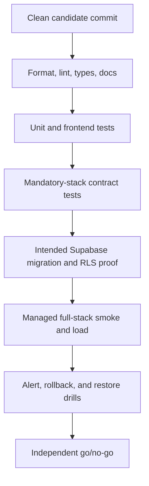

# Validation results

These results were collected from the dirty working tree at commit
`ed1866dabfc97ed8b74fd190f9be6e90948ccfd5`. They are diagnostic evidence, not
a release certificate. Rerun from a clean candidate.



## Automated checks

### Format

Command: `pnpm check:format`

Result: **Fail.** Ten Python files were reported as unformatted.

### Python lint and security rules

Command: `pnpm check:lint`

Result: **Fail.** Reported categories included:

- `E402` module import placement;
- `I001` import order/format;
- `S105` possible hardcoded-password constant;
- `S608` string-built SQL warning.

The string-built SQL paths must be reviewed manually even when identifiers are
allowlisted; parameterization does not cover identifiers.

### Python types

Commands:

- `pnpm check:types`
- `uv run pyright`

Result: **Fail.** The latest direct run reported 200 errors while
`scripts/ci/pyright_baseline.json` records zero. The largest concentration was
in release tooling, tests, query routing, and core modules.

Do not update the baseline upward. Fix the errors or narrow incorrect source
inclusion deliberately and document why.

### Unit tests

Command: `pnpm check:unit`

Result: **Fail: 7 tests.** Failures covered:

- LangSmith tracing;
- model gateway behavior;
- phase-3 graph-scope guard;
- query-profile classification;
- settings validation.

The failures include behavior changed in the dirty tree and are not safe to
dismiss as unrelated.

### Contract tests

Command: `pnpm check:contract`

Result: **Fail: 9 tests.** Failed contracts included:

- authored Python docstrings;
- centralized environment reads;
- frontend/Python workspace boundary;
- private candidate Compose publishers;
- budget/concurrency rejection without reservation;
- thin-UI live JWT upload/delete journey;
- five composite SSE streams;
- AAL1 upload requiring MFA;
- AAL2 upload reservation and signed URL.

Some contract files also skip when required infrastructure is absent. The
release job must fail on unexpected skips.

### Documentation

Command: `pnpm check:docs`

Result: **Fail.** Markdown lint reported four issues in two files, and the
independent index/link pass found nine broken transcript-style links in the
earlier review pack. This new report does not rely on those broken links.

### Frontend

Commands:

- `pnpm --dir apps/frontend lint`
- `pnpm --dir apps/frontend typecheck`
- `pnpm --dir apps/frontend test`

Result: **Pass.** ESLint and TypeScript completed cleanly; Vitest reported 171
passing tests.

Static follow-up still found uncovered production behaviors: protected shell
rendering when Supabase public variables are missing, localhost API fallback,
non-OK SSE reconnect handling, async transport rejection handling, and absent
route-level render error boundaries. Passing component tests do not invalidate
those findings.

A production Next.js build was not run because an active development server
was using the same `.next` workspace. It remains a required candidate gate.

### Dependency audits

Commands:

- configured strict `pip-audit` export flow;
- `pnpm audit --audit-level high`.

Result: **Pass under repository policy.** Python passed with the documented
accepted PyArrow advisory exclusion. Node reported no vulnerabilities at the
configured threshold.

Dependency-audit success does not cover container base images; no Trivy
candidate-image result was found.

## Local UX inspection

The public login page was inspected at 390-by-844:

- document height: about 2,413 pixels;
- horizontal overflow: zero;
- sign-in form top: about 1,961 pixels;
- reviewed fixture height: about 848 pixels;
- sign-in and OAuth controls: 40 pixels high;
- protected navigation was visible before authentication.

The browser console also showed stale development chunk 403s and HMR handshake
failures. Reproduction from a clean server is required before treating those as
a product defect.

## Intended Supabase checks not run

The connected database was unrelated, so none of these checks was run against
the intended Smart RAG project:

- migration count/order and schema fingerprint;
- table ownership, grants, `relrowsecurity`, and `relforcerowsecurity`;
- security and performance advisors;
- Auth JWT algorithm and JWKS rollover;
- storage buckets and policies;
- plan, PITR, backup, and restore;
- representative `EXPLAIN (ANALYZE, BUFFERS)`;
- cross-user and cross-role negative tests.

## Required live database queries

Run these only on the intended reviewed project after a clean migration apply.

```sql
select count(*) as applied_migrations
from supabase_migrations.schema_migrations;

select n.nspname, c.relname, c.relrowsecurity, c.relforcerowsecurity
from pg_class as c
join pg_namespace as n on n.oid = c.relnamespace
where n.nspname in ('app', 'langgraph', 'lightrag', 'private')
  and c.relkind = 'r'
order by n.nspname, c.relname;

select schemaname, tablename, policyname, roles, cmd, qual, with_check
from pg_policies
where schemaname = 'app'
order by tablename, policyname;

select grantee, table_schema, table_name, privilege_type
from information_schema.role_table_grants
where table_schema in ('app', 'langgraph', 'lightrag', 'private')
order by grantee, table_schema, table_name, privilege_type;

select n.nspname, p.proname, p.prosecdef, p.proconfig
from pg_proc as p
join pg_namespace as n on n.oid = p.pronamespace
where n.nspname in ('app', 'private', 'search')
  and p.prosecdef
order by n.nspname, p.proname;
```

## Candidate acceptance command set

At minimum:

```text
pnpm check:format
pnpm check:lint
pnpm check:types
pnpm check:unit
pnpm check:contract
pnpm check:docs
pnpm check:frontend
pnpm build:frontend
```

Add clean local Supabase reset/schema tests, managed smoke/load, container image
scan, alert drill, rollback drill, and timed restore. Record command, commit,
image digests, environment identity, timestamps, pass/fail, and artifact hashes.
