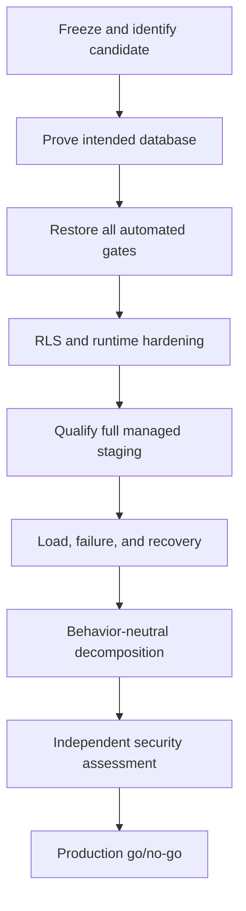

# Remediation plan

The sequence prioritizes release truth and security boundaries before
maintainability refactors. Time ranges are planning guidance, not a substitute
for evidence.

## Stage 0: Immediate release freeze

Target: first 48 hours.

Actions:

- declare the current candidate production-ineligible;
- preserve current evidence and command outputs;
- identify one candidate commit and stop mixing unrelated demo/deployment work;
- ensure the unrelated Supabase database cannot be modified by Smart RAG
  tooling;
- connect the intended Smart RAG staging project through a reviewed,
  least-privileged channel;
- rotate any credential that may have been copied into chat, terminal history,
  logs, or untracked files; verify rotation rather than assuming it;
- inventory the 68 modified and 26 untracked pre-report files and remove
  generated/runtime artifacts from candidate scope.

Exit:

- clean candidate branch/commit;
- environment identity manifest without secrets;
- owner assigned to every critical finding;
- no deployment or migration can run against an ambiguous project.

## Stage 1: Restore release truth

Target: days 1 through 7.

Actions:

- fix all 200 Pyright errors without raising the baseline;
- resolve 7 unit and 9 contract failures;
- fix format, Ruff, and documentation failures;
- make mandatory-stack contract jobs fail on unexpected skips;
- run a clean local Supabase reset and schema fingerprint;
- reconcile each earlier review finding as open, fixed-and-proven, or stale;
- run frontend lint, types, tests, and production build from clean checkout.

Exit:

- all repository check scripts green;
- zero unexpected skips;
- exact commands, versions, commit, and artifacts recorded;
- no evidence document claims a result that the current command contradicts.

## Stage 2: Database and application hardening

Target: week 2.

Actions:

- add a migration that enables and forces RLS or removes direct grants for
  revocation and MFA-recovery tables;
- revoke or replace permissive `app_api` table reads with ACL-aware policies or
  RPC-only access;
- force RLS on all tenant-sensitive tables and verify ownership;
- add direct-query negative tests for profiles, versions, chunks, tables,
  terms, and auth lifecycle;
- add version/status indexes based on measured planner output;
- change pagination to invoker semantics unless definer privilege is proven
  necessary;
- use expand-contract for future RPC signature changes;
- test whether LangGraph checkpoint persistence contains configurable secrets
  and move secret resolution out of graph config;
- add cooperative lease cancellation to expensive stages.

Exit:

- intended project applies the complete migration chain cleanly;
- schema fingerprint matches candidate;
- security/performance advisors reviewed;
- role/RLS matrix and cross-user negatives pass;
- checkpoint sentinel scan finds no secrets;
- lease-loss tests prove no duplicate canonical write or provider charge.

## Stage 3: Frontend and UX correction

Target: week 2.

Actions:

- fail the hosted build/startup when public Supabase or API configuration is
  missing or invalid;
- make the proxy render a blocking configuration error instead of continuing
  protected shells;
- introduce a focused public auth layout;
- put the sign-in form in the first mobile viewport;
- move readiness, outage internals, and hostile fixtures to authorized
  diagnostics;
- hide protected navigation until session/profile resolution;
- remove internal gap IDs from user copy;
- add feedback `aria-pressed`, de-duplicate live announcements, and add
  destructive-action confirmation or undo;
- classify all non-OK SSE reconnect responses and convert async transport
  exceptions into recoverable UI state;
- add route-level render error boundaries and loading states;
- reject off-origin API URLs inside the shared transport helper;
- choose and document English/LTR-only or full localization/RTL scope;
- implement nonce-based production CSP;
- codify and verify HSTS at the HTTPS edge;
- verify Supabase Auth abuse controls and CAPTCHA decision.

Exit:

- public auth journey passes 390-by-844, desktop, keyboard, axe, and
  screen-reader review;
- missing hosted configuration fails closed in build/startup and route tests;
- reconnect 401/403/429/500, malformed SSE, and connection loss show bounded
  recovery UI;
- production headers contain nonce CSP without inline-script allowance;
- authenticated role navigation and error states pass Playwright.

## Stage 4: Full managed-staging qualification

Target: weeks 3 and 4.

Actions:

- provision an approved host and intended isolated Supabase environment;
- run API, worker, ClamAV, parser sandbox, ParadeDB, Valkey, crawl proxy, and
  edge together;
- pin every image by digest and scan candidate images;
- wait for SSM migration/deploy completion in CI;
- gate promotion on complete readiness and product smoke;
- wire alert metrics, SNS delivery, owners, and escalation;
- prove Vercel Git-linked deployment and protected environments;
- test rollback to known-good digests.

Exit:

- one immutable evidence manifest covers all services and environment IDs;
- upload-scan-ingest-query-cite-delete path passes;
- origin/WAF/security negative matrix passes;
- synthetic alert is acknowledged;
- rollback drill succeeds.

## Stage 5: Scale and recovery qualification

Target: weeks 5 and 6.

Actions:

- publish the proposed launch envelope;
- run five live queries plus ingestion while measuring connections by role;
- run 25 users only if that remains a launch claim;
- capture first-token/completion p95, error rate, and provider cost;
- load graph and ingestion queues to representative backlog;
- kill/restart worker, ParadeDB, LightRAG, Valkey, and API in controlled tests;
- trigger maintenance pause under foreground load;
- perform timed PITR restore and derived projection rebuild.

Exit:

- signed capacity, latency, connection, backlog, cost, RTO, and RPO records;
- no unbounded queue, pool, or retry behavior;
- product claims do not exceed the measured envelope.

## Stage 6: Maintainability and independent review

Target: weeks 7 through 12.

Actions:

- split frontend API client by domain;
- split SSE, worker lifecycle, query pipeline, Hybrid, and LightRAG modules by
  stable responsibility;
- add complexity/file-size and documentation-index ratchets;
- clarify generated database type policy;
- split oversized tests and centralize required-stack fixtures;
- assign domain documentation owners and promote proven documents out of draft;
- run an independent penetration test against synthetic managed staging;
- fix and retest every critical/high external finding.

Exit:

- behavior parity and all gates remain green after each split;
- no new unapproved god files;
- documentation index, links, diagrams, ownership, and status pass;
- independent assessment has no open critical/high findings.

## Final production checklist

- [ ] Intended Supabase project identity is unambiguous and isolated.
- [ ] Full migration chain and schema fingerprint match.
- [ ] RLS, grants, ownership, and advisors are approved.
- [ ] Format, lint, types, unit, contract, docs, frontend, and build are green.
- [ ] Mandatory integration tests ran with zero unexpected skips.
- [ ] Full managed topology passed security and product smoke.
- [ ] Candidate images are pinned, scanned, and attested.
- [ ] Deploy waits for completion and supports tested rollback.
- [ ] Alerts route to acknowledged humans.
- [ ] Backup/PITR restore and derived rebuild meet RTO/RPO.
- [ ] Load and latency meet the published launch envelope.
- [ ] Checkpoints, logs, traces, evidence, and backups contain no secrets.
- [ ] Public auth and authenticated journeys pass accessibility review.
- [ ] Independent assessment has no open critical/high findings.
- [ ] Client approver signs a dated go decision for the exact manifest.

Any unchecked item keeps the verdict at **NO-GO**.
