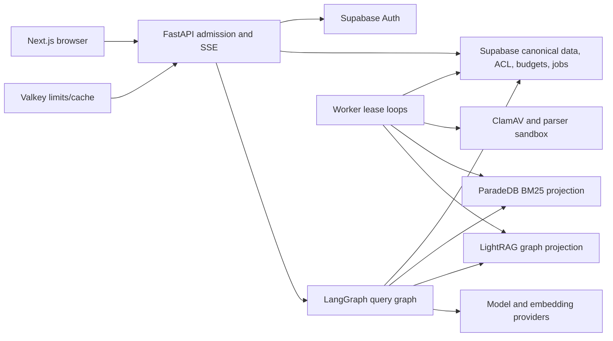

# Architecture and scalability audit

## Verdict

The architecture is strong for a bounded, single-company, single-host release
candidate. It is not yet proven as a horizontally scalable multi-tenant SaaS.
The design makes good consistency choices; the largest gap is measured
operational proof at the intended envelope.

## Sound system-design choices

### Canonical and derived state

Supabase owns documents, ACL, versions, evidence, budgets, jobs, and audit.
ParadeDB and LightRAG are treated as derived projections. Retrieval results are
rechecked against canonical authorization. This is the correct consistency
boundary for a RAG system.

### Durable asynchronous work

Ingestion uses database queues, claim ordering, `SKIP LOCKED`, lease tokens,
heartbeats, operation ledgers, checkpoints, dead letters, and idempotent
promotion. These controls are much safer than an in-memory background task.

### Query admission and budgets

Query runs reserve durable budgets and enforce a concurrency cap before model
work. The reserve-once pattern is appropriate for retryable graph execution and
provider-cost control.

### Bounded degradation

The design distinguishes mandatory canonical evidence from optional BM25 or
graph enrichment. Outage copy relabels degraded modes rather than presenting
derived snippets as evidence.

### Service boundaries

API transport/admission, worker lifecycle, graph nodes, and reusable core
domain/persistence code are separated at package level. Import-boundary tests
reinforce the intended dependency direction.

## Proven envelope

Repository evidence supports:

- 8 Hybrid-ready document versions;
- 16 chunks;
- 15 graph mapping documents;
- 5 simultaneous query runs;
- one API process and one worker process;
- one-host Docker networking;
- fixture-proven maintenance controls.

It does not prove:

- 10,000 versions or 1,000,000 chunks;
- 25 active users;
- multiple API/worker replicas;
- real first-token and completion p95 at launch traffic;
- sustained graph ingestion backlog;
- live 70-percent maintenance pause behavior;
- timed database and projection recovery.

The launch contract should use the proven values or fund a larger qualification
run.

## Primary bottlenecks

### Database connections

Hybrid retrieval fans out dense, term, BM25, context, run, and graph work.
Increasing API replicas multiplies role-specific pools and checkpointer
connections. The current budget assumes one API and one worker.

Required measurements:

- `pg_stat_activity` by role and application name;
- peak and p95 active/idle connections;
- pool wait time and timeout count;
- transaction duration;
- connection count while five queries and ingestion run together.

### Graph write serialization

One process-wide writer lease and advisory lock protect graph consistency but
serialize throughput. Keep this deliberately if the measured queue age meets
the launch objective; otherwise evolve through an ADR rather than removing the
lock casually.

### Lease cancellation

Lost leases stop final completion but not necessarily in-flight model, parse,
or embedding work. Add cooperative cancellation to prevent duplicate cost and
slow recovery under worker churn.

### Valkey connection behavior

Per-command TCP behavior and small `noeviction` memory create a connection and
availability hot spot. Pool connections and monitor cardinality/memory before
raising user or replica limits.

### Status polling

Ingestion status aggregates many tables on demand. Polling by many users can
become read amplification. Index by version and consider an event-maintained
status snapshot.

## Backpressure and overload

The system already has useful admission, job concurrency, budgets, and leases.
It still needs an end-to-end overload policy:

- cap queued and running jobs by class;
- expose queue age and oldest eligible job;
- pause lower-priority graph/rebuild work before foreground SLO breach;
- bound SSE reconnect and read fallback across replicas;
- reject new expensive work before pool saturation;
- separate provider throttling from internal concurrency;
- record retry-after and degraded-mode behavior.

## Availability and disaster recovery

The current managed shape has single points of failure:

- one EC2 host for API/projections/limits;
- one active API execution registry;
- one graph writer;
- intended hosted Supabase project not yet verified;
- derived data rebuild time not measured at target size.

RTO and RPO are targets, not evidence. A valid drill must restore canonical
data, Auth/storage configuration, checkpoint state as intended, and rebuild
derived stores while measuring user-visible outage.

## Multi-tenancy

Current defaults use one company and one default graph workspace. ACLs isolate
users and documents inside that company; they do not establish independent
customer tenants, billing domains, encryption domains, or noisy-neighbor
isolation.

Before marketing multi-company SaaS, add:

- `company_id` to every canonical tenant object and unique key;
- company-bound JWT/profile context and RLS;
- company-scoped budgets, queues, graph workspaces, audit, and deletion;
- cross-company negative tests;
- per-tenant capacity and abuse isolation;
- migration plan for existing single-company data.

## Scale qualification sequence

1. Reproduce the signed local envelope from a clean candidate.
2. Run the full managed stack with five concurrent live SSE queries plus
   ingestion.
3. Capture connection, CPU, memory, queue, provider, and projection metrics.
4. Run 25 distinct users only if 25 is the proposed launch claim.
5. Crash workers during parse/embed and expire leases.
6. Kill ParadeDB and LightRAG independently and verify degradation/rebuild.
7. Saturate Valkey limits and prove durable/fail-closed behavior.
8. Grow graph input from 15 to at least 150 documents and measure queue age.
9. trigger the maintenance pause while guarding foreground p95.
10. perform a timed canonical restore and derived rebuild.

## Architecture conclusion

This is not an architecture rewrite candidate. Preserve the canonical/derived,
lease, admission, and ACL-recheck model. Qualify it, remove process-local scale
assumptions, and publish an honest capacity envelope before production.
