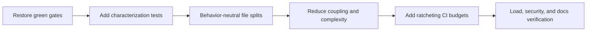

# Code quality, testing, and documentation audit

## Verdict

The repository has strong structural intent: package boundaries, strict type
configuration, docstring and documentation checks, and a large test corpus.
Execution has drifted from that intent. Type and test gates are red, god-file
count is growing, and several documentation rules exist only as prose.

## Measured snapshot before this report

- 26 Python files at or above roughly 800 lines;
- 5 TypeScript/TSX files at or above roughly 600 lines;
- 11 Markdown files above the preferred 300-line size;
- 164 maintained Markdown documents with frontmatter;
- 22 maintained documents absent from the main documentation index;
- 133 documents owned by `engineering-lead`;
- 124 documents marked `draft`;
- 200 current Pyright errors versus a zero-error baseline;
- 10 Python files failing format;
- multiple Ruff lint/security findings;
- 7 unit and 9 contract failures;
- 171 passing frontend Vitest tests;
- about 1,263 Python test functions and 29 Playwright tests by static count.

The exact counts will change as the dirty tree changes. The pattern is stable:
the repository is well specified but not currently gate-clean.

## Largest maintainability hotspots

### Frontend API client

`apps/frontend/src/lib/api.ts` is about 1,918 lines and owns unrelated domains:
query/SSE, documents, uploads, crawl, tables, graph, tools, administration,
usage, and readiness. Its test file is also over 1,000 lines.

Refactor into domain clients over one shared transport/error layer:

- `api/query.ts`;
- `api/documents.ts`;
- `api/ingestion.ts`;
- `api/graph.ts`;
- `api/admin.ts`;
- `api/usage.ts`;
- `api/transport.ts`.

### Retrieval and graph adapters

`lightrag_adapter.py` and `hybrid_run.py` are each around 1,400 lines. They mix
vendor adaptation, connection lifecycle, budgeting, orchestration, fallback,
mapping, and evidence shaping.

Separate stable interfaces from vendor-specific storage/query adapters and
from run orchestration. Preserve ACL recheck and budget invariants with
characterization tests before moving code.

### Query pipeline

The query `pipeline.py` exceeds 1,100 lines and combines routing, retrieval,
model calls, verification, answer state, and async bridging. The current
thread-based coroutine bridge fixes an earlier event-loop defect, but the file
remains a broad regression surface.

Extract one module per node family with explicit state input/output contracts.

### SSE and worker lifecycle

Backend `sse_stream.py` and worker `lifecycle.py` are around 900 lines. Split:

- SSE attach/ownership;
- durable replay;
- event serialization;
- executor lifecycle;
- worker polling/claims;
- heartbeat/cancellation;
- job-kind dispatch;
- terminal transitions.

### Generated database types

`packages/core/src/smart_rag_core/generated/database.ts` is roughly 7,040
lines. It is generated code, not a human god file, but its location and policy
are unclear in a Python package tree.

Record generator version, source schema fingerprint, regeneration command, and
whether generated output is committed. Exclude it from human complexity
budgets while verifying it is current.

## Complexity and coupling

Ruff does not enforce a meaningful cyclomatic-complexity budget, and there is
no project gate for file/function length or responsibility count. Add a small
ratchet:

- forbid new production files above an agreed line threshold;
- flag functions above complexity/branch thresholds;
- permit reviewed exceptions for generated/vendor/migrations;
- track hotspot reduction, not a one-time arbitrary rewrite.

Do not split files while tests are red. First establish behavior, then make
mechanical moves with no semantic changes.

## Error handling and types

The project configures strict Pyright, which is appropriate for security- and
state-heavy code. A baseline that says zero while current execution reports 200
is dangerous because documentation and automation disagree.

Required response:

1. verify Python and Pyright versions used by CI and local runs;
2. group diagnostics by root cause and source tree;
3. fix production code before test-only casts;
4. avoid broad `Any`, `type: ignore`, or baseline inflation;
5. update baseline and prose only after a true zero run.

Ruff `S608` findings in operations scripts need manual identifier allowlisting
or safer composition. A warning should not be suppressed merely because the
script is operator-only.

## Tests

### Strengths

- broad unit and contract coverage;
- role/RLS, import-boundary, docstring, settings, SSE, retrieval, parser, and
  lifecycle contracts;
- frontend tests inject fetch implementations and verify HTTP contract shapes;
- `xfail_strict` and Vitest `passWithNoTests: false`;
- hostile text and authorization-negative cases.

### Weaknesses

- release-critical unit and contract tests currently fail;
- many integration contracts skip when dependencies are absent;
- several test files exceed 900 lines;
- repeated Postgres reachability/skip boilerplate increases drift;
- no gate proves that mandatory integration markers actually ran.

Create shared required-stack fixtures and CI jobs that assert expected test and
skip counts. Split test files by scenario while preserving fixture reuse.

## Documentation

### Strengths

- every maintained document in the pre-report set had frontmatter;
- the repository has a central documentation index;
- architecture and operational concerns are documented extensively;
- link/Mermaid validation exists;
- ADR and runbook separation is generally good;
- limitations and evidence are often stated honestly.

### Gaps

- 22 documents were not indexed before this report;
- the earlier review pack contains nine broken transcript-style links;
- several required contract/architecture documents lack Mermaid;
- 11 documents exceed the preferred 300-line split;
- ownership and draft status are heavily concentrated;
- plan/evidence/wrapper status can disagree;
- current CI prose claims green type state that execution contradicts.

Extend documentation CI to verify:

- every maintained document is indexed or explicitly excluded;
- local links and Mermaid parse;
- required architecture/flow documents contain a diagram;
- oversized files have an approved exception or are split;
- owner/status values are meaningful;
- commands and evidence references match executable repository scripts.

## Clean-code sequence

## Prioritized refactor order

1. Fix the 200 type errors and all failing tests.
2. Fix lint, format, and documentation checks.
3. Split frontend `api.ts` and tests by domain.
4. Split SSE transport from execution.
5. Split query pipeline by node family.
6. Split Hybrid and LightRAG vendor/run concerns.
7. Split worker lifecycle by polling, heartbeat, and dispatch.
8. Add complexity, file-size, required-stack, and documentation-index ratchets.

## Quality conclusion

The codebase does not need indiscriminate cleanup. It needs trustworthy green
gates followed by narrow, behavior-neutral decomposition of the few modules
that concentrate security and lifecycle responsibilities.
