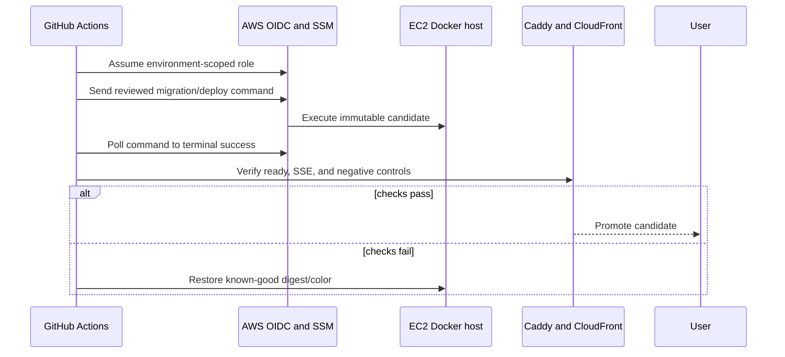

# Deployment and operations audit

## Verdict

Operations design is strong for a greenfield release candidate: IaC, OIDC
shape, SSM deployment documents, digest pinning, private networks, runbooks,
and evidence matrices are present. The deployed proof is partial. It does not
qualify production or a full managed staging environment.

The Supabase project available to this audit was unrelated and is excluded.
Intended hosted database plan, PITR, Auth, storage, and migration state are
unknown.

The repository defines much of this flow; polling, complete readiness, and
rollback are not yet proven end to end.

## Current evidence boundary

Repository evidence supports a partial small-host edge profile with:

- one API color;
- Caddy/CloudFront path;
- ParadeDB;
- Valkey;
- crawl proxy;
- private service networking.

The accepted small-host profile excludes:

- worker;
- ClamAV;
- parser sandbox;
- second API color;
- full ingestion and blue/green drain proof.

Therefore it proves edge reachability and partial API health, not complete
product operation.

## Strong operational controls

- application images use non-root/distroless patterns and locked dependencies;
- GitHub Actions are pinned to commit SHAs;
- AWS automation is designed around GitHub OIDC rather than repository AWS
  keys;
- IMDSv2, SSM access, restricted origin security groups, and no SSH are
  represented in IaC;
- private Docker services are not published to host ports in staging;
- Caddy applies origin-header checks and SSE-aware timeouts;
- plans and evidence files distinguish blocked, not-run, and passed states;
- runbooks cover protected migration, instance rebuild, BM25 rebuild, origin
  rotation, alert routing, and graph rollback;
- gitleaks, Python dependency audit, and Node audit are present in preflight;
- application/mock/test settings fail closed in hosted environments.

## Deployment automation gaps

### SSM completion

The staging workflow sends an SSM command but must poll terminal status and
surface command output. A command ID is not deployment success.

### Candidate verification

Before promotion, CI must verify:

- expected image digest and migration bundle hash;
- every required service is healthy;
- public liveness and authenticated readiness;
- a real 50-second SSE stream through the edge;
- upload, scan, ingest, retrieve, cite, delete, and authorization smoke;
- origin bypass and WAF negative controls.

### Rollback

Rollback needs a known-good immutable manifest, migration compatibility rule,
traffic switch, in-flight run behavior, and post-rollback smoke. It must be
tested, not only documented.

### Production path

The repository has migration workflow concepts but no fully qualified
production deployment workflow and all phase-11 packets remain unchecked.

## Environment segregation and secrets

Required properties:

- separate intended Supabase projects and credentials per environment;
- separate AWS accounts or strongly separated roles/policies;
- Vercel Git integration and protected environment promotion;
- no service-role or storage-admin secret in browser-visible variables;
- migration credentials available only to approved protected jobs;
- populated Secrets Manager values with rotation and CloudTrail evidence;
- origin header secrets rotated with overlap and rollback;
- no secrets in LangGraph checkpoints, traces, logs, evidence, or backups.

The dirty tree contains several environment-wiring helper scripts and an
example hosted-ingest environment file. Review them for secret-safe defaults
before commit.

## Network and TLS

Positive:

- derived stores and limits are private;
- the origin is intended to reject direct requests without the edge secret;
- public ports are minimized.

Open decisions:

- private Docker bridge traffic to ParadeDB/Valkey is cleartext;
- the CloudFront-origin hop may be HTTP by current design;
- same-host trust and origin-secret rotation need an accepted ADR for staging
  and production;
- crawl egress and provider egress must remain separately constrained.

## Health and availability

Current health checks do not fully prove service usefulness:

- worker health primarily proves module import/startup, not queue/DB/scanner
  operation;
- Caddy needs a service-level health probe;
- API readiness must distinguish canonical database, query graph, model,
  projection, and rate-limit degradation without leaking private detail;
- load balancers and deploy workflows must use the correct liveness/readiness
  semantics.

Add synthetic user journeys and dependency-aware operator probes rather than
only process checks.

## Backup, restore, and deletion

Production requires:

- intended Supabase plan and PITR proof;
- timed restore to an isolated target;
- storage bucket backup/restore policy;
- checkpoint retention and restore intent;
- audit-chain and KMS/Object Lock anchor proof;
- derived ParadeDB/LightRAG rebuild from canonical evidence;
- deletion/offboarding behavior after restore;
- measured RTO and RPO.

Host-local ParadeDB and Valkey volumes can be disposable only if rebuild time
meets the published recovery objective.

## Observability and incident response

IaC resources are insufficient without signal and delivery proof. Minimum
alerts:

- API error, latency, readiness, and SSE disconnect rate;
- Supabase pool saturation and slow transactions;
- oldest queue age, lease loss, dead letters, scan failures;
- ParadeDB/LightRAG unavailable and projection lag;
- Valkey memory/fallback/fail-closed events;
- provider errors, token/cost budgets, and external-processing denials;
- disk, memory, CPU, restart loops, certificate/origin failures;
- audit-anchor export and backup failure.

Each alert needs routing, owner, acknowledgement target, escalation, and a
synthetic drill.

## Supply chain

Open work:

- pin Caddy by digest, not only version tag;
- scan built candidate images with Trivy or equivalent;
- generate SBOM and provenance/attestation;
- verify deployed ECR digests against the release manifest;
- review untracked scripts and generated artifacts before candidate creation;
- keep gitleaks and dependency audit policy exceptions documented and dated.

## Managed-staging exit criteria

One evidence bundle must prove:

1. clean candidate commit and immutable digests;
2. intended isolated Supabase migration and RLS state;
3. full API, worker, scanner, parser, projection, limit, and edge topology;
4. protected migration and deploy with terminal SSM success;
5. readiness, SSE, security-negative, and complete product smoke;
6. alert delivery and operator acknowledgement;
7. rollback to known-good candidate;
8. timed PITR restore and projection rebuild;
9. load and latency at the signed launch envelope;
10. independent security assessment with no open critical/high defects.

## Operations conclusion

Do not promote the current partial profile. Finish one full managed-staging
qualification and make the resulting manifest the only input to production
planning.
