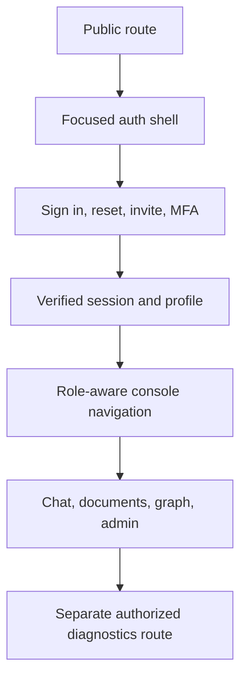

# Frontend, accessibility, and UX audit

## Verdict

The frontend has strong hostile-text, authorization, session-cache, SSE, and
component-level test practices. Its main weakness is product hierarchy: review
fixtures, readiness diagnostics, limitation copy, and implementation language
are mixed into end-user journeys. The login page is the clearest example.

## Security strengths

- `proxy.ts` refreshes Supabase Auth cookies and performs convenience redirects
  while documenting that FastAPI remains authoritative.
- query caches use decoded JWT `sub`, never the raw bearer token
  (`src/lib/query-keys.ts`).
- API helpers send bearer authorization and do not send test role headers.
- hostile filenames, entities, JavaScript-like URLs, and bidi controls render
  as text through `UserText`, safe-text helpers, and citation components.
- citation links are allowlisted rather than blindly trusting provenance URLs.
- invitation responses are mail-only; the UI does not render raw invitation
  tokens.
- CSP blocks objects, framing, broad connect origins, and production
  `unsafe-eval`; inline scripts remain an open hardening issue.
- server 401/403/402/426/429 responses are classified into user-visible
  authorization, MFA, budget, compatibility, and rate-limit states.

## Production configuration must fail closed

Two defaults make deployment errors look like application behavior:

- `proxy.ts:34-40` allows requests through without a session check when the
  public Supabase URL or anon key is absent;
- `src/lib/env.ts:10-12` defaults a missing API origin to
  `http://127.0.0.1:8000`, which is the end user's computer in production.

FastAPI still protects data if its authorization is correct, but protected
shells and forms can render in the first case and all API calls are broken in
the second. Hosted builds/startup must reject missing or invalid public Auth/API
configuration. The proxy should render one dedicated configuration failure,
not continue protected route rendering.

## Test posture

Frontend ESLint and TypeScript passed. Vitest reported 171 passing tests,
including:

- auth screens and callback behavior;
- hostile-text and XSS rendering;
- cache isolation by subject;
- SSE parsing, resume, cancellation, and limitations;
- administration role visibility;
- document, graph, table, tool, curation, and usage surfaces;
- focus handling and UI primitives.

This is a strong component/unit layer. It does not replace:

- production Next.js build;
- authenticated Playwright journeys against the complete stack;
- browser security-header inspection on the deployed domain;
- screen-reader testing;
- real slow/error/network interruption testing.

## Streaming and runtime failure handling

`chat-app.tsx:289-323` special-cases reconnect 404 but does not classify other
non-OK responses before passing them to the SSE consumer. Send and reconnect
also rethrow non-abort exceptions from async event handlers, producing an
unhandled rejection rather than a reliable banner and recovery action.

Required behavior:

- classify every non-OK reconnect response;
- preserve 401/403/429/500 semantics;
- reject malformed or non-SSE content types;
- convert transport exceptions into bounded chat failure state;
- retain the run/idempotency pointer needed for a safe retry;
- add route-level `error.tsx` boundaries for render failures;
- test connection loss, stale session, rate limit, server error, and malformed
  event streams.

## Primary UX finding: login task hierarchy

At 390-by-844, the public login page showed:

1. all nine console navigation links;
2. an explanation that navigation is not authorization;
3. sign-in description and gap identifiers;
4. owner-bootstrap limitation;
5. API readiness;
6. signed outage copy;
7. an 848-pixel hostile/mixed-direction fixture;
8. finally, the email/password form at about 1,961 pixels.

The total page was about 2,413 pixels high. Horizontal overflow was zero, which
is positive, but a user must scroll more than two mobile viewports before the
primary task.

Recommended change:

- use a separate public auth layout;
- place heading, form, error, and recovery links in the first viewport;
- move readiness and hostile-text fixtures to `/diagnostics` or Storybook;
- hide protected navigation until profile/role resolution;
- replace internal `GAP-*`, route, and provider language with product copy;
- keep operational detail available to authorized support users.

## Authentication UX and abuse controls

Browser-direct Supabase Auth is a valid architecture, but FastAPI middleware
does not rate-limit sign-in. Verify and document Supabase Auth email/password,
OTP, reset, and invitation rate limits; enable CAPTCHA or equivalent controls
when abuse risk justifies it.

Other auth improvements:

- make callback, expired link, revoked session, and MFA recovery paths explicit;
- ensure successful password reset has a clear safe destination;
- disable forms and expose pending state during submission;
- associate field-specific errors with inputs;
- avoid permanently disabled OAuth controls in the main form when the provider
  is not configured.

Invitation acceptance should preserve a validated relative destination through
sign-in. The route is currently not public and the login component does not
explicitly resume the invitation intent after authentication.

## Accessibility findings

### Duplicate announcements

`chat-app.tsx:417-422` renders the MFA message in both an alert banner and an
assertive live region. Other failures can similarly appear in an alert plus
`assertiveCopy`. Screen readers may announce the same blocking message twice.

Choose one assertive channel and use focus movement only when it improves the
task.

### Feedback state

The thumbs controls use visual button variants but no `aria-pressed` state
(`chat-app.tsx:686-701`). Assistive technology cannot reliably determine the
current selection.

Add `aria-pressed`, a grouped label, and keyboard-visible state.

### Streaming announcements

The answer live region includes `"No tokens yet."` and can update rapidly.
Throttle or batch token announcements, expose busy state, and provide a final
completion announcement without repeating the entire answer on each update.

### Destructive actions

Conversation deletion triggers immediately
(`chat-app.tsx:197-210,497-503`). Add a confirmation dialog or a server-backed
undo window, state the deletion scope, and restore focus after completion.

### Touch targets

Mobile sign-in controls measured 40 pixels high. Increase primary interactive
targets toward 44 pixels while preserving compact desktop density.

## Localization and bidirectional text

The root layout hardcodes `<html lang="en" dir="ltr">`. Mixed-direction fixture
tests are useful security/robustness checks, but they are not Arabic/RTL product
support.

Choose and document one launch contract:

- English and LTR only, with safe Arabic text display; or
- locale-aware `lang`/`dir`, translated UI/errors, mirrored navigation,
  logical CSS properties, and dedicated RTL snapshots/journeys.

Do not infer full RTL support from isolated text fixtures.

## Component and data architecture

TanStack Query session scoping and API error normalization are sound. The main
maintainability problem is `src/lib/api.ts`, which combines query/SSE,
documents, ingestion, tables, graph, administration, tools, usage, and
readiness in roughly 1,918 lines.

Split it into domain clients sharing:

- URL and bearer-header construction;
- abort/timeout behavior;
- JSON/error parsing;
- idempotency and SSE resume metadata;
- stable typed response contracts.

Keep server authorization authoritative; role-based hiding remains a
convenience and usability feature.

Defense-in-depth URL validation should also move inward:

- `apiUrl()` should reject absolute origins rather than trusting every caller;
- `CitationChip` should validate HTTP(S) itself rather than assuming a caller
  sanitized `href`;
- TOTP QR image data should be limited to the formats actually required.

No current bearer-token exfiltration through these helpers was found; the risk
is latent and easy to remove.

## Security headers and polling

No repository-controlled HSTS policy was found in Next.js, Caddy, or CloudFront
IaC. The deployed edge may add one outside source control; verify it and then
codify it at the edge.

Readiness is polled every five seconds on chat and login. Pause when the tab is
hidden, back off when state is stable, and remove operator readiness polling
from the focused public auth shell.

## Performance checks needed

- production bundle analysis by route;
- Core Web Vitals on login, chat, document detail, and graph;
- large conversation and citation-list virtualization;
- SSE rendering under long answers;
- readiness polling and ingestion-status polling frequency;
- mobile CPU/memory under mixed-direction hostile content;
- caching behavior across sign-out/sign-in and subject changes.

## UX acceptance criteria

- sign-in form visible without scrolling at 390-by-844;
- signed-out navigation limited to public auth actions;
- no internal gap IDs in normal user copy;
- no duplicate assertive announcements;
- destructive actions confirmed or undoable;
- selected feedback state exposed accessibly;
- supported locale contract explicit and tested;
- missing public Auth/API configuration fails closed;
- reconnect 401/403/429/500 and malformed SSE produce recoverable UI state;
- deployed HTTPS responses include the reviewed HSTS policy;
- authenticated core journeys pass keyboard, axe, and screen-reader review;
- production build and deployed security-header tests pass.
