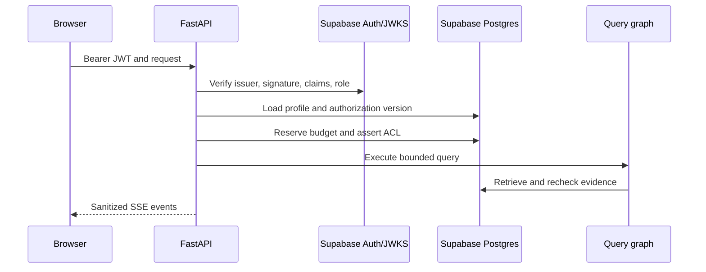

# Security, backend, worker, and agents audit

## Overall assessment

The source implements unusually strong application-layer security for a
greenfield RAG system. The main confirmed weaknesses are database role breadth,
release proof, degraded distributed limits, and operational trust in privileged
worker credentials. No confirmed critical JWT bypass, obvious HTTP IDOR, raw
invitation-token response, command injection, or unescaped frontend HTML sink
was found in the reviewed paths.

## Verified positive controls

### Authentication and identity

- `packages/core/src/smart_rag_core/security/jwks.py` restricts accepted
  asymmetric algorithms, handles `kid` refresh, validates claims, and requires
  the JWT role `authenticated`.
- local issuer aliases are environment-gated.
- test identity requires both test environment and an explicit enable flag;
  hosted settings reject mock/test combinations.
- caller role and authorization version are loaded from authoritative profile
  state rather than trusted client headers.
- owner/admin and upload paths enforce MFA/AAL requirements.

### Authorization and privacy

- mutating routers depend on caller context and server-side role checks;
- foreign conversation/run/delete paths return not-found or forbidden according
  to the documented concealment contract;
- retrieval rechecks derived candidates against canonical ACLs;
- ingestion status now uses `app.get_version_ingestion_status`;
- invitation creation returns a mail-only result to the frontend; tests assert
  that raw tokens are not rendered;
- query keys use the user subject identity, not the raw bearer token.

Database defense-in-depth gaps remain in
[Supabase and migrations](./supabase-migrations.md).

### Request and browser boundaries

- CORS uses exact origins and does not allow wildcard credentials;
- hosted configuration rejects insecure non-loopback origins;
- mutation requests use size/length controls;
- backend errors and SSE failures are sanitized;
- logs redact bearer/token-like values;
- OpenAPI is disabled outside intended development/test contexts.

### SSRF, upload, and parser boundaries

- crawl policy normalizes URLs, blocks private/metadata IPs, pins DNS, restricts
  approved domains, and routes through a proxy;
- uploads require scan/governance evidence before promotion/indexing;
- the parser sandbox uses Docker with no network, read-only root, and dropped
  capabilities;
- the worker refuses privileged in-process parsing when hosted storage secrets
  are present;
- ClamAV failure blocks promotion rather than allowing unscanned content.

### Jobs and query execution

- queue claims use `FOR UPDATE SKIP LOCKED`, lease owner/token, heartbeat, and
  lease-conditional terminal writes;
- the current tree refreshes configurable lease tokens after reclaim;
- graph/query dependencies are bound through `query_graph_runtime.py`;
- synchronous/async bridging is moved off the FastAPI event loop;
- SSE validates ownership before attach, supports replay, and avoids starting a
  second graph on reconnect;
- inspected SQL calls use parameters for values.

## Confirmed security concerns

### Database roles are the largest source-level risk

The missing RLS, permissive direct reads, and non-forced RLS findings in
[high findings](../02-high.md) reduce the protection gained from server-side
RPC discipline. Treat these as pre-production security work.

### Distributed abuse control degrades during outages

Approved read/SSE fallback limits are process-local when Valkey and durable
limits are unavailable. Scaling API replicas multiplies the effective
allowance. Mutations fail closed, which is the correct higher-risk behavior.

### Privileged workers have a large blast radius

Workers need storage administration, canonical writes, and graph/projection
access. Broad worker policies are intentional, but credential theft can affect
the whole corpus. Use separate identities, short rotation, egress controls,
secret-free logs/checkpoints, and no user-facing execution path.

### Lease loss wastes work before it prevents completion

The final canonical transition is lease-protected, but long parse/embed/model
calls do not stop immediately. This is primarily cost and consistency exposure,
with security relevance when old jobs continue processing content after
authorization or operator cancellation changes.

## Important unverified question: checkpoint secret persistence

`apps/worker/src/smart_rag_worker/lifecycle.py` passes values such as Postgres
URL and storage admin secret through LangGraph `configurable` data for
ingestion nodes. This audit did not prove whether the installed checkpointer
persists arbitrary configurable fields in checkpoint rows or metadata.

Do not classify this as a confirmed leak without evidence. Close it by:

1. invoking a real checkpointed ingestion with sentinel credentials;
2. inspecting checkpoint, write, blob, and metadata columns for the sentinel;
3. adding a contract that scans persisted checkpoint payloads;
4. moving privileged secret resolution inside process-local node dependencies
   regardless, leaving only non-secret IDs in graph config.

## Earlier findings now stale in source

The current working tree contradicts several earlier critical hypotheses:

- query graph dependencies are not empty;
- ingestion status is ACL-aware at the HTTP/RPC path;
- parser sandboxing is required for privileged worker startup;
- nested query coroutine execution uses a dedicated thread bridge;
- dead-letter transitions check the active lease;
- crawl snapshots are scanned before indexing;
- graph eligibility reads persisted governance evidence.

These are source-level corrections. They still need green tests and managed
runtime proof.

## Tests still required

- complete live role/RLS matrix on the intended Supabase project;
- JWKS key rotation and issuer mismatch against managed Auth;
- checkpoint secret non-persistence;
- parser escape and malicious corpus integration tests;
- ClamAV unavailable/timeout/infected matrix;
- DNS rebinding and redirect-chain SSRF tests through deployed proxy;
- SSE reconnect/cancel across process restart and deployment;
- worker lease loss in every external-call stage;
- log/trace/backups scan for bearer, storage-admin, DSN, and source-text leaks;
- independent penetration test using synthetic data.

## Security conclusion

The application security model is coherent and mostly fail closed. Production
approval is blocked because database least privilege is incomplete and the
intended hosted, integration, checkpoint, and external-assessment evidence does
not yet exist.
