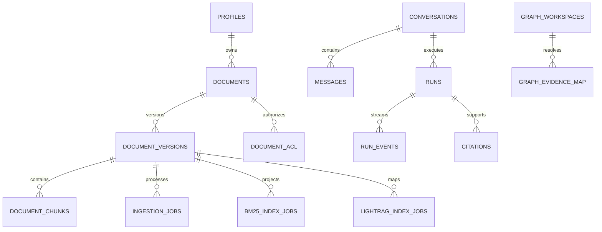

# Supabase and Postgres migration audit

## Scope boundary

This is a **source migration audit only**. The available Supabase connection
belongs to another application and was excluded. Nothing here claims that the
intended hosted Smart RAG project has these objects or controls applied.

## Static inventory

The 59 SQL migration files contain:

- 86 table declarations by unique qualified name;
- 65 application tables in `app`;
- 14 LightRAG vendor/projection tables in `lightrag`;
- 6 LangGraph checkpoint/store tables in `langgraph`;
- 1 private rate-limit table in `private`;
- approximately 170 `CREATE FUNCTION` or `CREATE OR REPLACE FUNCTION`
  statements;
- 100 index-creation statements;
- no duplicate migration basenames;
- no sampled `SECURITY DEFINER` function without a pinned `search_path`.

This excludes Supabase-managed `auth`, `storage`, and platform tables.

## Why there are many tables

The count is high but not arbitrary. The schema persists several separate
durability and governance concerns:

- identity, profiles, invitations, revocation, MFA recovery, and authorization
  versions;
- documents, versions, sources, ACL, scans, chunks, tables, aliases, glossary,
  crawl snapshots, quotas, and promotion sagas;
- ingestion, BM25, LightRAG, graph mapping, repair, cleanup, ledger, and
  dead-letter jobs;
- conversations, messages, runs, events, citations, feedback, memory, budgets,
  and usage;
- audit events, anchors, restricted reads, notifications, retention, and
  offboarding;
- vendor-owned graph and checkpoint storage.

The design correctly chooses durable rows over in-memory workflow state. The
cost is a large policy and migration surface that requires automated ownership,
RLS, grant, index, and lifecycle assertions.

The diagram is intentionally conceptual; it does not replace the canonical
schema or include vendor tables.

## Strong migration design

Verified positives include:

- canonical evidence and ACLs remain in Supabase while ParadeDB is derived;
- Hybrid and graph candidates are rechecked against canonical authorization;
- worker claims use `FOR UPDATE SKIP LOCKED`, lease tokens, and heartbeats;
- security-definer functions sampled use qualified objects and fixed
  `search_path`;
- migration history is expand-oriented with no table or column drops found;
- audit, budget reservation, job ledger, and query-run state are durable;
- new `20260819_*` migrations repair earlier ingestion ACL, pagination,
  citation, invitation, profile-update, delete, and crawl-policy defects;
- SQL functions generally accept caller role and authorization version rather
  than trusting frontend role headers.

## RLS and grant risks

### Auth lifecycle

`20260813120000_auth_jwks_invitations_v1.sql` grants `app_api` access to
`revoked_sessions` and `mfa_recovery_requests` without source-level RLS.

Preferred design:

1. revoke direct runtime table grants;
2. expose minimum-purpose RPCs;
3. enable and force RLS even when RPC-only;
4. add role-matrix tests for every read and mutation.

### Canonical direct reads

Several `app_api` policies permit universal or broad reads on profiles,
versions, chunks, tables, search terms, and aliases. RPCs currently enforce ACL
in important paths, but RLS should remain safe if a future developer performs a
direct query.

Prefer ACL-aware policies or no direct table grant. A policy whose safety
depends on every caller remembering a separate check is not defense in depth.

### Force RLS

Several core tables enable but do not force RLS. Force it on tenant-sensitive
tables and ensure runtime roles do not own them. Superuser connections must
remain migration/operations only.

## Migration lifecycle risks

### Large migration units

Five migrations exceed about 35 KB:

- query-run admission;
- storage quotas and graph retention;
- query memory and store reaper;
- graph entity rules;
- graph pointer switch and cleanup.

Do not rewrite applied history. For future work, separate table shape, data
backfill, authorization, API function, and cleanup into ordered units with
explicit preconditions and postconditions.

### Function signature replacement

Invitation acceptance drops the old function before installing the new
signature. Use expand-contract for RPC changes so old and new application
versions can coexist during rollout.

### Rollback

The expand-only pattern reduces destructive rollback risk, but rollback still
needs a forward-fix strategy for functions, grants, and policies. Every
high-impact migration should state:

- compatible application versions;
- lock and timeout expectations;
- data backfill cost;
- rollback/forward-fix action;
- live verification query.

## Performance and scalability

The ingestion-status function performs many correlated counts and aggregates.
The following high-churn tables need verified `version_id` access paths:

- `ingestion_jobs`;
- `bm25_index_jobs`;
- `lightrag_index_jobs`;
- `document_scan_events`;
- `embedding_operation_ledger`.

Use partial indexes where nullable versions are common. Validate with realistic
history and buffers, not only empty-schema planner output.

Other scale checks:

- policy predicates must use indexed subject/document keys;
- JSON aggregates must be bounded and paginated;
- cleanup/reaper functions need row limits and lock timeouts;
- graph vendor tables need workspace and vector-query index proof;
- migration DDL needs statement/lock timeout behavior on populated tables;
- connection pools must be budgeted separately for API, worker, checkpointer,
  graph, and maintenance roles.

## Recommended database gates

Add one schema contract that fails if:

- any application table lacks an explicit owner classification;
- a tenant-sensitive table lacks `ENABLE` or `FORCE RLS`;
- `app_api` receives a new direct table privilege without an allowlist;
- a definer function lacks a pinned `search_path`;
- a policy uses `true` without an approved exception;
- foreign keys or high-frequency query predicates lack reviewed indexes;
- a migration version is missing, duplicated, or reordered;
- the schema fingerprint differs from the candidate manifest.

## Live proof required

On the intended hosted project:

1. apply all migrations to a fresh isolated branch/project;
2. compare schema fingerprint and generated types;
3. run security and performance advisors;
4. execute the complete RLS/grant role matrix;
5. test unauthorized direct table reads and every public RPC;
6. capture planner output at representative cardinality;
7. prove Auth/JWKS, storage policies, PITR, and restore;
8. record project identity without copying secrets into evidence.

Until that proof exists, migration quality is **promising in source and
unverified in the intended hosted database**.
