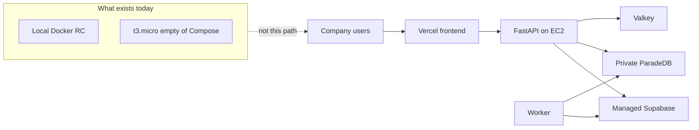

# Executive verdict

**Do not put this application in front of paying users, real company files, or a production DNS name.** The honest label today is **local release candidate on a signed reduced envelope**, with **staging infrastructure half-applied and unable to run the stack**.

The libraries are unusually careful. The **live chat path does not bind them**. `LangGraphQueryRunExecutor` compiles `QueryGraphDeps()` with Hybrid/Graph/table retrievers and the model gateway left `None`. Paid admitted runs therefore do not retrieve company evidence (C-009). Binding those adapters without rewriting `_run_coro` then crashes on `asyncio.run` inside `astream` (C-014).

That is not a slight on the Hybrid/BM25/graph **contracts**. Relative to typical RAG demos, that machinery is in a different league. The failure mode is twofold: **the code is more careful than the operational proof**, and **the production transport does not yet call the careful code**.

## One paragraph for the client

Smart RAG can authenticate a company user, scan and index synthetic files, and stream an Auto-routed **scaffold** with citations from whatever the unbound graph returns. It cannot yet prove that production chat runs Hybrid fusion, that ingestion status is ACL-safe, that website snapshots were scanned, that parsers stay sandboxed, or that answers are faithful at launch quality. OpenAI/LangSmith org settings are still `unverified`, so real corpus is forbidden by your own signed policy. Independent assessment has not happened. Phase 11 production packets are all unchecked.

## Scorecard

| Area | Rating | Why |
| --- | --- | --- |
| Security design | Strong libraries | Identity, JWKS, RLS tests, recheck, scan/promote, crawl egress are real |
| Security proof | Incomplete | Status IDOR (C-010); hosted HS256 project; no pentest; `/docs` public |
| Agents | Strong contracts, unbound runtime | Deterministic routing exists; SSE does not attach retrievers; unbound path can still emit `verified` (H-029) |
| Backend | Strong local, one IDOR | Thin routers, SSE persist-then-flush; GET ingestion status skips ACL |
| Frontend / UX | Good console, not bilingual product | Hostile-text isolation is serious; chrome is English LTR; CSP still localhost; cancel aborts the reader not the admit fetch |
| Retrieval quality | Engineering-complete, launch-incomplete | Locator correctness 1.0 on n=7; Hybrid Recall@10 **0.25**; holdout sealed; live path unbound |
| Scale / latency | Proven only on 8 docs / 16 chunks | QT-CAP-001-P9 is 8 versions. 25 users unverified. First-token p95 often null |
| Operations | Local RC yes, staging no | Distroless images, IaC, runbooks. Live EC2 is `t3.micro` without Compose |
| Clean code / docs | Contracts strong, files too large | AST docstrings and C4 split exist; 23 files ≥800 LOC; 11 docs over the 300-line rule; no complexity gate |

## What "production" would mean here

The plan's production is Phase 11: promote **Phase-10-qualified** artifacts, not Docker Desktop. Phase 10's intended host is `m6i.xlarge`. Live AWS rejected that on Free Tier and left `i-0abe79350a3880e87` as `t3.micro` with 916 MiB RAM. Compose files are on `/opt/smart-rag` and **were not started**. CloudFront has a placeholder origin. That is not a staging environment. There is nothing qualified to promote.

## Dual truth

1. **If the question is "did we build a serious RAG platform?"** Yes. See [what is excellent](./92-what-is-excellent.md).
2. **If the question is "can we turn it on for the company tomorrow?"** No. See [critical findings](./01-critical.md) and [go / no-go](./90-go-no-go.md).

The dangerous mistake is collapsing those two questions. Calling this production would violate QUALITY_TARGETS, OPENAI_DATA_GOVERNANCE, the Phase 9 reduce ADR, and the verify-release-gates rule: never say production-ready while a mandatory gate is blocked or unrun.

## Recommended public language until go

Use: **local release candidate**, **synthetic corpus only**, **advertised envelope 8 Hybrid versions / 16 chunks / 15 graph-mapping documents**, **five simultaneous query runs**. Do not use: production, Hybrid Pilot at 10k documents, GraphRAG at 2,000 documents, 25 concurrent users, or "launch quality."
