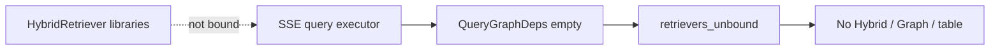

# Critical findings

Critical means: shipping now would be a false production claim, a policy violation, or an unproven security boundary that the program itself treats as a stop. Each item is a production blocker.

C-001–C-008 are the original pack. C-009–C-016 were parent-verified after parallel reviewers. See [reviewer merge](./06-reviewer-deltas.md).

Related: [high](./02-high.md) · [go / no-go](./90-go-no-go.md) · [QUALITY_TARGETS.md](../../QUALITY_TARGETS.md)

## PRD-C-001 — Real company content is still prohibited

- **Type:** policy / security
- **Location:** `docs/security/OPENAI_DATA_GOVERNANCE.md:10`, `docs/security/SUBPROCESSOR_GOVERNANCE.md:10`, `packages/core/src/smart_rag_core/security/external_processing.py`
- **Evidence:** Frontmatter `real_company_content_external_processing: prohibited`. OpenAI training/ZDR/DPA/residency rows are `unverified`. `decide_external_processing` is deny-by-default and requires `provider_settings_verified`.
- **Impact:** Enabling live OpenAI on company files would send bounded evidence to an unverified org contract (OAI-CHAT, OAI-EMB, OAI-RERANK, OAI-EXTRACT). That is exactly the path the signed packet forbids.
- **Invariant:** External processing only after documented retention/training/DPA settings.
- **Tests:** Unit coverage of deny-by-default exists; org verification cannot be unit-tested into existence.
- **Remediation:** Verification owner marks the OpenAI and LangSmith matrices `verified` from the live org console or signed DPA. Keep `MOCK_MODEL_MODE=true` until then. Do not "just turn the key."
- **Production blocker:** yes

## PRD-C-002 — Managed staging cannot run the application

- **Type:** launch-gate
- **Location:** `docs/adr/ADR-phase10-free-tier-ec2.md`, `docs/deployment/MANAGED_STAGING.md:21-27`, `docs/development/phase-10-managed-staging-evidence.md`
- **Evidence:** Intended instance `m6i.xlarge` rejected (`FreeTierRestrictionError`). Live instance `i-0abe79350a3880e87` is `t3.micro` with 916 MiB RAM. Compose is on disk and **not started**. CloudFront origin hostname is a placeholder. Private-port qualification is explicitly not P10-01-C.
- **Impact:** There is no running staging API, worker, ParadeDB, or Valkey to soak, pentest, or promote. Phase 11 consumes Phase 10-qualified artifacts that do not exist.
- **Remediation:** Paid/non-Free-Tier path, apply `m6i.xlarge` (or a signed smaller-but-runnable type with a new envelope ADR), start Compose, prove health and private-port scans, then resume Phase 10 packets.
- **Production blocker:** yes

## PRD-C-003 — Phase 11 production is entirely unchecked

- **Type:** launch-gate
- **Location:** `.cursor/plans/hybrid-graph-rag/11-phase-production.md:50-56`, plan index todos `phase-11-production: pending`
- **Evidence:** All six production packets are `[ ]`. No `docs/development/phase-11-production-evidence.md` close. Go/no-go, production provision, protected migrations, smoke/rollback, runbook publish, and ownership handoff have not run.
- **Impact:** DNS, TLS, production CORS, SES, backups, alarms, and rollback are not production-verified.
- **Remediation:** Finish Phase 10, then execute Phase 11 packets in order. Do not skip to "configure Vercel production" from the laptop.
- **Production blocker:** yes

## PRD-C-004 — Independent security assessment has not run

- **Type:** security-gate
- **Location:** `docs/security/phase-10-external-assessment-scope.md:1-13,79-80`
- **Evidence:** Status `not-run`. Document states it is not a pentest report and "Until a real report exists, Packet 7-C stays Blocked. Do not invent counts."
- **Impact:** Auth/JWKS, RLS/ACL, BM25 recheck, signed-URL abuse, SSRF, injection, origin bypass, and rate-limit ownership have **internal** tests. They have no independent retest. The program itself classifies open Critical/High from that assessment as a stop.
- **Remediation:** Engage an assessor against isolated synthetic staging (once staging actually runs). Remediate Critical/High and retest. Medium needs a dated ADR and named owner.
- **Production blocker:** yes

## PRD-C-005 — Launch holdout is sealed; live quality gates fail or are Not Run

- **Type:** quality-gate
- **Location:** `docs/evaluation/PHASE4_HOLDOUT.md:11-14`, `docs/development/phase-09-local-release-candidate-evidence.md:553-581`, `docs/QUALITY_TARGETS.md` QT-EVAL-002..009
- **Evidence:** Holdout "was **not opened**" and records a **no-go**. Open-split Hybrid Recall@10 **0.25** (misses alias, arabic_mixed, latest_as_of). Alias Recall@10 **0.0**. Faithfulness / citation completeness / routing accuracy live-model rows are **Not Run**. Locator correctness 1.0 is retrieve locators, not answer-assembler completeness.
- **Impact:** Shipping would advertise ≥85% Recall@10, ≥98% citation correctness, ≥90% faithfulness, and Combined +10 pp over Hybrid without those measurements. Arabic/mixed and alias queries are the product's differentiator and the current miss.
- **Invariant:** Evaluation gates are falsifiable launch criteria, not aspirations after go-live.
- **Remediation:** Live OpenAI (after C-001) on a newly SME-sealed holdout. Do not open the old sealed file and "use it anyway." Repair alias/Arabic retrieval before claiming Hybrid launch quality. Keep Combined off the default Auto path until QT-EVAL-009 is live.
- **Production blocker:** yes

## PRD-C-006 — Advertised production scale is an unsigned aspiration

- **Type:** integrity / capacity
- **Location:** `docs/adr/ADR-phase9-local-envelope-reduce.md:39-46`, `docs/QUALITY_TARGETS.md:249-266`
- **Evidence:** Signed local candidate is **8 Hybrid versions / 16 chunks**. Graph stays **15** mapping documents (`QT-CAP-005-P8`). QT-CAP-003 (25 users) is **unverified**. Phase 1 rows of 10,000 / 1,000,000 remain "unsigned-for-local aspiration."
- **Impact:** A production launch at the original envelope is a capacity lie. A production launch at 8 documents is a demo. Either needs an explicit client sentence; the current code and ads must not mix them.
- **Remediation:** Pick one: (a) production **pilot** at the signed reduced envelope with UI copy that says so, or (b) fund a load program that can fire the 70% isolation trigger and re-sign QT-CAP-*. Do not infer 10k from Docker.
- **Production blocker:** yes for any "full v1" claim

## PRD-C-007 — Phase 6/7/8 wrappers are not closed while production is being discussed

- **Type:** process-gate
- **Location:** `.cursor/plans/hybrid-graph-rag/06-phase-agent-intelligence.md:4` status `pending`; `docs/development/phase-06-agent-intelligence-evidence.md:4`; Phase 7 `in_progress`; Phase 8 `pending`; plan todos still pending for 6–8
- **Evidence:** Phase 6 packets are checked in the wrapper, but the wrapper `Done when` / evidence frontmatter stay pending. Phase 8 journey matrix exists; phase status remains pending. Production (Phase 11) depends on 6–10.
- **Impact:** The program's own rule is that a later phase may not compensate for a failed earlier gate. Discussing production while 6–8 are administratively open invites skipped Combined/holdout/citation close-out (risk R-08).
- **Remediation:** Write Phase 6/7/8 exit records against `Done when`, or record a dated ADR that production-pilot may proceed with named waived items. Do not leave the ledger fuzzy.
- **Production blocker:** yes until the ledger matches reality

## PRD-C-008 — MOCK_MODEL_MODE defaults on; production has no hard env fail-closed

- **Type:** security / correctness
- **Location:** `packages/core/src/smart_rag_core/settings/base.py:87-97`, `apps/backend/src/smart_rag_api/dependencies/identity.py:46-58`, `apps/backend/src/smart_rag_api/main.py:112`
- **Evidence:** `APP_ENV` defaults to `local`. `MOCK_MODEL_MODE` defaults to `true` and blocks OpenAI DNS in mock. `X-Test-User-Id` / `X-Test-Role` bypass JWKS when `APP_ENV=test`. No settings validator refuses `APP_ENV=test` or `MOCK_MODEL_MODE=true` when `APP_ENV=production`. Readiness is honest (`query_ready=false` in mock) but a mis-set `APP_ENV=test` on a reachable API is a total auth bypass.
- **Impact:** Two bad deploys: (1) mock mode in "production" looks healthy and answers from fixtures; (2) `APP_ENV=test` makes bearer tokens optional. Either is catastrophic.
- **Remediation:** Startup fail-closed: production images require `APP_ENV=production`, `MOCK_MODEL_MODE=false` only after C-001, reject `X-Test-*` at the HTTP layer even if env is wrong (defense in depth: also refuse the headers unless a signed `ALLOW_TEST_IDENTITY=true` that production images omit). Add a contract test that production settings reject the test bypass.
- **Production blocker:** yes

## PRD-C-009 — Live SSE query graph never binds retrievers or models

- **Type:** correctness
- **Location:** `apps/backend/src/smart_rag_api/services/sse_stream.py:159-177`
- **Evidence:** `LangGraphQueryRunExecutor._runtime_graph` constructs `QueryGraphDeps()` and only attaches memory store get/put. `hybrid_retriever`, `graph_retriever`, `table_executor`, `model_gateway`, and `connection` stay `None`. Unbound Hybrid returns `retrievers_unbound`.
- **Impact:** Admitted, budget-reserved chat does not retrieve company evidence. Ranked-ID evals and Hybrid contracts do not apply to the user-facing path.
- **Tests:** Config tests compile the unbound Studio graph. No contract that the default executor binds adapters.
- **Remediation:** Bind Hybrid, GraphRetriever, table executor, counted gateway, `app_api` connection, prompts, and cancel per run. Fail closed if any required adapter is missing.
- **Production blocker:** yes

## PRD-C-010 — Ingestion status IDOR (ACL bypass)

- **Type:** security
- **Location:** `apps/backend/src/smart_rag_api/routers/ingestion_status.py:77-88`; `supabase/migrations/20260814103200_finalize_uploading_status_grants_v1.sql:316-321`
- **Evidence:** GET binds `CallerContextDep` then discards it (`_ = caller`) except for `retry_allowed`. SQL has no `caller_can_read_document`. Policy `document_versions_api_status_read` is `USING (true)` for `app_api`. Companion chunk/scan/job policies are the same. `GET /documents/{id}` uses `get_visible_document` (correct contrast).
- **Impact:** Any authenticated user who learns a `version_id` reads restricted titles, scan hashes, job errors, and BM25/graph tallies.
- **Tests:** OpenAPI and retry 403 tests. No ACL/IDOR test on GET status.
- **Remediation:** ACL RPC + FORCE RLS; 404 on unauthorized; sanitize `last_error`. Add a negative test with a restricted document.
- **Production blocker:** yes

## PRD-C-011 — Website snapshots skip ClamAV and still index

- **Type:** security
- **Location:** `apps/agents/src/smart_rag_agents/ingestion/crawl_graph.py:244-258`; `apps/agents/src/smart_rag_agents/ingestion/index_graph.py:169-175,282,315,550`
- **Evidence:** Crawl enqueues `hybrid_index` with `review_approved: True` and no scan event. `mark_parsing_for_index` accepts `uploaded` or `scanning`. Index/parse paths pass `scan_evidence_current=True`.
- **Impact:** Unscanned HTML can be parsed, embedded, BM25-projected, and graph-handoff'd. File uploads are gated; websites are not.
- **Remediation:** Scan each snapshot (or crawl-run bundle) before enqueue; reject hybrid_index without a current clean scan row.
- **Production blocker:** yes

## PRD-C-012 — Parser sandbox fails open into the worker process

- **Type:** security
- **Location:** `packages/core/src/smart_rag_core/ingestion/parser/sandbox/launcher.py:51,102-109`
- **Evidence:** Default `use_docker=_docker_available()`. If Docker is down, `_run_inprocess` parses next to worker secrets and network.
- **Impact:** Malicious PDF/zip-bomb/OCR runs beside `SUPABASE_STORAGE_ADMIN_SECRET` and DB URLs.
- **Remediation:** Worker requires Docker/gVisor and fails the job; in-process only behind an explicit test flag.
- **Production blocker:** yes

## PRD-C-013 — Hosted Auth is still HS256; reuse project is Free / no PITR

- **Type:** security / launch-gate
- **Location:** `docs/deployment/phase-10/packet1-live-supabase.json:14-44`
- **Evidence:** Reused project `qsjivtwtmlmtksufqjik`: plan Free, `pitr: false`, `asymmetric_jwks_proven: false`, `legacy_anon_alg: HS256`. Advisor RLS disabled on `app.revoked_sessions` and `app.mfa_recovery_requests`. `schema_migrations_duplicate_names: true`.
- **Impact:** Application JWKS forbids HS256, but this hosted project is not a production Auth/DB. Promoting it would ship the algorithm the plan bans and a restore story without PITR.
- **Remediation:** Isolated Pro + PITR project; prove ES256/RS256 rollover; enable RLS on every app table; clean `schema_migrations`. Never promote this project ID.
- **Production blocker:** yes

## PRD-C-014 — Sync `asyncio.run` on the live SSE event loop

- **Type:** correctness
- **Location:** `apps/agents/src/smart_rag_agents/query/nodes/pipeline.py:1109-1123`
- **Evidence:** `_run_coro` calls `asyncio.run` for answer/verifier gateway calls. Production SSE uses `compiled.astream` on a running loop. Binding a live gateway (C-009) raises `RuntimeError: asyncio.run() cannot be called from a running event loop`.
- **Impact:** First real answer/verifier call crashes after reservation.
- **Remediation:** Async nodes or a dedicated worker loop with cancellation. Never `asyncio.run` from `astream`.
- **Production blocker:** yes (latent until C-009; then immediate)

## PRD-C-015 — Lease loss does not stop work; dead-letter is not lease-conditional

- **Type:** correctness
- **Location:** `apps/worker/src/smart_rag_worker/lifecycle.py` heartbeat vs `_process_job`; `packages/core/src/smart_rag_core/jobs/ingestion_repository.py:384-395`
- **Evidence:** Heartbeat thread can return on `JobLeaseError` while the graph keeps running. `_move_to_dead_letter` is `UPDATE … WHERE id = %s` with no lease/status predicate.
- **Impact:** Two workers can parse/embed the same job; a late DL write can tombstone a newly claimed row.
- **Remediation:** Abort the graph on heartbeat loss; DL/fail must be `WHERE lease_token AND status=processing`.
- **Production blocker:** yes

## PRD-C-016 — Index graph hardcodes scan-fresh and provider-verified

- **Type:** security / policy
- **Location:** `apps/agents/src/smart_rag_agents/ingestion/index_graph.py:311-322`
- **Evidence:** `scan_evidence_current=True`, `policy_version_matches=True`, `category=ALLOWED`, `provider_settings_verified=(content_class == "synthetic")`. Real company content always hits unverified providers unless operators lie with `content_class=synthetic`.
- **Impact:** Production Hybrid either never embeds real files, or skips scan/attestation by mislabeling.
- **Remediation:** Load scan-event age, attestation, and provider matrix from DB. Never default `synthetic`.
- **Production blocker:** yes
