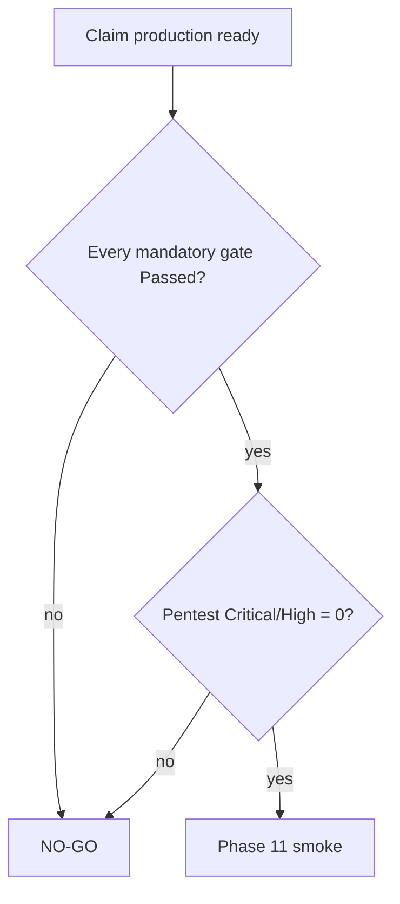

# Unverified mandatory gates

verify-release-gates: a skipped, missing, empty, flaky, or unavailable mandatory test is a **failed gate**. Never say production-ready while a gate is Blocked or Not Run.

Related: [QUALITY_TARGETS.md](../../QUALITY_TARGETS.md) · [CI_TIERS.md](../../development/CI_TIERS.md) · [phase-10 evidence](../../development/phase-10-managed-staging-evidence.md)

## Gate table

| Gate | Status | Evidence | Next action |
| --- | --- | --- | --- |
| Fast lint/types/unit (local policy) | Passed locally (claimed) | PYRIGHT_BASELINE 0 errors 2026-08-16; not re-run this review | Record GitHub run URL |
| Remote GitHub CI | **Not Run** (this review) | CI_TIERS: remote conclusion unverified | Attach `main` workflow URL |
| RLS matrix | Partial | `tests/contract/test_rls_matrix.py` exists; live managed project unproven | Run against isolated staging DB |
| JWKS HS256 forbidden | Passed (code + tests) | `FORBIDDEN_ALGORITHMS`; contract tests | Staging rollover drill |
| JWKS standby→active→retired live | **Not Run** / Blocked | Phase 10 packet 4 notes no live managed rollover | `docs/runbooks/SUPABASE_JWKS_ROLLOVER.md` on staging |
| Origin-secret dual rotation live | **Not Run** | Runbook exists | Rotate through CloudFront once origin is real |
| ClamAV fresh signatures + re-scan | **Not Run** on staging | Local runbooks | Staging signature freshness check |
| External pentest Packet 7-C | **Blocked** | `phase-10-external-assessment-scope.md` not-run | Need running staging |
| QT-LAT-001 first evidence p95 | Passed on 7-case subset | ~350–560 ms vs 2000 ms | Do not extrapolate to 1M chunks |
| QT-LAT-002 first token p95 Hybrid | **Not Run** / null | Stream samples missing or mock | Live OpenAI five-stream |
| QT-LAT-003 completion Hybrid | **Not Run** live | Mock completion ~1.8s Composite | Live models |
| QT-LAT-004..011 Combined/table/composite | **Not Run** live | Mock or not measured | Staging load |
| QT-CAP-001/002 10k / 1M | **Failed as claim** | Signed reduce to 8 / 16 | Either advertise P9 or re-measure |
| QT-CAP-003 25 users | **Not Run** | ADR-phase9 | Phase 10 load on real size |
| QT-CAP-004 5 simultaneous runs | Passed on subset | Phase 9 Packet 4 | Re-run on staging |
| QT-CAP-005 2000 graph docs | **Failed as claim** | Reduced to 15 | Keep Combined off default |
| QT-BM25-002 1M index/RAM/rebuild | **Not Run** | 16 chunks locally | Do not claim Hybrid Ready at envelope |
| QT-EVAL-001 zero ACL leaks | Partial / Failed on one path | RLS tests; **ingestion status IDOR C-010** | Fix C-010 then pentest |
| QT-EVAL-002 citation correctness ≥98% | Partial | Locator 1.0 n=7; empty Combined spans (H-024) | Load canonical text; live citations eval |
| QT-EVAL-009 Combined +10 pp | Fixture only / unverified | 66.7 pp fixture; live status unverified | Live ablation; keep Hybrid default |
| Live SSE Hybrid retrieve | **Failed** | `QueryGraphDeps()` unbound (C-009) | Bind adapters before quoting any chat quality |
| QT-EVAL-003/004 completeness/faithfulness | **Not Run** | live_model_required | After C-001 |
| QT-EVAL-005 routing ≥90% | **Not Run** | Phase 6 eval registry | Live labeled set |
| QT-EVAL-006 Recall@10 ≥85% | **Failed** on open split | **0.25** | Retrieval repair |
| QT-EVAL-007 exact Recall@5 | Partial 1.0 small n | Not holdout | New holdout |
| QT-EVAL-008 alias Recall@10 ≥95% | **Failed** | **0.0** | Retrieval repair |
| Holdout opened | **Denied** | PHASE4_HOLDOUT no-go | New SME-sealed holdout |
| Backup restore + BM25 rebuild | Local/docs | Not managed drill | Staging clock RTO/RPO |
| SSE through CloudFront 90s | IaC asserted | Placeholder origin | Slow-stream staging |
| Valkey live kill on EC2 | **Not Run** | App fail-closed tests ≠ host outage | Packet 4 live |
| Graph rebuild 7-day SLO | **Unmeasured** | RISK R-03 | Measure before bulk |
| Provider matrix verified | **Unverified** | OPENAI_DATA_GOVERNANCE | Product-owner console proof |
| Phase 11 smoke/rollback | **Not Run** | Wrapper pending | After Phase 10 |
| Live KMS/Object Lock audit anchor | **Not Run** | Exporter `"kms": False` (H-033) | Packet 5 live overwrite probe |
| Operator IAM access-key rotation | **Unverified** | Keys pasted in chat (H-032); not in git | Rotate; CloudTrail credential report |

## Classification used in this review

- **Passed:** Committed tests or dated evidence with numbers, on the topology they claim.
- **Partial:** Tests exist but not on the launch topology or not the metric named by QUALITY_TARGETS.
- **Failed:** Measured number misses the signed target, or a signed reduce forbids the original claim.
- **Blocked:** Cannot run until another blocker moves (staging host, pentest engagement, provider verification).
- **Not Run:** Required and absent.

Any production announcement that averages these into a green dashboard would itself be a defect.
