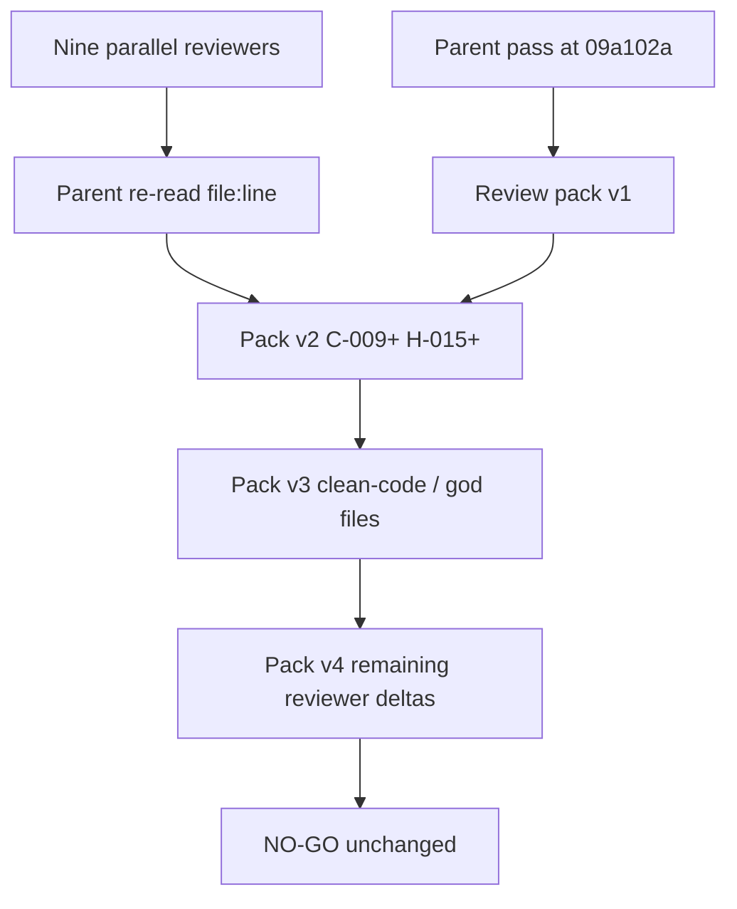

# Parallel reviewer merge

Parent inspection wrote the first pack. Nine Grok 4.6 reviewers then reported independently. This file maps their IDs onto canonical `PRD-*` findings. Severity files remain source of truth.

Related: [critical](./01-critical.md) · [high](./02-high.md) · [README](./README.md)

## Reviewers

| Reviewer | Topic | Merged as |
| --- | --- | --- |
| Ops release gates | Phase 9/10/11 gates | C-002 C-003 C-013 H-015 H-020 H-032 H-033 |
| Auth RLS secrets | Identity proof | Strengths kept; H-016; M-029 worker Storage Admin env; L-011 L-012 |
| Ingestion worker | Scan/jobs/parser | C-011 C-012 C-015 C-016 H-030 H-031 M-015 M-029 |
| Agents LangGraph | Query graph runtime | C-009 C-014 H-017 H-018 H-029 M-027 L-013 |
| Backend API | FastAPI IDOR/SSE | C-010 H-005 H-019 M-021 M-022 M-023 M-024 M-028 |
| Frontend UX | CSP/SSE cancel | H-002 H-021 M-025 M-026 L-013 |
| System design | Capacity/latency | H-019 H-020 H-022 H-023 M-028 |
| Retrieval graph | Hybrid/Combined | C-009 H-024 H-029 QT-EVAL-009 still unverified |
| Security production | Full-repo security | C-010 C-012 H-016 H-025 H-026 H-033 M-013–M-016 M-021 L-009 L-012 |
| Parent clean-code pass | God files, 300-line docs, docstring/TSDoc gates | H-027 H-028 M-017–M-020 L-010 |

## Highest-confidence new defects (re-read)

1. Live SSE builds `QueryGraphDeps()` with retrievers unbound (`sse_stream.py`).
2. Ingestion status GET discards caller; `USING (true)` on version/chunk SELECT.
3. Parser sandbox falls through to in-process when Docker is absent.
4. Crawl enqueue sets `review_approved: True` with no scan event.
5. Hosted project still reports `legacy_anon_alg: HS256`.
6. `_run_coro` uses `asyncio.run` under `astream`.
7. Combined locators can carry empty `citation_text` and still pass the span check.
8. `api.ts` is 1819 lines; `sse_stream.py` is 842 and contains unbound `QueryGraphDeps`. Eleven docs exceed the 300-line split with no CI gate.
9. Unbound gateway uses `mock_answer_payload` then skips the verifier and can still emit `verified` (H-029).
10. Operator AWS keys were pasted in chat (H-032; rotate; not copied here). Audit export remains `"kms": False` (H-033).

## What reviewers confirmed is still strong

Typed RPC identity, HS256 forbidden in **application** JWKS, BM25 IDs-only, graph prose fail-closed, cache recheck design, crawl SSRF pin, Valkey-down mutation fail-closed, conversation cascade delete. Those remain true of the **libraries**. They are not true of the **live SSE path** until C-009.

## Not merged as Critical

Speculative load numbers, LightRAG extract prompt-injection as query evidence (ingestion-time residual), cookie `httpOnly` defaults (L-011), `POST /graph/inspect` cost without an ACL bypass (M-021), and Valkey named-ACL remainder (called out under H-033/ops, not a new Critical). Unverified gates stay in [05-unverified-gates.md](./05-unverified-gates.md).

## Parent corrections on reviewer claims

- **H-021:** `consumeSse` now takes `AbortSignal` and cancels the reader. Admission/resume **fetch** still has no `signal`.
- **Graph inspect rate limit:** `GET /graph/entities/search` is limited; **POST `/graph/inspect` is not** (M-021).
- **Document delete / Storage:** There is no delete HTTP (GAP-07-14), so Storage purge on user delete cannot run (H-031). This is not a missing `delete_object` in quarantine cleanup.
- **AWS keys:** Recorded in Phase 10 evidence as pasted **in chat**, not committed. Do not copy secret material into this pack.
