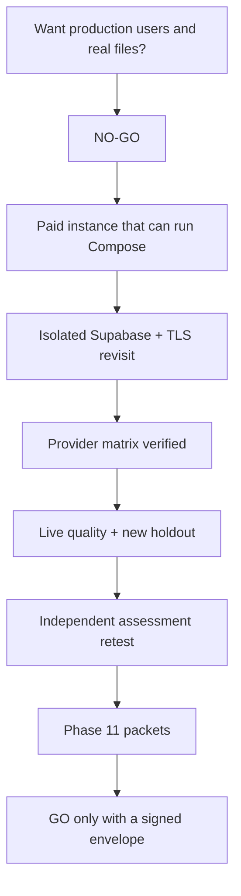

# Go / no-go

**NO-GO for production.** **GO for continued local RC and for standing up a real staging host.**

## May do now

- Keep developing against local Docker.
- Demo Auto chat on **synthetic** fixtures with mock or verified-synthetic OpenAI keys. Until C-009, that stream does **not** run Hybrid retrieve.
- Advertise **8 Hybrid documents / 16 chunks / 15 graph-mapping docs / 5 concurrent runs**.
- Fix H-001..H-004 and C-008 immediately (they are code, not AWS).
- Bind retrievers + ACL on ingestion status + parser fail-closed + crawl scan (C-009–C-012, C-014–C-016) before any “chat retrieves documents” demo claim.

## Must not do now

- Ingest real company files.
- Point customers at Vercel + this API.
- Claim Recall, faithfulness, or 10k scale.
- Enable Combined as default Auto.
- Call the t3.micro "staging."
- Promote hosted project `qsjivtwtmlmtksufqjik` (HS256 / Free / no PITR).

## Exit criteria to even schedule a go-live review

Every Critical in [01-critical.md](./01-critical.md) closed with evidence paths. High items H-001, H-002, H-003, H-007, H-010, H-013, H-015, H-016, H-024, H-025, H-029, H-031, H-032, H-033 closed or ADR'd. Gate table in [05-unverified-gates.md](./05-unverified-gates.md) has no Blocked rows that the wrapper still calls mandatory.
