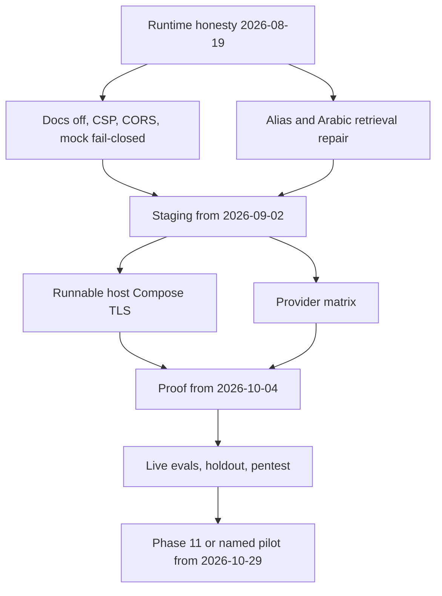

# 90-day hardening plan

This is a suggested sequence, not a new plan phase and not authorization to skip packet contracts. One production-shaped workstream at a time still applies.

## Days 1–14 — stop lying to the runtime

Owner: engineering-lead.

- Disable `/docs` `/redoc` in staging/production builds (H-001).
- Fail-closed production settings: no `APP_ENV=test`, no test CORS headers, no mock mode without an explicit `ALLOW_MOCK_IN_STAGING` (C-008, H-003).
- CSP connect-src from env; drop localhost (H-002).
- Byte-counting body limit (H-004).
- Bind Hybrid/Graph/table/gateway into SSE `QueryGraphDeps` without `asyncio.run` (C-009, C-014). Unbound must not emit `verified` (H-029).
- ACL + FORCE RLS on ingestion status (C-010).
- Rotate operator AWS keys recorded in Phase 10 evidence (H-032). Do not paste IAM user keys into chat.
- Scan website snapshots before hybrid_index; fail parser closed without Docker (C-011, C-012).
- Lease-conditional dead-letter; abort on heartbeat loss (C-015). Load scan/attestation from DB (C-016).
- Reject empty Combined citation text (H-024). Restrict owner invites (H-025).
- Close Phase 6/7/8 ledgers or ADR the waivers (C-007).
- Change UI metadata off the word Production (L-001).
- Retrieval spike: alias + arabic_mixed open-split misses (H-010). Do not touch holdout.
- Extract `build_query_graph_deps()` out of `sse_stream.py` as part of C-009 (do not leave the bind inside an 842-line file). Add a max-lines architecture test after the bind (H-027, H-028).

## Days 15–45 — a staging that actually runs

Owner: ops + engineering-lead.

- Leave Free Tier theater: instance that can run ParadeDB + API + worker + Valkey (C-002).
- Reopen TLS ADR (H-007). Isolated Supabase or signed "never promote this project" (H-006).
- Start Compose; private-port scan; origin-secret; CloudFront 90s hang test (H-013).
- JWKS rollover drill; Valkey fail-closed on the host.
- Provider matrix verification (C-001) — product-owner, unblocking live models on **synthetic** staging data only.
- Split `api.ts`, `pipeline.py`, `hybrid_run.py` **after** C-009/C-014 are green (H-028). Split phase evidence Markdown past 300 lines (M-017). Do not mix splits with fusion/sandbox behavior.

## Days 46–70 — prove answers and soak

Owner: engineering-lead + SME.

- Live five-stream latency vs QT-LAT-* on staging hardware (H-008).
- Live routing / faithfulness / citation completeness (C-005).
- Combined ablation if you still want it default; else ADR Auto=Hybrid only (H-012).
- New independently sealed holdout; then open **that** file once (C-005).
- Restore drill: DB + Storage + BM25 rebuild, timed (M-011).
- Independent assessment against synthetic staging (C-004).

## Days 71–90 — Phase 11 or a named pilot

Owner: client-approver + engineering-lead.

- If holdout and pentest Critical/High are clean: execute Phase 11 packets on a **signed envelope** (8-doc pilot vs re-signed larger cap).
- If not: stay on staging, publish a Hybrid-only internal pilot ADR, still no real corpus until C-001.

Dates are illustrative from the review day 2026-08-19.
