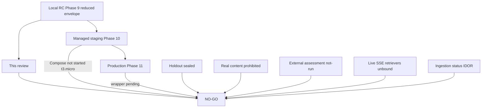

# Production-readiness review — 19 August 2026

Independent review of Smart RAG at git `09a102a` (`main`, 14 commits ahead of `origin/main` at review time). This is an implementation and operations review, not a plan review. It does not authorize production traffic, real company content, or a "production ready" label.

**Verdict: NO-GO.** The platform is an unusually strong local release candidate with real security machinery. It is not a production system. Staging Compose is not running. Phase 11 is untouched. Real company content remains prohibited. Quality holdout is sealed. Independent assessment has not run.

Related: [executive verdict](./00-executive-verdict.md) · [go / no-go](./90-go-no-go.md) · [90-day plan](./91-90-day-plan.md) · [what is excellent](./92-what-is-excellent.md) · [docs index](../../README.md)

## How to read this pack

| File | Use when |
| --- | --- |
| [00-executive-verdict.md](./00-executive-verdict.md) | You need the one-page answer |
| [01-critical.md](./01-critical.md) | Launch is blocked until these close |
| [02-high.md](./02-high.md) | Must fix or ADR before production users |
| [03-medium.md](./03-medium.md) | Fix in the hardening window |
| [04-low.md](./04-low.md) | Polish, hygiene, residual |
| [05-unverified-gates.md](./05-unverified-gates.md) | Mandatory gates that are Failed / Blocked / Not Run |
| [06-reviewer-deltas.md](./06-reviewer-deltas.md) | How parallel reviewers map onto PRD IDs |
| [domain/security.md](./domain/security.md) | Auth, RLS, JWT, injection, secrets |
| [domain/system-design.md](./domain/system-design.md) | Scale, latency, availability, cost |
| [domain/agents.md](./domain/agents.md) | LangGraph, routing, budgets, verification |
| [domain/backend.md](./domain/backend.md) | FastAPI, SSE, middleware |
| [domain/frontend-ux.md](./domain/frontend-ux.md) | Next.js console, a11y, RTL, CSP |
| [domain/ingestion.md](./domain/ingestion.md) | Worker, scan, jobs, BM25/graph pipelines |
| [domain/retrieval.md](./domain/retrieval.md) | Hybrid, Combined, tables, citations |
| [domain/operations.md](./domain/operations.md) | Staging, CI, runbooks, release |
| [domain/code-quality.md](./domain/code-quality.md) | God files, docstrings, 300-line docs, Mermaid |

Severity files are canonical. Domain files add maps, scorecards, and context. Do not treat a finding as closed because a domain file is polite.

## Method

Nine parallel Grok 4.6 reviewers plus a parent pass over identity, JWKS, CORS, CSP, SSE registry, query graph, citation filters, QUALITY_TARGETS, Phase 9/10 evidence, and ADRs. Late reviewer completions were merged as pack v4 (H-029–H-033, M-021–M-029, L-011–L-013). Findings below are parent-verified against the tree. Speculative items are in [unverified gates](./05-unverified-gates.md), not in Critical. Mapping: [reviewer merge](./06-reviewer-deltas.md).

This review did **not** re-run live Compose, ClamAV, ParadeDB load, OpenAI bake-off, or a penetration test. Numbers are taken from committed evidence unless marked `re-inspected`.

## Snapshot counts

| Severity | Count | Production blockers |
| --- | --- | --- |
| Critical | 16 | 16 |
| High | 33 | 24 (incl. conditional) |
| Medium | 29 | 0 (M-013 is an ACL-invariant High if you treat citation GET as launch) |
| Low | 13 | 0 |
| Unverified mandatory gates | 18 | 18 (cannot claim pass) |

