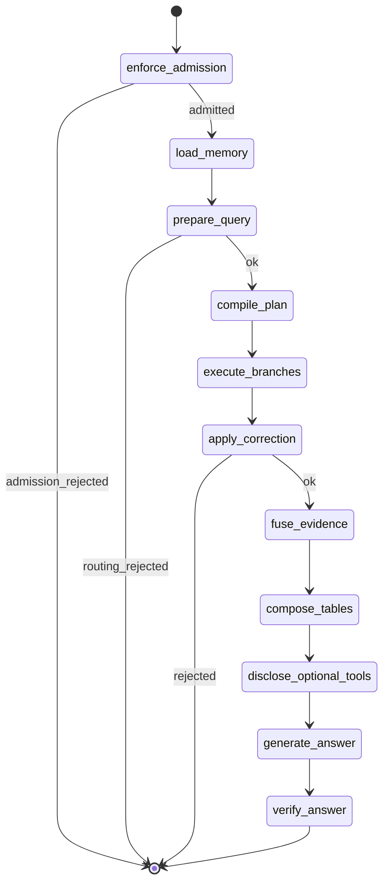

# Domain: agents

Canonical findings: [critical](../01-critical.md) C-005 C-007 C-008 C-009 C-014 · [high](../02-high.md) H-008 H-010 H-012 H-017 H-018 H-024 H-029 · [medium](../03-medium.md) M-003 M-004 M-009 M-027 · [low](../04-low.md) L-013.

## Graph shape (re-inspected)

`apps/agents/src/smart_rag_agents/query/graph.py` compiles a real state machine. `apps/backend/src/smart_rag_api/services/sse_stream.py` then compiles it with **empty** `QueryGraphDeps` (C-009). The diagram below is what *would* run after adapters are bound. Today the execute_branches node returns `retrievers_unbound`.

Admission copies **server** ceilings and never enlarges them. Client role fields are `extra=forbid` on runtime context. That is the correct trust boundary.

## What is excellent

Contracts and nodes, not the live executor:

- Deterministic route matrix in `query_routing/matrix.py` ("Catalog-search LLMs are never consulted").
- One correction budget (`correction.py`), not an unbounded ReAct loop.
- Memory loaded as delimited untrusted records (`safety.py`).
- `filter_invented_ids` + `deterministic_check_answer` + batched verifier.
- Optional tools after core retrieval (`optional_tools.py` / progressive disclosure).
- Prompt files versioned under `prompts/` with CHANGELOG and registry hashes.
- Ingestion graphs are separate modules from query graphs.

## Agent-specific risks

1. **Live SSE never binds retrievers or models** (C-009). Eval scripts construct `HybridRetriever` themselves. Unbound gateway still uses `mock_answer_payload` and can emit `verified` (H-029).
2. **`asyncio.run` inside `astream`** (C-014) — first live gateway call crashes once C-009 is fixed.
3. **Ceilings omit embed/rerank/LightRAG consume** (H-018).
4. **Reservation true-up never scheduled** (H-017).
5. **Phase 6 wrapper still pending** while packets are checked (C-007).
6. **Verifier omission → still complete** (M-004). Empty citation spans can pass (H-024). `insufficient_evidence` from correction still fuses (M-027).
7. **Checkpointer DSN** can fall back to `SUPABASE_DB_URL`. Staging must not use a transaction pooler.
8. **Graph-only is inspection** in routing docs; UI must not POST a user-facing graph-only answer.

## Eval honesty

Routing accuracy, faithfulness, and Combined gain are **not** launch-proven. Fixture Combined gain of 66.7 pp is not QT-EVAL-009. Do not let a polished LangGraph diagram substitute for those numbers.
