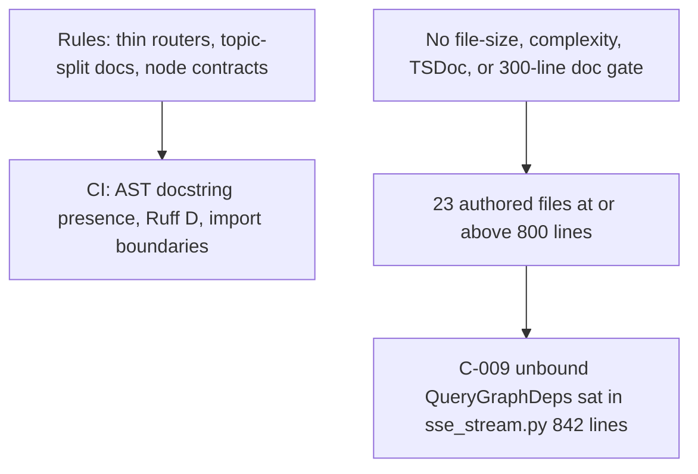

# Domain: clean code and documentation

Canonical findings: [high](../02-high.md) H-027 H-028 · [medium](../03-medium.md) M-017 M-018 M-019 M-020 · [low](../04-low.md) L-010.

This pass scores the tree against `.cursor/rules/10-python-quality.mdc`, `.cursor/rules/05-monorepo-boundaries.mdc`, `.cursor/rules/70-documentation-standards.mdc`, and the historical lesson in `docs/prev_review/15_QA_CODE_QUALITY_REVIEW.md` (A-Q3: one module, too many responsibilities). Those historical files describe a different product; the **lesson** is in force. The current plan's documentation rule is explicit: one topic per Markdown file, split past roughly **300 lines**, no catch-all design or operations dump.

## What is already excellent

- **Python docstring presence is real.** `tests/contract/test_docstrings.py` fails the tree if any authored module/class/function/method lacks a docstring. Ruff pydocstyle Google is selected (`pyproject.toml` `D`).
- **LangGraph query nodes document the contract the rule asks for.** Example: `load_memory_node` in `pipeline.py` states State inputs/outputs, persistence writes, external/model calls, budget/deadline, failure/fallback, then Args/Returns.
- **Settings carry `Field(description=...)`.** Shared and backend settings are not silent knobs.
- **C4 architecture split exists.** `docs/architecture/01-system-context.md` through `08-data-dictionary.md` plus availability triggers. That is the right answer to the 2026-04 documentation review (no mixed Context/Container/Code picture).
- **Monorepo direction is tested.** Core does not import apps; routers are supposed to be thin.

Presence of a docstring is not the same as a maintainable module. The AST scanner does not read the docstring body.

## God files (measured at `09a102a`)

Line counts are physical lines, excluding `generated/` and `docs/prev_review`. Threshold used here: **400** is a smell; **800** is a god file unless it is a generated dump.

| Lines | Path | Mixed concerns |
| --- | --- | --- |
| 1819 | `apps/frontend/src/lib/api.ts` | Every HTTP client, SSE, admin, tables, tools, crawl, invitations |
| 1251 | `packages/core/.../retrieval/hybrid_run.py` | Embed, channels, fuse, temporal `SET ROLE postgres`, coverage, locators |
| 1232 | `packages/core/.../retrieval/lightrag_adapter.py` | Pin, query, mapping, fail-closed wrappers |
| 1190 | `packages/core/.../jobs/graph_mapping_service.py` | Mapping job + SQL + survival |
| 1061 | `packages/core/.../jobs/graph_index_service.py` | Index orchestration |
| 1031 | `packages/core/.../jobs/graph_resolver.py` | Resolve + unbounded evidence-map SQL |
| 959 | `apps/agents/.../query/nodes/pipeline.py` | All query nodes plus `_run_coro` / `asyncio.run` |
| 943 | `packages/core/.../gateways/model.py` | All model families in one gateway |
| 842 | `apps/backend/.../services/sse_stream.py` | SSE transport **and** graph compile with empty deps (C-009) |
| 839 | `packages/core/.../query_routing/branches.py` | Hybrid/Graph/table execute + Combined fusion holes (H-024) |
| 714 | `apps/frontend/.../auth/auth-screens.tsx` | Multiple auth journeys |
| 660 | `apps/frontend/.../components/chat-app.tsx` | Handshake, SSE, citations, feedback, usage |

Also oversized, but packet-shaped rather than runtime: `release/packet3.py` (1395), `phase10_packet6.py` (1342), `phase10_packet7.py` (1263). Those mix quality, latency, BM25, cost, and graph measurement in one module.

**Counts:** 23 authored Python/TS files ≥800 lines (first measurement, excluding generated DB types). 11 maintained Markdown files ≥300 lines (rule threshold), five of them ≥800, all phase evidence dumps plus `docs/frontend/API_UI_MAPPING.md`.

There is **no** Ruff `C901` / complexity select, **no** max-lines architecture test, and **no** `check_docs` 300-line split. The rule is prose-only.

## Why this is a production-readiness issue

God files did not invent C-009, C-010, or C-014. They hid them. `_runtime_graph` constructing `QueryGraphDeps()` with only store get/put is a small function; it lives inside an 842-line SSE service. `ingestion_status.py` still opens `psycopg.connect` in the router (thin-router rule). Reviewers and tests that grep `HybridRetriever(` in eval scripts never see the live path.

The historical A-Q3 fix still applies: split by responsibility so the next ACL or event-loop defect cannot hide in the same file as heartbeats and sanitizers.

## Documentation vs the written standard

| Rule | Reality |
| --- | --- |
| Split Markdown past ~300 lines | 11 docs over; Phase 6 evidence is **1259** lines |
| One primary topic per file | Phase 4/5/6/9/10 evidence files are catch-all packet ledgers |
| Mermaid on architecture, auth, ingestion, retrieval, agent-routing, deployment | C4 architecture files have diagrams. Missing on `QUERY_BUDGETS.md`, `CHUNKING_CONTRACT.md`, `INGESTION_LIMITS.md`, `BM25_PROJECTION_CONTRACT.md`, `GRAPH_MAPPING_CONTRACT.md`, several security contracts, `STREAMING_TIMEOUTS.md` |
| `docs/README.md` indexes every document | Table exists; it is not a C4 router. `scripts/check_docs.py` does not fail on unlisted files |
| Google-style Args/Returns/Raises when relevant | Presence enforced; completeness not |
| LangGraph node extra sections | Query pipeline nodes have them; ingestion graphs were not fully re-audited line-by-line |
| Exported TypeScript TSDoc | Many `api.ts` exports have `@param`; **no** CI/AST test. ESLint is Next core-web-vitals only |
| Stale docs are a failing defect | Most index rows remain `draft`; last-reviewed dates lag live defects (unbound SSE, status IDOR) |

## Clean-code rule scorecard (10-python-quality)

| Rule | Grade |
| --- | --- |
| Strict typing / Pydantic at boundaries | Strong |
| Thin FastAPI routers | Mostly; **ingestion status and retry talk to Postgres in the router** |
| OpenAI only through gateway | Library yes; live SSE does not bind the gateway (C-009) |
| Settings per deployable, no scattered `os.getenv` | Proven by `test_environment_boundary.py` |
| Explicit domain exceptions, no swallow | Strong in libraries |
| Do not block the FastAPI event loop | Failed: `_run_coro` → `asyncio.run` (C-014); Hybrid temporal `psycopg.connect` is sync |
| Bound lists/timeouts | Strong constants; graph evidence SQL still unbounded (H-013) |
| Structured logs, no secrets | Designed; not re-proven on staging |

## Recommended split order (do not mix with behavior changes)

1. Extract `QueryGraphDeps` factory from `sse_stream.py` (makes C-009 a one-file contract test).
2. Split `pipeline.py` into admission / memory / prepare / branches / answer nodes (makes C-014 local).
3. Split `api.ts` by surface: query-sse, documents, admin, tables.
4. Split `hybrid_run.py` temporal load + coverage recompute out of retrieve composition.
5. Split phase evidence Markdown by packet (300-line rule) after the runtime splits, not before.

Do not “clean up” Combined fusion, parser sandbox, or ACL while splitting. One concern per PR.
