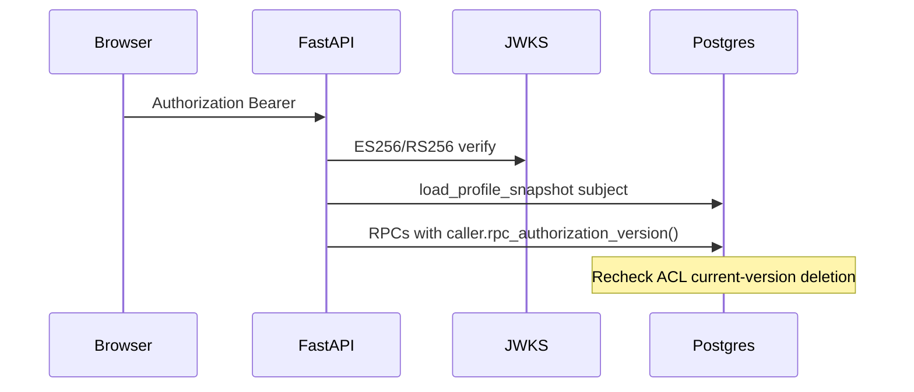

# Domain: security

Canonical findings: [critical](../01-critical.md) C-001 C-004 C-008 C-010 C-012 C-013 · [high](../02-high.md) H-001 H-002 H-003 H-004 H-006 H-007 H-011 H-013 H-015 H-016 H-025 H-026 H-032 H-033 · [medium](../03-medium.md) M-001 M-002 M-007 M-008 M-013–M-016 M-021 M-029 · [low](../04-low.md) L-002 L-009 L-011 L-012.

## What is proven in code (re-inspected)

| Claim | Result | Pointer |
| --- | --- | --- |
| End-user identity is typed caller context, not JWT role alone | **Proven** | `dependencies/identity.py` loads live profile; `CallerContext.from_profile_row` |
| Session GUC identity | **Not used on this path** | Profile snapshot + RPC args (see IDENTITY_PROPAGATION.md) |
| HS256 | **Forbidden** | `jwks.py` `FORBIDDEN_ALGORITHMS`; contract tests mint HS256 and expect failure |
| Local issuer aliases | **Gated to APP_ENV=local** | `jwks.py` `_LOCAL_APP_ENV` |
| Test identity bypass | **Gated to APP_ENV=test** | `_resolve_test_bypass` — production must still refuse the headers (C-008) |
| Runtime general `service_role` | **Absent from SharedSettings** | Privileged class isolated; tests scan env names |
| Retrieval `service_role` EXECUTE | **Denied** | `test_hybrid_retrieval.py` |
| Cache is not authority | **Proven design** | `cache_store.py` recheck on hit; keys include `principal_scope_hash` |
| Hostile HTML | **No dangerouslySetInnerHTML** | Frontend prohibited-patterns test |
| Citation href XSS | **Hardened** | `safe-text.ts` `isSafeHttpUrl`; UserText isolates |
| Upload MFA | **Server-enforced** | Frontend hides chrome; API 403 `mfa_required` tests |
| Viewer chrome vs authz | **Correct split** | `roles.ts` documents convenience ≠ authorization |

## Residual attacks that still matter

1. **Mis-set `APP_ENV=test` on a public API** — total bypass (C-008).
2. **Ingestion status IDOR** — caller discarded; `USING (true)` (C-010).
3. **Parser in-process fallback** (C-012).
4. **Hosted Auth HS256 + RLS disabled on revocation tables** (C-013, H-015).
5. **Local/staging-shaped postgres superuser DSN** (H-016).
6. **Admin owner-invite + accept overwrite** (H-025).
7. **Swagger UI on the origin** — recon (H-001).
8. **Inline script CSP** — XSS amplification (H-002).
9. **Same-process Auth Admin secret** — blast radius (H-011).
10. **Cleartext ParadeDB on Docker net** once staging Compose starts (H-007).
11. **Prompt injection** — memory is delimited (`delimit_memory_record`) and citations are filtered; this is strong but not pentested (C-004). Do not claim "injection-proof."
12. **Signed URL / quarantine** — designed; independent abuse test not run.

## Do not weaken

Do not "simplify" identity to trusting `app_metadata` only, do not add HS256 "just for local scripts," do not skip recheck on cache hits, and do not put `service_role` in Vercel.
