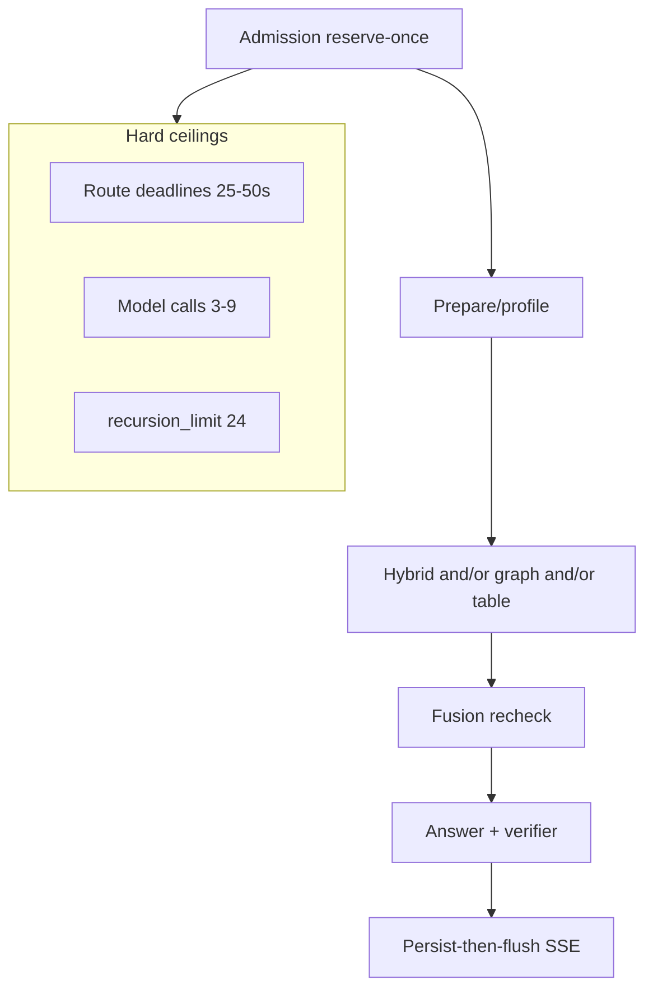

# Domain: system design, scalability, latency

Canonical findings: [critical](../01-critical.md) C-002 C-006 C-009 · [high](../02-high.md) H-005 H-008 H-012 H-013 H-019 H-020 H-022 H-023 · [medium](../03-medium.md) M-022 M-028 · [unverified gates](../05-unverified-gates.md).

## Honest capacity

| Story | Signed / measured | Usable as production claim? |
| --- | --- | --- |
| 10,000 Hybrid versions / 1M chunks | Phase 1 aspiration | **No** |
| 8 versions / 16 chunks | QT-CAP-001-P9 / 002-P9 | Yes, as **local RC** only |
| 25 concurrent users | Unverified | **No** |
| 5 simultaneous query runs | Proven on subset | Yes at that subset |
| 2,000 graph versions | Reduced to 15 | **No** |
| Single-host RTO 4h / RPO 24h | Policy; no managed drill | Not proven |
| Hybrid first evidence ≤2s p95 | Passed n=7 retrieve | Not at envelope |
| Hybrid first token ≤5s p95 | Not Run live | **No** |

The architecture is **honest about being single-host**. Availability triggers exist (`AVAILABILITY_AND_ISOLATION_TRIGGERS.md`). QueryRunRegistry being in-memory is consistent with one API task — and becomes a foot-gun the first time someone sets `desired_count=2`.

## Bottleneck map (ranked)

1. **Staging host RAM (916 MiB)** — cannot start ParadeDB + API + worker + Valkey. This is the current hard stop.
2. **Live query graph unbound** — chat does not consume Hybrid/Graph capacity at all until C-009.
3. **OpenAI tokens and LightRAG extraction** — graph onboarding is model-limited; Combined latency will be too.
4. **HNSW RAM ~8.84 GB for 1M 1024-d vectors** vs Nano / 60% rule (H-022).
5. **ParadeDB rebuild** — unmeasured at envelope; Hybrid Ready lag SLO unverified at 1M.
6. **Single graph writer ~1008 docs / 7 days** if 600s serial (H-023).
7. **Checkpointer pool 4 vs 5 concurrent runs**; dual API colors double pools (H-019, H-020).
8. **Process-local SSE executor** — cancel/resume across processes.
9. **CloudFront 90s** — Combined hard deadline is 45s, Composite 50s; 90s CDN is enough if heartbeats work. Unproven through CDN.

## What scales without a rewrite

- Schema-scoped roles, outbox jobs, SKIP LOCKED leases, expand/contract migrations.
- BM25 as derived projection (rebuildable).
- Cache as ID-only with recheck.
- Distroless API image, digest pins.

## What is a hard v1 ceiling

- One EC2, one LightRAG workspace, one company, graph concurrency-one, in-memory live runs.
- Crossing 80% of the **signed** envelope for 30 days must open a multi-host ADR — today the signed envelope is 8 documents, so "80%" is theater until you re-sign.

## Latency UX implication

Even if p95 retrieve is 500 ms, users feel **rerank + answer tokens**. Mock completion at 1.8s will become 8–25s on live Hybrid and worse on Combined. The UI already has live regions and limitation callouts; it needs a route-aware "still retrieving" status that matches SSE events, not a generic spinner.
