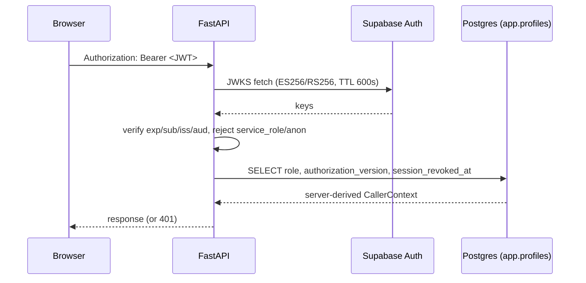

# Security review

Scope: authentication, authorization/RLS, API surface, input validation, secrets,
upload/parser path, SSE, frontend exposure, and audit. Every finding cites code
that was read during this review.

## Executive summary

The security posture is **strong and consistently fail-closed**. Identity is
server-derived from Postgres profiles (never from JWT claims or
`user_metadata`); RLS is enabled on exposed tables with `anon`/`authenticated`
revoked from application schemas; runtime DB access runs through scoped roles
(`app_api`, `app_worker`, `app_checkpointer`, `app_audit_writer`); privileged
service-role secrets are isolated from the shared settings; uploads are
quarantined, ClamAV-scanned, and parsed inside a `network_mode: none` non-root
sandbox; SSE resume requires Bearer + ownership with 404 no-enumeration; CORS
reflects exact origins only.

No Critical or High severity findings. The residuals are Medium/Low hardening
and operational items — the most important being an explicit **MFA policy
decision** and making **Valkey mandatory outside local** so pre-auth rate limits
cannot be silently skipped.

## Authentication and session

Verified strengths:

- **Strict JWT verification** — ES256/RS256 only, HS\* forbidden; `exp`, `sub`,
  `iss`, `aud` required; fixed issuer `{SUPABASE_URL}/auth/v1`; `service_role`
  and `anon` roles rejected (`packages/core/src/smart_rag_core/security/jwks.py:17-20,182-249`).
- **JWKS cache** with TTL cap 600s and refresh on unknown `kid`
  (`jwks.py:44-50,152-153,280-298`).
- **Server-derived identity** — role and `authorization_version` come from the
  Postgres profile snapshot, not JWT claims
  (`apps/backend/src/smart_rag_api/dependencies/identity.py:188-246`;
  `packages/core/src/smart_rag_core/security/profile_snapshot.py:26-78`).
- **Session revocation** via `session_revoked_at` + `app.revoked_sessions`
  (`identity.py:230-238`).
- **Test identity bypass is double-gated** — `APP_ENV=test` **and**
  `ALLOW_TEST_IDENTITY=true`; forbidden at settings load in staging/production
  (`identity.py:42-84`; `packages/core/src/smart_rag_core/settings/base.py:113-121,294-303`).

Findings:

| ID | Severity | Finding | Evidence |
| --- | --- | --- | --- |
| SEC-1 | Medium | **No MFA/AAL enforcement at the API** — `assurance_level` is stored but explicitly not an auth gate; `mfa_enrolled` forced false on context | `identity.py:160-168,206`; `profile_snapshot.py:133-157` |
| SEC-2 | Low | JWKS refresh uses sync `httpx` inside verification — cold/expired cache blocks a worker thread under load (availability, not bypass) | `jwks.py:305-307` |
| SEC-3 | Low | No stale-JWKS grace period: expired cache + failed fetch fails all auth (correct fail-closed behavior; document the ops dependency) | `jwks.py:291-297,309-314` |

## Authorization and RLS

Verified strengths:

- Documented model (`docs/security/AUTHORIZATION_MODEL.md`) matches code
  direction: roles live in `app.profiles.role` only; `user_metadata` is never
  authorization input.
- Broad RLS enablement on app/evidence tables
  (`supabase/migrations/20260812135115_indexes_rls_grants_v1.sql:64-110`); creator-private
  + owner/admin audit policies on documents, ACL, conversations, runs
  (`20260812135916_roles_rls_identity_v1.sql:507-666`).
- `anon`/`authenticated` fully revoked from `app`, `private`, `langgraph`,
  `lightrag` schemas and their tables (`20260812135916_roles_rls_identity_v1.sql:830-846`).
- Runtime services use `SET ROLE app_api` for RPC-scoped access (e.g.
  `apps/backend/src/smart_rag_api/services/upload_quota.py:103-104,174-175`).
- **Service-role isolation**: `PrivilegedAuthSettings`/`PrivilegedStorageSettings`
  are not part of `SharedSettings`; only `auth_admin`/`storage_admin` modules can
  load them (`apps/backend/src/smart_rag_api/auth_admin/settings.py:10-38`;
  `storage_admin/settings.py:10-38`). No `service_role` in core settings.
- Storage quarantine: INSERT-only for `authenticated`, path enforced by
  `app.quarantine_upload_path_allowed`, no browse policies on document buckets
  (`20260813140000_storage_quotas_graph_retention_v1.sql:285-297`).

Findings:

| ID | Severity | Finding | Evidence |
| --- | --- | --- | --- |
| SEC-4 | Low | `app.run_events` SELECT granted to `authenticated` — RLS limits rows to run owner/admin, but a client could read SSE payloads via PostgREST, bypassing FastAPI rate limits (payloads are stripped at insert; frontend does not use this table) | `20260816200000_query_run_events_v1.sql:45-69,124-141` |

## API surface

- Public routes are exactly three: `GET /health/live`, `GET /health/ready`,
  `GET /api/meta` (no secrets) — `apps/backend/src/smart_rag_api/routers/ops.py:76-104,130-164`.
  Every other router requires `CallerContextDep`. Admin routes check
  `UserRole.OWNER|ADMIN` (e.g. `routers/auth_team.py:91-95`).
- **Rate limits**: pre-auth IP limits on mutation prefixes (60/min hashed IP)
  when Valkey or Postgres is configured (`middleware/preauth.py:24-34,50-88`);
  per-route `RateLimitKind` limits fail closed for mutations; `LOW_RISK_READ`
  falls back to a per-process emergency cap when Valkey is down
  (`services/auth_rate_limits.py:59-98,226-320`).
- **CORS**: exact origins only, never `*`, credentials allowed, test headers only
  in `APP_ENV=test` (`middleware/cors.py` — verified in full; wildcards also
  rejected at settings load, `settings/backend.py:265-280`).
- **Body limits**: default 1 MiB, streamed cap, POST/PUT/PATCH require numeric
  `Content-Length` (`middleware/request_limits.py:96-149`).
- **OpenAPI/docs disabled in staging/production** (`main.py:317-360`).

Findings:

| ID | Severity | Finding | Evidence |
| --- | --- | --- | --- |
| SEC-5 | Medium | Pre-auth IP limits are **skipped silently** when neither `VALKEY_LIMITS_URL` nor `SUPABASE_DB_URL` is configured | `preauth.py:72-76` |
| SEC-6 | Medium | `LOW_RISK_READ` degrades to a **per-process** emergency limiter (30/min) when Valkey fails — aggregate limit is weaker across multiple API replicas | `auth_rate_limits.py:59-98,284-301` |
| SEC-7 | Low | API default bind `0.0.0.0:8000` — relies on firewall/reverse proxy; compose publishes API+frontend on host (dev posture) | `settings/backend.py:90-99`; `docker-compose.yml:191-192,303-304` |
| SEC-8 | Low | Local OpenAPI CSP allows `'unsafe-inline'` scripts (docs mounted in local/test only) | `security_headers.py:19-28,61-62` |

## Input validation and injection

- Pydantic bounds throughout (chat message 16,384 chars; bounded uploads, crawl
  URLs, invitations) — `schemas/fastapi_security.py`.
- Backend SQL is parameterized; **no f-string SQL** in `apps/backend` (grep clean).
- **Prompt-injection defenses**: Exa web queries sanitized (JWTs, secrets,
  company markers stripped — `web_research/sanitize.py:10-36,63-80`); source
  records are delimited untrusted data in every prompt (`answer_v4.md:16-17`);
  memory records delimited as untrusted (`nodes/memory.py`).
- **ACL blindness**: unauthorized callers cannot learn existence counts
  (`query_routing/acl_blindness.py:8-30`).
- Untrusted text HTML-escaped for JSON APIs (`security/untrusted.py:13-23`).
- SSE payload sanitizer strips forbidden keys and reduces errors to generic codes
  (`services/sse/sanitize.py:17-51,103-115`); the DB RPC also strips before persist
  (`20260816200000_query_run_events_v1.sql:124-166`).

Findings:

| ID | Severity | Finding | Evidence |
| --- | --- | --- | --- |
| SEC-9 | Low | Entity-rule alias list capped at 32 entries but **no per-string `max_length`** in the API schema | `schemas/entity_rules.py:20-23` |

## Secrets and configuration

- Central Pydantic settings with staging/production guards: mock mode, test
  identity, and raw LangSmith I/O export are rejected outside local
  (`settings/base.py:162-170,278-307`).
- Hosted CORS must be HTTPS + non-loopback (`settings/backend.py:328-357`);
  hosted mode **requires** `VALKEY_LIMITS_URL` (`backend.py:361-377`).
- Compose keeps ParadeDB/Valkey/ClamAV on an internal network with **no host
  ports** (`docker-compose.yml:7-13,22-34`); API/worker run non-root with
  read-only root FS (`docker-compose.yml:218-221,285-288`).
- No hardcoded secrets found in application code paths; ops scripts write
  service-role values to gitignored compose env only.

## Upload and parser path

- Upload quota reserve/finalize through RPCs as `app_api`
  (`services/upload_quota.py:66-140,143-205`).
- Quarantine bucket + path policy before any indexing.
- **ClamAV**: signature staleness checks, size limits, INSTREAM
  (`gateways/clamav.py`); the crawl path also scans before index
  (`apps/agents/src/smart_rag_agents/ingestion/crawl_graph.py:141-163`).
- **Parser sandbox**: non-root UID 10001 (`infra/parser-sandbox/Dockerfile:10-20`),
  `--network none`, read-only root, dropped capabilities, memory/CPU/pids limits
  (`ingestion/parser/sandbox/launcher.py:238-271`).

Findings:

| ID | Severity | Finding | Evidence |
| --- | --- | --- | --- |
| SEC-10 | Low | Parser failure may embed sandbox stderr into worker-local `ParseResult.detail` — verify HTTP ingestion errors always go through the redaction helper, never raw stderr | `launcher.py:295-298`; `services/ingestion_error_text.py` |

## SSE and streaming

- Resume requires Bearer + run ownership before any stream attach
  (`routers/query_runs.py:181-208`; `services/run_access.py:72-86`).
- Foreign/missing runs return 404 (no enumeration) (`services/http_errors.py:20-91`).
- Resume replays persisted events; it never re-executes the graph.
- Error events are sanitized to `{code: run_failed}`; secrets/passages stripped
  at persist time (`20260816200000_query_run_events_v1.sql:124-141`).

## Frontend exposure

- Tokens come from Supabase SSR cookies via the session provider — no hand-rolled
  localStorage JWTs (`src/lib/auth/session-provider.tsx:51-72`).
- Bearer is attached only through `useApiAuth` — no forgeable role headers
  (`lib/client-authorization.ts:40-46`).
- **XSS discipline**: `answer-prose.tsx` documents and enforces no
  `dangerouslySetInnerHTML`; `safe-text.ts` strips NULs and blocks
  `javascript:`/`data:` URLs (`safe-text.ts:49-68`); hostile-text fixtures and
  prohibited-pattern tests run in CI.
- OAuth callback uses PKCE with generic failures; `safeNextPath` blocks
  open-redirect (`app/(auth)/auth/callback/safe-next-path.ts:28-74`).
- Browser Supabase client uses the anon key only.
- Route protection is `src/proxy.ts` (cookie refresh + redirects) and is
  explicitly documented as **not** the security boundary — FastAPI Bearer auth is
  authoritative.

## Audit and observability

- Append-only hash-chain audit with payload redaction
  (password/token/secret/raw_ip) — `security/audit_chain.py:18-40`, SQL triggers.
- Structured JSON logging with correlation IDs; request middleware does not log
  URLs, bodies, or auth headers (`main.py:298-312`).
- Log redaction for `sk-*`, Bearer tokens, and credentials in URLs
  (`observability/logging.py:18-35,58-74`).
- LangSmith tracing redacts gateway I/O by default; full I/O export is
  local-only (`settings/base.py:162-170`).

Findings:

| ID | Severity | Finding | Evidence |
| --- | --- | --- | --- |
| SEC-11 | Low | Audit-chain KMS/external anchoring is not live yet (local chain only) | `docs/security/AUDIT_CHAIN.md:72-83` |

## Consolidated finding list

| ID | Severity | Summary |
| --- | --- | --- |
| SEC-1 | Medium | No MFA/AAL gate at the API — make an explicit policy decision |
| SEC-5 | Medium | Pre-auth IP limits silently skipped without Valkey/Postgres config |
| SEC-6 | Medium | Degraded read rate limiting is per-process, not aggregate |
| SEC-2/3 | Low | JWKS sync fetch; no stale-key grace (ops documentation) |
| SEC-4 | Low | Optional direct `run_events` reads via PostgREST JWT |
| SEC-7/8 | Low | Dev host ports; local docs CSP inline scripts |
| SEC-9 | Low | Alias strings lack per-item max length |
| SEC-10 | Low | Keep parser stderr out of client-visible errors |
| SEC-11 | Low | External audit anchoring pending |

## Recommendations

1. **Decide MFA policy** (SEC-1): if production requires MFA, re-enable AAL
   checks in `resolve_caller_context` and align with Supabase Auth enforcement;
   otherwise document that AAL is informational-only.
2. **Make rate-limit backends mandatory outside local** (SEC-5/6): fail startup
   in staging/production when `VALKEY_LIMITS_URL` is unset (staging already
   requires it — extend to production) and alert on the
   `rate_limit_degraded` latch (`routers/ops.py:68-72`).
3. **Lock down `run_events`** (SEC-4): revoke `GRANT SELECT ON app.run_events TO
   authenticated` and route all reads through the API, or accept and document
   the PostgREST path.
4. **Async JWKS refresh** (SEC-2): background refresh before TTL expiry so a
   cold Supabase Auth outage cannot block workers.
5. **Bound alias strings** (SEC-9) and keep the parser-stderr redaction contract
   test (SEC-10).
6. Keep running `tests/contract/test_audit_chain.py` in release gates and
   schedule external anchoring (SEC-11).

## Verification commands

- `uv run pytest tests/contract/test_storage_buckets_rls.py tests/contract/test_query_admission_budget.py -q`
- `uv run pytest tests/contract -q` (full contract suite incl. RLS and audit chain)
- `pnpm --filter frontend test -- prohibited-patterns` (XSS/secret guard rails)