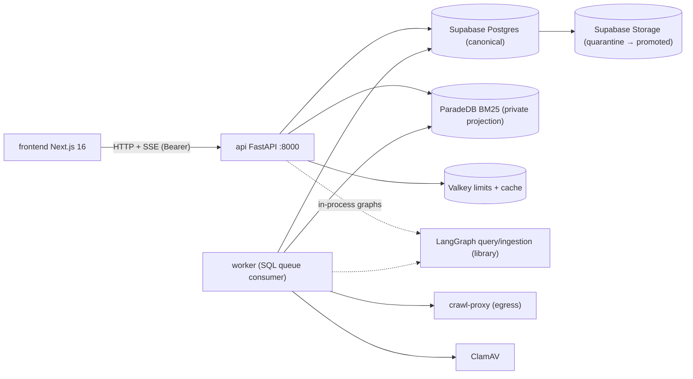
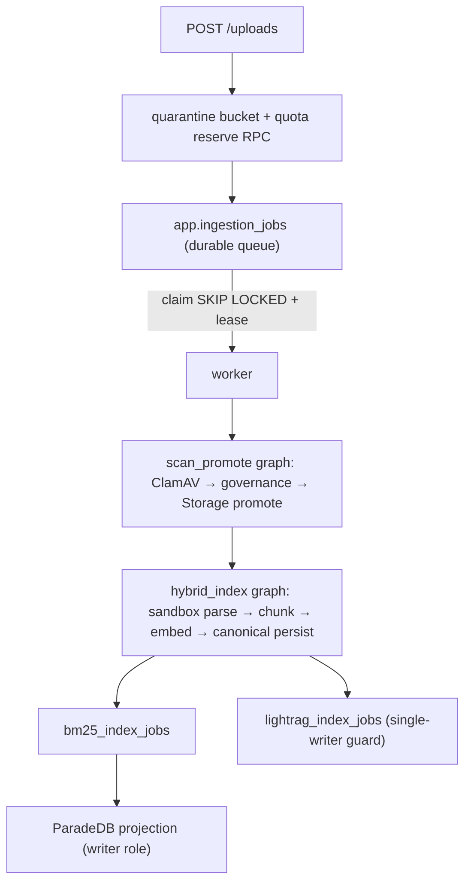

# System design review

Scope: topology, ingestion pipeline, retrieval pipeline, query execution/SSE,
data model, resilience, scaling, and structural code-health of the monorepo.

## Executive summary

The architecture is a disciplined, evidence-first design: **Supabase Postgres is
the single source of truth**, ParadeDB is a rebuildable private projection,
LightRAG graph output is steering-only, and every retrieval channel is re-checked
against canonical ACL state before it can become evidence. Durable SQL queues
with `SKIP LOCKED` claims, leases, and checkpoint resume make ingestion
restart-safe. Import boundaries are contract-tested.

Two findings deserve priority:

1. **`app.run_events` schema drift (High)** — the Python SSE event catalog
   contains event types (`tool_progress`, `answer_origin`) that the Postgres
   `CHECK` constraint does not allow. Inserting any catalog-only type would fail
   at the DB layer today.
2. **Query execution is bound to a single API process (High for scaling)** — the
   live-run registry is in-memory, so a second API replica cannot attach to or
   resume another process's stream. Fine at current scale; a documented
   sticky-session or lease-based claim pattern is needed before horizontal
   scaling.

God-module size (`index_graph.py` 1,131 lines, `graph_index_service.py` 1,458,
worker `lifecycle.py` 1,054) is the main maintainability risk.

## Topology

- Deploy units: `frontend`, `api`, `worker` (Compose profile `compose-worker`),
  plus private `paradedb`, `valkey-cache`, `valkey-limits`, `crawl-proxy`,
  `clamav`. The `apps/agents` Dockerfile is build/Library-only — there is no
  `agents` service, which is correct per boundaries but worth documenting.
- **No HTTP between worker and API** — all ingestion coordination is a durable
  SQL queue (`app.ingestion_jobs`), so the two deploy units scale independently.
- LangGraph query runs execute **inside the API process**
  (`LangGraphQueryRunExecutor` wired in `main.py` lifespan, ~187-201).

## Ingestion pipeline

Verified properties:

- **Durability**: job state, leases, and the operation ledger live in Postgres;
  parsed bytes are deliberately excluded from checkpoint state (documented in
  `apps/agents/src/smart_rag_agents/ingestion/index_graph.py` TypedDict docs).
- **Idempotency**: chunk IDs are deterministic UUID5
  (`ingestion/chunking/stable_id.py:15-73`); graph resume with patched lease
  token (`worker/lifecycle.py:266-328`); terminal-success checkpoints skip
  re-invocation.
- **Admission control**: pending-cap, size-cap, and daily budget reservations
  (`jobs/admission.py:35-92`).
- **Failure/retry**: heartbeat leases (`ingestion_repository.py:181-197`),
  crash reclaim via claim RPC, BM25 reconcile path for stuck jobs
  (`worker/bm25_runner.py:44-54`).

## Retrieval pipeline

Entry: `HybridRetriever.retrieve` (`retrieval/hybrid_run/retriever.py:99-123`).

1. Frozen profile JSON, SHA-pinned (`retrieval/frozen_profile.py:28-37`).
2. Budgeted query embedding (`hybrid_run/budget.py:counted_retrieve_send`).
3. Parallel channels — dense (pgvector), BM25 (ParadeDB), exact/trigram term —
   each on its own Postgres connection (`retriever.py:153-157`;
   `hybrid_run/jobs.py:37-83`).
4. **Mandatory ACL recheck**: ≤300 BM25 IDs → ≤75 authorized survivors
   (`retrieval/recheck.py:20-38`). BM25 outage/version mismatch degrades the
   channel to dense + term with a typed reason (`retrieval/bm25.py:171-200`).
5. **Fusion**: weighted RRF (k=60), max-across-variants, bounded metadata
   factors (`retrieval/fusion.py:63-81,135-177`; caps in `profiles.py:24-28`).
6. **Rerank**: one-shot OpenAI top-20, 10s slice budget (`profiles.py:47-49`).
7. **Cache**: Valkey holds ID/rank sets only; hits still recheck ACL
   (`cache_store.py`, `cache_lookup.py:46-96`).

Graph retrieval (`retrieval/graph_retriever.py`) resolves LightRAG vendor leads
through Supabase mappings with survival-ratio thresholds — global graph output is
steering only, never direct evidence.

## Query execution and SSE

- Admit → optional immediate SSE or 202 + resume by `Last-Event-ID`
  (`routers/conversations.py:428-517`).
- **Persist-then-flush** event pipeline; one terminal per run enforced by a
  partial unique index on `app.run_events (run_id)`; CHECK allow-list on
  `event_type` (`20260816200000_query_run_events_v1.sql:13-40`).
- Heartbeats every 15s (`sse/run_heartbeat.py:33-53`); settlement true-up once
  per run (`sse/run_settlement.py:97-98`); answer persistence off the SSE path.
- Mapping strips sensitive keys and holds draft answers until verify
  (`services/sse/mapping/mapper.py:62-84`).

## Data model highlights

- `documents` ↔ `document_versions` (1:N) with a single transactional
  `current_version_id` pointer and RESTRICT; `graph_eligible` requires
  company-visible + current version (CHECK).
- `conversations` → `messages`, `runs` (idempotency key unique) → `citations`,
  `user_feedback`.
- Job family: `ingestion_jobs`, `bm25_index_jobs`(+versions), `lightrag_index_jobs`,
  `dead_letter_jobs`.
- LightRAG mapping tables (`lightrag_source_map`, `lightrag_chunk_map`,
  `graph_evidence_map`) keep graph answers resolvable to canonical chunks.

## Verified strengths

1. **Canonical vs derived separation** — Supabase holds chunks/vectors/ACL;
   ParadeDB is a projection that is always revalidated; caches are advisory.
2. **Durable, restart-safe ingestion** — SQL claims + leases + checkpoint resume
   with lease-token patching.
3. **Frozen retrieval profiles** — pinned SHA; deterministic fusion formulas.
4. **SSE safety** — persist-then-flush, allow-listed types, terminal freeze,
   resume cursor.
5. **Security-oriented Compose** — private networks, no host ports for data
   services, non-root containers.
6. **Import-boundary contract tests** (`tests/contract/test_import_boundaries.py`)
   enforce `backend → agents + core`, `worker → agents + core`, core imports
   nothing from apps.
7. **Bounded warm pools for Ask latency** (`services/api_postgres_pool.py:34-44`).

## Weaknesses and risks

| ID | Severity | Finding | Evidence |
| --- | --- | --- | --- |
| SYS-1 | High | **SSE event-type drift**: Python catalog (`ALLOWED_SSE_EVENT_TYPES`) includes `tool_progress` and `answer_origin`, but the `app.run_events` CHECK constraint does not. Persisting those types fails at the DB layer; nothing amends the CHECK in later migrations | `packages/core/src/smart_rag_core/sse/catalog.py:13-33` vs `20260816200000_query_run_events_v1.sql:13-31` |
| SYS-2 | High (scaling) | **Live runs are process-local**: `QueryRunRegistry` keeps executors in memory; resume/attach assumes the same process owns the run. Multiple API replicas need sticky sessions or a lease-based claim | `services/sse/registry.py:67-75`; `services/sse/run_orchestration.py:69-73` |
| SYS-3 | Medium | **God modules**: `index_graph.py` (1,131 LOC), `graph_index_service.py` (1,458), worker `lifecycle.py` (1,054) concentrate orchestration, making review and testing harder | file sizes |
| SYS-4 | Medium | **Dual local-worker story**: Compose worker profile vs host script both documented as valid ingestion drivers — operational ambiguity | `docker-compose.yml:289-290`; `docs/architecture/02-containers.md:25-36` |
| SYS-5 | Medium | **Single ParadeDB instance** (fallback exists, but BM25 coverage is lost cluster-wide during outage windows) | `docker-compose.yml` (one service) |
| SYS-6 | Medium | **Per-process LightRAG adapter** — session pools multiply with API/worker replicas; memory footprint per process | `main.py:191-195`; `worker/lifecycle.py:121-128` |
| SYS-7 | Low | `apps/agents/Dockerfile` exists but is not a deploy unit — document it as build-only to avoid a "missing fifth service" reading | `docker-compose.yml` (no agents service) |
| SYS-8 | Low | Postgres connection budget is hand-computed against tier limits — no CI check when pool sizes or replica counts change | `api_postgres_pool.py:6-11`; `docs/architecture/05-database-connections.md` |

## Recommendations

1. **Fix the CHECK drift now (SYS-1)** — expand-only migration adding the missing
   event types to `app.run_events_type_allowed`, plus an integration test that
   appends every catalog type through `RunEventStore`. This is the only finding
   that can produce runtime 500s on a code path that already exists.
2. **Design multi-API execution before scaling (SYS-2)** — either document
   sticky-session as a hard requirement at the load balancer, or move run
   execution behind a lease-based claim row (`query_run_worker` pattern mirroring
   ingestion jobs) so any API can replay from `run_events` while only one
   executes.
3. **Split the god modules (SYS-3)** — break `index_graph.py` into core-invoked
   steps (parse/chunk/embed/persist) with thin LangGraph nodes; split
   `graph_index_service.py` by phase (claim/index/map/finalize).
4. **One documented local-ingest path (SYS-4)** with health gates linked from the
   root README.
5. **CI connection-math check (SYS-8)** recomputing pool totals when
   `ADMISSION_POOL_MAX_SIZE`, `RUN_POOL_MAX_SIZE`, or replica counts change.
6. Surface BM25 degradation and cache recheck events into run diagnostics
   payloads for ops dashboards (hooks already exist in `cache_store.py:69-75`).

## Verification commands

- `uv run pytest tests/contract/test_hybrid_index_enqueue.py tests/contract/test_structured_table.py -q`
- `uv run python scripts/check.py --tier fast`
- Manual: append every `ALLOWED_SSE_EVENT_TYPES` entry through `RunEventStore`
  against a migrated database to expose SYS-1.