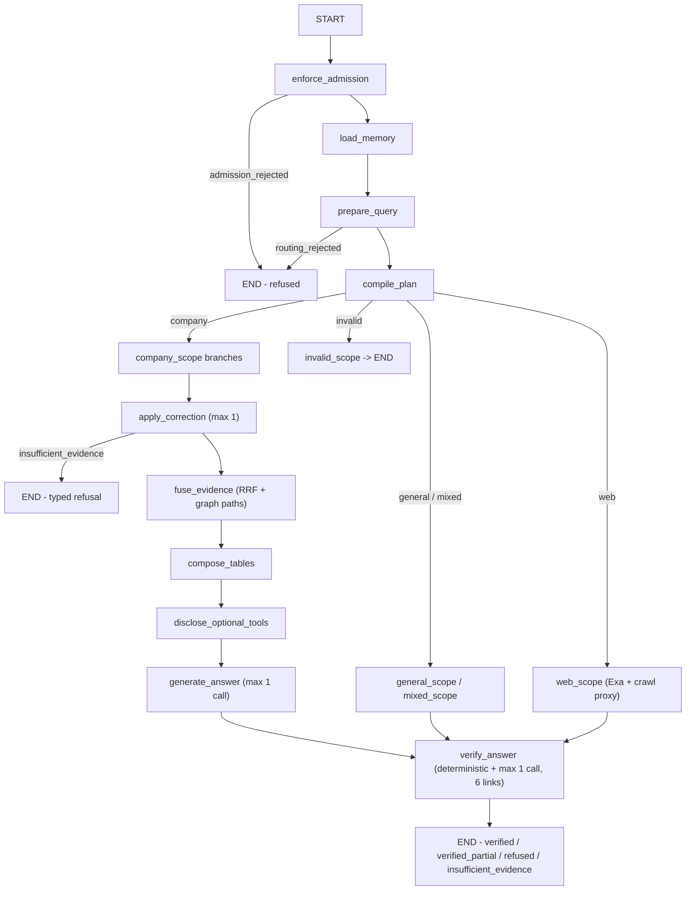

# Agent brain review — the query reasoning layer

Scope: `apps/agents/src/smart_rag_agents/query/**`, `apps/agents/src/smart_rag_agents/prompts/**`,
and supporting domain logic in `packages/core/src/smart_rag_core/query_routing/**`,
`query_answer/**`, `query_fusion/**`, `query_admission/**`, `retrieval/rerank.py`.

## Executive summary

The "brain" is a **deterministic, budget-bounded pipeline with LLM islands**, not an
open-ended agent. That choice is deliberate and mostly right for an
enterprise citation product: routing is reproducible, model calls are capped
(≤1 profile, ≤1 answer, ≤1 verifier), every terminal state is typed, and grounding
is enforced by deterministic citation checks plus one bounded verifier pass.

The largest weakness is **not** the architecture — it is **eval-set scaffolding
baked into four layers** (prompts, retrieval promotions, answer salvages,
verify-loop salvages). Roughly a thousand lines and several prompt rules exist to
answer specific known-answer benchmark questions about the demo corpus (ADAS
defaults, PSI retrain thresholds, autonomy mode labels, chunking window values,
protocol names, helper-function names). Each is extractive (so grounding is
preserved), but none of it generalizes to a new corpus or a re-phrased question,
and it silently inflates the 100-question baseline relative to what the general
pipeline achieves alone.

Verdict: strong safety spine, brittle intelligence. The highest-leverage work is
to replace per-question scaffolding with a general extractive-answering mode and
to give the brain a few adaptive behaviors it currently lacks.

## The actual state machine

Compiled from `apps/agents/src/smart_rag_agents/query/graph.py:170-216` and
`nodes/topology.py`:

Key invariants verified in code:

- **Admission first**: `nodes/admission.py` gates paid runs; every later node
  calls `skip_closed_nodes(state)` (`nodes/shared.py`), so a closed run can never
  spend money or stream an answer.
- **One correction only**: `nodes/correction.py:170-195` — a single retry or a
  single Hybrid→Combined escalation, never both, matching the plan contract
  (`CORRECTION_CEILING = 1`; a second attempt raises `correction_loop`).
- **One answer call**: `nodes/answer.py` and `gateway/answer.py:130-149` build one
  `AnswerModelRequest`; there is no regeneration loop (`MAX_ANSWER_GENERATIONS = 1`).
- **One verifier call, six links max**: `nodes/verify.py:199-238`,
  `gateway/verifier.py` enforces `MAX_VERIFIER_LINKS`; a seventh link is omitted,
  forcing `verified_partial` (`nodes/verify.py:304-314`). There is no
  verify→answer or verify→retrieve edge — `verify_answer` is always terminal
  (`graph.py:213`).
- **Deterministic routing**: `nodes/plan.py` compiles the plan from
  `query_routing/matrix.py` with **zero** model calls; `prepare.py` shares one
  structured rewrite+profile call (`preparation.py:166-260`), and deterministic
  signals can classify without any model call at all
  (`preparation.py:91-128`, `signals.py`).

Model-call envelope (Hybrid family): the reservation allows 7 counted calls and
a 25s deadline (`query_routing/envelopes.py:36-44`) — that headroom is for
embedding + rerank within retrieval; the *generation* stages remain ≤1 profile,
≤1 answer, ≤1 verifier.

## What the brain does well

1. **Typed failure vocabulary.** Statuses are enumerated and terminal:
   `admission_rejected`, `routing_rejected`, `insufficient_evidence`, `verified`,
   `verified_partial`, `refused`. Refusals are typed, not guesses — the product
   promise ("answers or stops") is enforced in code, e.g. `nodes/verify.py:299-314`
   and the refusal-rendering in `query_answer/release.py`.
2. **Budget honesty.** Every model call consumes a durable reservation
   (`query_admission/usage.py`, `execute_counted_model_call`), token counts are
   accumulated per stage (`nodes/tokens.py`), and settlement trues-up provider
   numbers (`nodes/verify.py:344-357`). Deadline exhaustion degrades to
   `verified_partial` rather than fabricating success.
3. **Grounding discipline.** Claims must cite canonical chunk IDs; invented IDs are
   filtered (`gateway/answer.py:35-70` → `query_answer/generate.filter_invented_ids`);
   the deterministic check (`query_answer/deterministic.py`) plus the bounded
   verifier (`verifier_v2.md`) reject uncited claims; company answers without
   persisted paragraph mappings become refusals, never uncited prose
   (`nodes/verify.py:112-119`).
4. **Prompt-injection hardening.** `answer_v4.md:16-17` treats every source record
   as untrusted data inside `<<untrusted-source>>` delimiters, and the same
   instruction family appears in the verifier prompt. Memory records are also
   delimited as untrusted (`nodes/memory.py:71-99`).
5. **Prompt versioning.** `prompts/registry.py` pins SHA-256 per version with
   fail-closed unknown ids; 18 versioned prompts exist with a changelog.
6. **Fail-closed degradation.** Missing gateway, schema-invalid verifier JSON,
   verifier timeout, or citation persistence failure all degrade to
   `verified_partial`/`insufficient_evidence` with a machine-readable detail —
   never to a confident-sounding wrong answer (`nodes/verify.py:105-119`,
   `320-337`).
7. **Conversation memory is bounded and privacy-correct.** Creator-only,
   capped record loads plus a compact store summary injected as a single
   untrusted system record (`nodes/memory.py:70-99`).

## Weaknesses and risks

### W1 — Eval-set scaffolding baked into four layers (High, generalization risk)

Evidence of question-specific handling for known benchmark items:

| Layer | File | Evidence |
| --- | --- | --- |
| Prompt | `apps/agents/src/smart_rag_agents/prompts/answer_v4.md:33-45` | "When the question asks which mode labels to expose…", "…named example's default model and temperature (ADAS, LLMAgentBase)…", "…`window_size` and `overlap`…" — bespoke answer-shape rules for specific eval asks |
| Retrieval | `packages/core/src/smart_rag_core/retrieval/rerank.py` | Named code-definition and named table-caption promotions only (question-specific `promote_*` helpers removed in G1b). |
| Answer | `packages/core/src/smart_rag_core/query_answer/generate_grounded.py:45-131, 613-1015, 1394-1478` | Gold regexes (`_ADAS_MODEL_GOLD`, `_PSI_RETRAIN_GOLD`, `_PROTOCOL_GOLD`, `_CHUNKING_GOLD`, `_TOOL_DESCRIPTION_GOLD`, `_METHOD_LABEL_GOLD`) and ~11 `salvage_*` functions applied at `:1777-1849` |
| Verify | `apps/agents/src/smart_rag_agents/query/nodes/verify.py:249-296` | The same salvage loop re-runs inside the verify node to rescue refusals |

Consequences:

- The 37/100 strict-substring baseline and later eval improvements partly measure
  the scaffolding, not the pipeline. A new corpus or paraphrased question gets
  none of it.
- ~1,000+ lines of high-churn, low-reuse code sit in the hot path of every
  company answer (`generate_grounded.py` is ~1,900 lines; `rerank.py` ~1,900).
- Salvages run after verification rendering, adding failure modes the verifier
  prompt does not know about (mitigated today by re-rendering and strict
  exception handling at `verify.py:269-296`, but each new eval item adds another
  branch to test).

Recommendation: replace with a **general extractive-answer mode** — when the
profile classifies a query as literal/lookup-style (`rerank.py:807` already has
`literal_anchor_ask`), deterministically select the best evidence span and emit it
verbatim as the first claim, independent of model phrasing. That single mechanism
covers the majority of the per-question salvages. Keep the eval-specific salvage
list behind a deprecation flag and measure its removal on the holdout before
deleting.

### W2 — Intent detection is regex-brittle for anything but greetings (Medium)

`query_routing/signals.py:9-70` and `knowledge_scope.py:354-470` classify scope
and routes via fixed English/Arabic regexes (`_GRAPH_INSPECT`, `_CORPUS_THEME`,
`_PAST_REL`, `_REL_HINT`, …). The one structured prep call can override, but
only when `_needs_model` (`preparation.py:91-128`) decides a call is justified —
and several of those triggers are themselves regex-based. Consequences: "who
depends on the billing service?" matches `_REL_HINT`; "which team is responsible
for invoicing?" may not. Scope classification priority is deterministic-signals
first, model second (`knowledge_scope.py:388-460`), so a stale regex can force
`AMBIGUOUS` even when the model would have classified correctly.

Recommendation: invert the priority for live traffic — trust the structured
model payload unless a **company** signal fires (the security-critical direction),
and keep regexes only as the fallback when the profile call is unavailable. Add a
monthly misclassification sample review from persisted profile fields
(`query_profile/models.py` already stores what is needed).

### W3 — No query decomposition execution for multi-hop (Medium)

The prep payload can carry up to three subquestions
(`preparation.py`, `REQUIRED_PREPARATION_FIELDS`; matrix rejects the fourth in
`compile_plan`), and multi-hop answers are verified link-by-link — but there is
no per-subquestion retrieval loop: branches are planned once, executed once, and
corrected once. Long chains that need sequential evidence (A to find B, B to find
C) rely on the Combined route's graph expansion rather than iterative retrieval.

Recommendation: a bounded "decompose-then-retrieve" branch family for
`inference`-shaped questions: execute subquestion 1, extract its answer entities,
and inject them as seed terms for subquestion 2 — within the existing budget
envelope. This is the standard fix for the multi-hop ceiling and fits the
existing branch-scheduler design (`query_routing/branch_scheduler.py`).

### W4 — Verifier cap can silently truncate long chains (Medium)

`MAX_VERIFIER_LINKS = 6` (`query_answer/versions.py`) and links beyond six are
omitted (`gateway/verifier.py:57-59` forces a batch-cap error path;
`nodes/verify.py:304-314` downgrades to `verified_partial`). A legitimate
8-link comparison answer is structurally incapable of reaching `verified`.

Recommendation: either raise the cap for table/comparison routes (budget still
guards cost), or summarize omitted links in the UI with a "show why partial"
affordance. The frontend already renders limitations; the missing piece is
surfacing *which* links were dropped.

### W4b — Optional tools execute but never feed the answer (Medium)

`disclose_optional_tools` may select and execute allow-listed side-effect-free
tools, writing `optional_result` onto graph state
(`nodes/optional_tools.py:192-196`). `generate_answer` then runs — and **never
reads `optional_result`** (verified by grep: the field is written and declared in
`state.py:119-123` only). Tool output reaches the user only as streamed progress.
Either wire optional tool results into the answer source records (as untrusted,
delimited inputs like every other source) or move disclosure after the answer so
the ordering matches reality.

### W4c — Model `ambiguous` degrades to General instead of mixed retrieval (Medium)

When the single prep call returns `ambiguous`, `classify_knowledge_scope` routes
to `GENERAL_KNOWLEDGE` with a degradation reason
(`knowledge_scope.py:487-493`); only deterministic company∧general conflicts
become a `mixed_scope` clarification ask (`knowledge_scope.py:404-409`). So
genuinely ambiguous live questions silently lose company evidence instead of
asking one clarifying question or running both scoped retrievals.

### W4d — Short follow-ups skip the profile call (Medium)

`_needs_model` returns False for ≤4-word factual queries when memory exists
(`preparation.py:118-119`), so "who owns it?" after a topic switch relies on
deterministic extraction alone. Follow-up resolution then depends on whether
the memory loader's company-signal regex fires. Consider treating "short query
+ memory" as always-model (the call is cheap and already reserved).

### W4e — No multilingual answer policy in the prompts (Low)

Extraction and retrieval are Arabic-aware (`extract.py:85-91`, `arabic_norm_v1`
on BM25), but `answer_v4.md` has no "reply in the user's language" rule — the
answer language tracks the prompt's English instructions and whatever the model
infers. Add a language field to the profile payload and a reply-language rule to
`answer_v5`.

### W4f — Web scope bypasses the optional-tools stage (Low)

`web_scope` edges directly to `verify_answer` (`graph.py:198-201`), so web runs
never see tool disclosure/progress parity with company runs. Probably fine, but
worth an explicit comment in the graph so future tool additions don't assume
uniform coverage.

### W5 — General/web scopes skip the citation benefits (Medium)

`general_scope` and `web_scope` answers are verified only against web excerpts or
model priors; company citations are stripped for web answers
(`nodes/verify.py:364-380`). That is correct for scope isolation, but general
answers carry **no provenance at all** — the user cannot distinguish "model
prior" from "documented fact" inside a General turn.

Recommendation: label general answers with an explicit "model knowledge, no
company evidence" banner in the answer payload (a field exists:
`answer_origin`), and consider optional web grounding for general turns when
the Web flag is enabled.

### W6 — Memory is load-only in the graph (Low)

`nodes/memory.py` loads records and a stored summary, but the graph never writes
a post-turn summary itself in the query path (summary generation lives in
conversation tooling). Long conversations rely on whatever the store already has;
follow-up quality degrades silently when no summary exists.

Recommendation: after a settled run, enqueue a bounded summary update job
(worker-side) so the next turn's memory is fresh — the compact-store read path is
already implemented (`nodes/memory.py:80-99`).

### W7 — Scope UX is all-or-nothing per turn (Low)

One scope per turn (Auto/Company/General/Web) is enforced at admission. A
question like "compare our policy with the industry standard" becomes `mixed`
only when signals fire; otherwise it lands in one scope and the other half of the
question is answered from memory or refused.

Recommendation: treat `mixed_scope` as first-class in the UI (it exists in the
graph) and let Auto route emit a two-part answer with explicit provenance labels.

## Scorecard

| Dimension | Rating | Notes |
| --- | --- | --- |
| Grounding & citation integrity | ★★★★★ | Deterministic checks + bounded verifier; refusals typed |
| Determinism & auditability | ★★★★★ | Frozen route matrix, prompt hashes, per-stage telemetry |
| Cost discipline | ★★★★★ | ≤3 model calls/run, durable reservations |
| Robustness / fail-closed | ★★★★☆ | Excellent; verifier cap and salvage loops add complexity |
| Generalization (new corpora) | ★★☆☆☆ | Eval-specific scaffolding across four layers |
| Intent understanding | ★★★☆☆ | Regex-first classification; one structured call exists but is gated |
| Multi-hop reasoning | ★★☆☆☆ | Planned but not executed iteratively |
| Conversation memory | ★★★☆☆ | Bounded loads + summaries; no post-turn summarization in graph |

## Verification commands

- `uv run python scripts/check.py --tier fast` — lint/types/unit gates.
- `uv run pytest tests/unit/test_query_node_bindings.py tests/unit/test_answer_verifier_integration.py -q` — node wiring and verifier integration.
- Re-run the company-documents Ask baseline with salvage functions feature-flagged off to quantify W1's effect on the strict-substring metric.