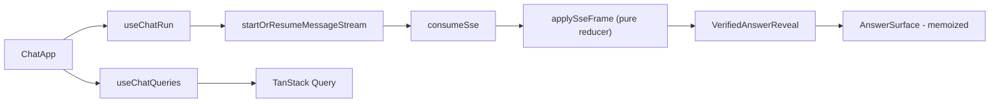

# Frontend review — `apps/frontend`

Scope: App Router structure, chat/SSE experience, state management, UX flows,
accessibility, performance, error handling, and test coverage. Next.js 16.3.3 /
React 19.2.8 / TanStack Query 5.85.5.

## Executive summary

The frontend is a **security-conscious, well-tested streaming client**. The SSE
stack is the strongest part: pure reducer, monotonic sequences, terminal freeze,
stale-run frame filtering, unverified-token rejection, bounded reconnects, and
resume by event ID. Content rendering keeps a hard no-`dangerouslySetInnerHTML`
discipline with hostile-text fixtures and prohibited-pattern tests in CI.

The main gaps are **App Router resilience primitives** (no `error.tsx`,
`loading.tsx`, `not-found.tsx` anywhere) and **chat performance hygiene**: the
Ask page mounts the data-hook twice, streaming token batches re-render the
whole chat stage, and two render-phase `setState` calls violate React 19
strictness. None are functional bugs; all degrade polish and long-conversation
performance.

## Architecture summary

| Layer | Path | Role |
| --- | --- | --- |
| Root | `src/app/layout.tsx` | HTML shell, providers (Query + session) |
| Auth group | `src/app/(auth)/*` | login, signup, reset, callback (PKCE), invitation accept |
| Console group | `src/app/(console)/*` | `/` chat, `/documents`, `/tables`, `/graph`, `/admin`, `/account` |
| Route gate | `src/proxy.ts` | Supabase cookie refresh + redirects (explicitly **not** the security boundary) |
| Redirect pages | `team`, `tools`, `curation`, `usage`, `profile` | Redirect to `/admin?tab=…` or `/account` |

Chat/SSE pipeline:

- Transport: `lib/api/sse.ts` (POST admit + GET resume, Bearer, idempotency key).
- Framing: `lib/sse.ts`; consumption: `lib/sse-consume.ts` (run-id filtering,
  batched `onState`, terminal exit).
- Reducer: `lib/chat-view.ts` — `token_delta` is only applied after
  `verificationCompleted` (verified-answer reveal contract).
- Rendering: `answer-surface.tsx` (paragraph split, prose, tables, code blocks),
  citations via `citation-drawer.ts` (company citations have no `href`; web
  citations pass `isSafeHttpUrl`).

## What is done well

1. **Security-first content rendering** — `answer-prose.tsx` documents and
   enforces no `dangerouslySetInnerHTML` (lines 4-6); `safe-text.ts` strips NULs
   and blocks `javascript:`/`data:` URLs (49-68); citation storage URLs never
   become `href`s; CI tests include prohibited patterns and hostile fixtures.
2. **SSE correctness** — sequence monotonicity + terminal freeze
   (`chat-view.ts:294-311,396-421`); stale-run frame drop (`sse-consume.ts:36-48`);
   unverified token rejection (`chat-view.ts:374-377`); bounded reconnect policy
   (`stream-reconnect.ts:6-9,68-70`).
3. **Classified API errors** — `ApiFailure` union + sanitized copy
   (`lib/api/errors.ts:76-87`), surfaced through banners and an assertive
   `LiveRegion`.
4. **Auth contract clarity** — `client-authorization.ts` documents that nav
   hiding ≠ authorization; skip link + `#main` landmark in `app-shell.tsx:38-59`;
   proxy fail-closed without Supabase env (`proxy.ts:7-9,50-78`).
5. **Handshake before paid work** — `evaluatePaidHandshake` gates the composer;
   resume GET is exempt by design.
6. **Test depth** — ~97 unit/integration files plus Playwright suites
   (a11y-security, SSE fixtures, phase-08 journeys, visual snapshots). SSE libs
   and chat hooks are heavily covered.
7. **Accessibility primitives** — `live-region`, `focus-trap`, drawer focus
   restore, roving tabs, scope `radiogroup` in the composer.
8. **Perf isolation where it counts** — `@xyflow/react` is dynamically imported
   for the graph explorer (`graph-explorer.tsx:29-31`); `AnswerSurface` is
   memoized.

## Weaknesses and gaps

### Route resilience (High)

| ID | Finding | Evidence |
| --- | --- | --- |
| FE-1 | **No `error.tsx` / `loading.tsx` / `not-found.tsx`** anywhere in the app — unhandled RSC/render throws fall through to Next's generic UI; document 404s are not a dedicated route | glob: 0 matches |
| FE-2 | Weak Suspense fallbacks — plain `
Loading…` on documents/graph/tables pages; blank-flash `fallback={null}` on admin | `documents/page.tsx:14`; `graph/page.tsx:14`; `tables/page.tsx:14`; `admin/page.tsx:14-15` |

### Chat performance (High)

| ID | Finding | Evidence |
| --- | --- | --- |
| FE-3 | **Ask page instantiates the data hook twice** — `useChatQueries` at `chat-app.tsx:50-55` and again at `69-77`, duplicating `useCurrentUser`, 15s readiness polling, meta, conversations, and message subscriptions | verified by grep (lines 50 and 69) |
| FE-4 | **Streaming re-render scope** — every visible token batch calls `setChat`; `ChatStage` is not memoized, so composer, header, and run-details re-render per batch despite `AnswerSurface`'s memo | `start-chat-send.ts:92-96`; `chat-stage.tsx:102+` |
| FE-5 | **Render-phase `setState`** in `chat-app.tsx` (`loadingEarlier` 124-126, `sessionRevoked` 137-138) and `use-verified-answer-reveal.ts:79-80` — fragile under Strict Mode / React 19 | verified lines |

### State and data fetching (Medium)

| ID | Finding | Evidence |
| --- | --- | --- |
| FE-6 | Global `retry: false` for all queries — transient network blips need manual refresh everywhere | `providers.tsx:20-23` |
| FE-7 | Duplicate `fetchMe` observers (`AppNav` vs chat `useCurrentUser`) and minimal `staleTime` tuning → extra `/me` + readiness traffic | `app-nav.tsx:88-92`; `use-console-readiness.ts:40` |
| FE-8 | No optimistic updates (`setQueryData` unused) — conversation create/delete feels slower than necessary | grep: 0 matches |

### UX flows (Medium/Low)

| ID | Finding | Evidence |
| --- | --- | --- |
| FE-9 | Reconnect status rendered in **two places** (banner + composer) — duplicate copy, chatty live-region announcements | `chat-banners.tsx:79-88`; `chat-composer.tsx:107-113` |
| FE-10 | `/invitations/accept` is not in `PUBLIC_EXACT` paths — deep links always hit login first (possibly intentional; confirm) | `lib/auth/paths.ts:5-15` |
| FE-11 | `LiveRegion` sanitizes string children only — non-string children bypass `displayText` | `live-region.tsx:38` |
| FE-12 | Admin errors are plain strings, less structured than chat's `ApiFailure` | `lib/api/admin-errors.ts:18-49` |

### Design system (Low)

| ID | Finding | Evidence |
| --- | --- | --- |
| FE-13 | Dual styling systems — Tailwind 4 imported globally, but most UI is CSS modules + `design-tokens.ts` mirrored in `globals.css`; token drift is possible | `globals.css:1`; `lib/design-tokens.ts` |
| FE-14 | `(console)/layout.tsx:8-9` comment claims invitation-accept lives in console group — it lives under `(auth)` | verified comment |

### Test coverage holes (Low)

Well covered: SSE stack, chat hooks, answer surface, documents import, admin
surfaces, design tokens/CSP. Lighter: `chat-stage.tsx`, `chat-workspace.tsx`,
`citation-sheet.tsx`, `document-detail.tsx`, `command-menu.tsx`, `menu.tsx`.

## Recommendations (ranked by impact)

1. **Collapse the double data hook (FE-3)** — merge the two `useChatQueries`
   calls into one hook parameterized by `runId`/`terminal`/citation-sheet state.
   Stops duplicate `/me`, readiness polling, and message subscriptions. (High)
2. **Isolate the streaming subtree (FE-4)** — split `ChatStage` so token-driven
   state feeds only the answer column + progress; memoize static chrome with
   stable props. (High)
3. **Add route boundaries (FE-1/2)** — `(console)/error.tsx`, `loading.tsx`,
   `not-found.tsx`; skeletons + live-region loading text instead of bare `
`.
   (High)
4. **Move render-phase `setState` into effects/handlers (FE-5)**. (Medium)
5. **Per-domain query defaults (FE-6/7)** — keep `retry: false` for mutations,
   allow `retry: 1` with short `staleTime` for `meta`/`me`/conversations; single
   `useCurrentUser` observer. (Medium)
6. **One reconnect surface (FE-9)** — banner or composer, not both; throttle
   live-region announcements; single Retry action wired to `run.reconnect()`.
   (Medium)
7. **Optimistic conversation list (FE-8)** with rollback on classified errors.
   (Medium)
8. Confirm the invitation deep-link policy (FE-10) and fix the layout comment
   (FE-14). (Low)
9. Component tests for `chat-stage` (scope lock while running, reconnect),
   `citation-sheet`, and document 404. (Low)

## Verification commands

- `pnpm --filter frontend test` (unit/integration)
- `pnpm --filter frontend exec playwright test tests/e2e`
- Manual long-conversation check: 50+ turn thread, watch re-render scope with
  React DevTools while streaming (FE-4).
