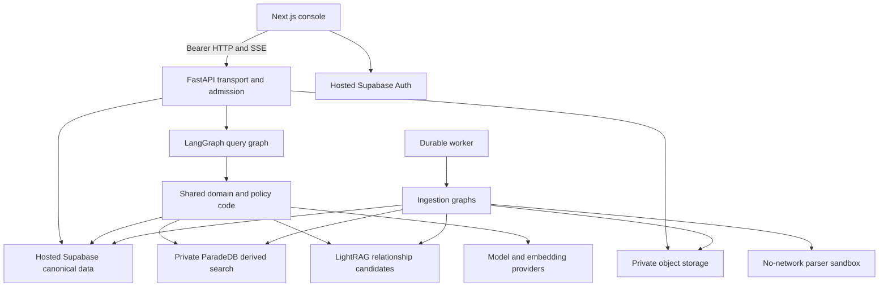

# Architecture and repository structure review

See [scope and evidence conventions](README.md). Verdict: **good top-level decomposition, uneven enforcement inside newer paths**.

## Current architecture

This diagram describes the major boundaries; it is not a proof of the deployed network topology. Figure materialization and PDF previews are exceptions to the intended parser boundary, discussed in SEC-02.

The deployables have sensible responsibilities:

- `apps/frontend`: presentation, session integration, HTTP/SSE clients, and browser-side state.
- `apps/backend`: authentication dependencies, transport schemas, endpoint controls, run admission, event persistence, and administrative services.
- `apps/agents`: query/ingestion topology and node orchestration.
- `apps/worker`: job polling, leases, heartbeats, and ingestion execution.
- `packages/core`: domain contracts, retrieval, policies, repositories, providers, table execution, evaluation, and release helpers.
- `supabase/migrations`: database authority, RLS, RPCs, durable jobs, and budget primitives.
- `infra`: images, network/egress configuration, deployment and runtime infrastructure.

Useful entry points are `apps/backend/src/smart_rag_api/main.py`, `apps/agents/src/smart_rag_agents/query/graph.py`, `apps/worker/src/smart_rag_worker/lifecycle.py`, and `apps/frontend/src/components/chat/chat-app.tsx`.

## What is strong

1. **Boundaries are more than directory names.** Core retrieval has explicit canonical rechecks, table plans compile to parameterized SQL, and query nodes receive runtime dependencies rather than constructing every dependency in graph topology.
2. **Import-time work is intentionally limited.** Backend sockets and provider bindings belong in lifespan. The graph compiles independently of network clients, making deterministic testing practical.
3. **The project has explicit contracts.** Typed settings, Pydantic payloads, immutable result models, route matrices, plan checks, ADRs, and unit/contract suites provide a reviewable framework.
4. **Derived search is not final authority.** ParadeDB and graph output lead back to canonical evidence checks. Preserve this separation during optimization.

## AR-01 — P2: core contains too many operational concerns

**Evidence: confirmed structure.** `packages/core/src/smart_rag_core` includes domain code alongside `evaluation`, `release`, `generated`, ingestion infrastructure, provider clients, and database repositories. The inventory found 491 source-like files and about 137,769 lines, including 7,969 generated TypeScript lines. Several individual runtime modules exceed 1,500 lines, including `retrieval/lightrag_adapter.py` and `retrieval/rerank.py`.

**Impact:** dependency direction remains broadly understandable, but the “core” label no longer tells a maintainer what is lightweight domain code versus operational tooling. A change to shared settings or provider behavior has a large review surface. Large runtime modules make it harder to establish which layer owns a fallback.

**Recommendation:** define internal layers before moving files: pure contracts/policies, application services, adapters, and offline evaluation/release tools. Enforce import direction with a small architecture check. Move offline utilities only where that removes a real deployment dependency or ownership ambiguity. Do not do a sweeping monorepo rewrite just to reduce file counts.

**Acceptance:** a documented dependency map and automated checks that domain contracts do not import infrastructure, application packages, or offline release tooling.

## FE-01 — P2: existing composition boundary is over budget

**Evidence: reproduced.** `apps/frontend/src/lib/architecture-budget.test.ts:26` permits 320 physical lines for `components/chat/chat-app.tsx`; the current file has 344. This fails both the full and focused frontend test runs.

The component already uses extracted hooks, which is the right direction. However, it still coordinates session revocation, two query-hook instances, live run state, reveal animation, transcript history, scroll state, citation selection, and quiz capture.

**Recommendation:** extract one cohesive composition concern, such as citation/quiz panel composition or session/readiness coordination. Keep ownership explicit. Raising the threshold alone would hide the warning without reducing coupling.

**Acceptance:** the existing architecture test passes and conversation switching, source selection, history restore, and run cancellation retain their behavior.

## Boundary drift worth addressing first

- **AG-03 and SEC-01:** provider work can bypass durable accounting even though the rest of the architecture has an accounting boundary.
- **AG-01 and AG-02:** the answer is mutable after its verification and citation-persistence boundary.
- **SEC-02:** parser isolation is not consistently applied to figure/preview processing.
- **BE-02:** run execution ownership is process-local despite durable run/event storage.

These are more important than renaming directories. A small number of shared, mandatory execution wrappers would prevent more defects than additional documentation alone.

## Suggested ownership model

Assign one owner for each durable contract: identity, canonical document visibility, provider usage, run state/events, answer release/citation mapping, ingestion publication, and frontend session state. Changes crossing one of these boundaries should include the owner's acceptance checks. Presently the tests catch some drift, but newer paths can still implement their own variants.

## Questions remaining for a later architecture validation

- Does the deployed API run one process/replica, and what prevents an unintended second executor?
- What is the measured total Postgres session budget across API, query graph, checkpointer, graph adapter, and workers?
- Which core modules actually enter each production image, and which are operator-only?
- Can document visibility changes be proved across canonical retrieval, derived projections, cached IDs, historical citations, and preview reads in one integration scenario?

These are explicit verification gaps, not findings that the corresponding systems are currently broken.
