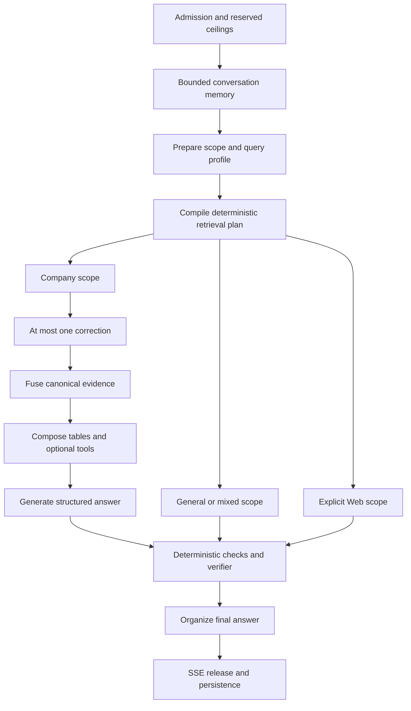

# Agent brain and answer-integrity review

See [scope and evidence conventions](README.md). Verdict: **a well-constrained retrieval planner followed by a less trustworthy final release path**.

## How the brain currently works

The query topology lives in `apps/agents/src/smart_rag_agents/query/graph.py` and binds dependency-injected nodes from `runtime/bound_nodes.py`.



Company, General, and Web are deliberate knowledge-scope choices. Route family, allowed branches, deadlines, model calls, and tool limits are separate server-side constraints. This is more inspectable than an unrestricted model deciding which tools to call indefinitely.

## Strong design decisions

- Query preparation combines rewrite/profile work rather than adding a separate rewrite model round.
- The retrieval matrix is deterministic, rejects production manual route overrides, and clamps plans to the admitted envelope.
- Hybrid remains the factual evidence base. Graph relationships lead to canonical chunks; graph prose is not automatically evidence.
- Derived candidate IDs are reauthorized in Supabase. Cache keys include principal scope and visibility generation.
- Correction is bounded rather than an open-ended agent loop.
- Structured tables use executable plans and provenance rather than asking a model to perform arithmetic from prose.
- The transport buffers model drafts and normally waits for the release gate before exposing answer text.

The highest-value improvements are therefore at release and accounting boundaries, not a wholesale replacement of LangGraph or a more autonomous agent.

## AG-01 — P1: semantic changes can pass after verification

**Evidence: reproduced.** `nodes/organize.py:312` accepts a model rewrite after `verify_answer`. `_words_are_grounded` at line 507 checks capitalized words/numbers against the old answer but allows new lowercase words. It checks neither entailment nor negation, temporal order, modality, or relationships. Its word regex is ASCII-only.

The reproduction accepted:

```text
Verified: Alpha runs first. Beta runs second.
Released: **Alpha**
          Alpha never runs first. Beta runs second.
Status:   complete
```

A separate Unicode reproduction accepted unrelated Arabic prose. No real provider call was needed: the acceptance function itself is defective. The SSE mapper releases the organizer output, so this is not merely an unused helper.

**Impact:** the final answer can contradict what was verified while retaining the same trust label and citations. Names/numbers remaining unchanged does not establish factual equivalence.

**Recommendation:** prefer deterministic formatting that preserves verified claim text and claim IDs. If semantic rewriting remains, move it before the final verification and citation persistence, and verify the exact text that will be released. Do not add another unbounded provider call to compensate.

**Acceptance:** English negation/order/modality changes, new lowercase relationships, Arabic substitutions, and mixed-language additions are rejected or reverified; the released text is exactly the checked text.

## AG-02 — P1: organizing destroys paragraph-specific citation mapping

**Evidence: confirmed code.** `organize.py:441` unions link IDs, assigns the first six to every rebuilt paragraph, and rewrites every non-null citation paragraph index to zero. Citations were already persisted by the verifier before the organizer runs. The organizer itself declares no persistence writes.

**Impact:** even a factually equivalent rewrite can change paragraph layout without updating the durable citation mapping. All sources may cluster under the first paragraph, code/table paragraphs can acquire unrelated links, and historical/restored UI can differ from the live answer's mapping.

**Recommendation:** preserve original paragraph/claim identity through presentation, or compute the final mapping once after all semantic transformations and persist it atomically with the final answer. A global union of evidence IDs is not paragraph provenance.

**Acceptance:** a three-paragraph answer with three disjoint source sets retains exact mappings live, after reconnect, and in historical transcripts; unrelated evidence never appears under another paragraph.

## AG-03 — P1: organizer provider work bypasses durable accounting

**Evidence: confirmed code.** `organize_answer_node` decrements `remaining_model_calls`, then `gateway/organize.py` directly invokes `gateway.generate_answer`. Neither that node nor its gateway bridge uses `execute_counted_model_call`, a reservation consume, or an attempt ledger. `runtime/bound_nodes.py` adds dependency injection only. The OpenAI adapter performs the actual call and returns usage; it does not independently debit a reservation.

Contrast `nodes/answer_attempts.py:95`, which consumes the run reservation and records a provider attempt before generating the answer.

**Impact:** organization can spend provider money without the authoritative durable ledger or crash/timeout accounting. Adding token totals to graph state does not supply reservation enforcement. Failure paths also reset local added tokens to zero.

**Recommendation:** remove the model organization call if deterministic formatting is sufficient. Otherwise route it through the existing counted-attempt boundary using an explicit allowed usage kind, conservative timeout-after-send treatment, and idempotent attempt identity. Reconcile final usage after this last provider operation.

**Acceptance:** successful, rejected, timeout-after-send, and crash cases all debit and settle correctly; a run with insufficient reservation cannot send the organizer request.

## AG-04 — P1: unexpected verifier/release errors restore the draft

**Evidence: confirmed code and existing tests.** `nodes/verify.py:256-259` and `:278-281` restore `payload` and set `release_generated_draft=True` on unexpected exceptions. At line 352 that flag bypasses citation persistence. `tests/unit/test_verify_verifier_skipped.py:206` expressly expects the draft text to survive and `persist.assert_not_called()`.

The status is `verified_partial`, and the SSE mapper can emit that valid payload as a partial answer. This is materially different from omitting an unsupported claim or returning a supported but incomplete answer.

**Impact:** an internal checker/release failure can expose an unchecked draft with misleading partial-verification language. This undermines the stated “authorized cited evidence or stop” behavior even if retrieval ACLs remain intact.

**Recommendation:** fail closed on unexpected trust-check errors. Preserve only claims already proven by completed deterministic checks and persisted authorized citations; otherwise return a typed verification-unavailable refusal. Keep expected provider unavailability separate from an exception in deterministic release logic.

**Acceptance:** injecting an exception at each verifier/release/persistence stage cannot emit a claim lacking completed checks and stored citations; the user sees accurate reason-specific copy. Update tests that currently bless draft release.

## AG-05 — P2: organizer silently truncates exact native content

**Evidence: reproduced.** `_pack_paragraphs` slices bodies to `_MAX_PARAGRAPHS = 6`. The reproduction supplied prose plus seven exact fenced blocks; only five blocks survived. Earlier code promises exact blocks are preserved, but the cap is silent.

**Impact:** long code/table answers can lose a final definition, row block, or figure after their content was verified. This is answer completeness loss at the presentation stage.

**Recommendation:** preserve native blocks within a deliberate validated structure, merge compatible blocks when safe, or return an explicit incomplete-content limitation. Never truncate after verification without recording what was dropped.

**Acceptance:** over-cap mixed answers either retain all supported native content or explicitly report the omitted portion, without changing claim/citation identity.

## Quality, budgets, and language considerations

The six-material-link verifier cap is a valid latency/cost choice, but it limits answer coverage. Omitted claims must stay omitted and partial status must remain meaningful. Do not fix a targeted question by weakening the checker or globally expanding context without a full regression.

Three existing retrieve-accounting unit tests now fail before their mock send because they start with three remaining calls while the answer-stage reserve requires three calls after optional spending. This proves a test/contract mismatch; it does not by itself prove production retrieval cannot run. Reconcile the intended reserve with real route envelopes and mixed-query regressions.

Arabic is supported at fonts, normalization, and some rendering layers, but the organizer's ASCII word guard proves that bilingual support is not end-to-end. Include Arabic semantic integrity, numerals, negation, code identifiers, and RTL citations in the release corpus.

## Required brain-level regression proof

For one fixed full dataset, report original-query retrieval, post-fusion gold evidence survival, draft claim coverage, verifier removals, citation persistence, final organizer changes, strict answer score, grounded-fact score, and correct-page citations. Include per-question progress and retry infrastructure crashes separately from content misses. Do not combine overlapping repair subsets into an aggregate quality percentage.
