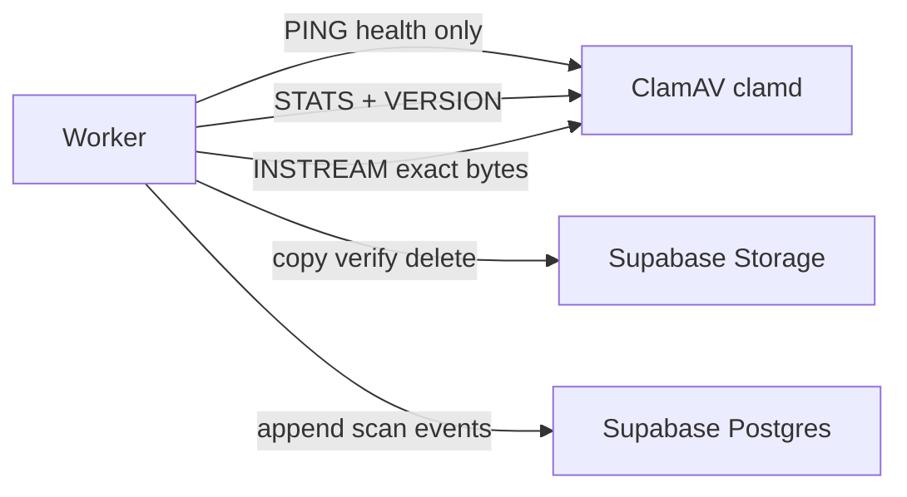

# ClamAV scan and Storage promotion runbook

Operational procedures for Phase 3 quarantine scanning, promotion saga recovery, and orphan cleanup.

Related: [INGESTION_LIMITS.md](../ingestion/INGESTION_LIMITS.md) · [Phase 3 evidence](../development/phase-03-ingestion-evidence.md)

## Components

| Component | Responsibility |
| --- | --- |
| `clamav` Compose service | Official `clamav/clamav:stable` with persistent `/var/lib/clamav` signatures |
| Worker scan graph | Lease-validated download → ClamAV INSTREAM → scan events → governance → promotion |
| `app.storage_promotion_sagas` | Resumable copy/verify/DB-switch/delete ledger |
| `app.list_quarantine_cleanup_candidates` | Never-finalized (>24h) and over-limit orphan selection |
| Storage Admin HTTP API | Copy/upload/delete only; never SQL-delete `storage.objects` as object management |

## Health checks



1. `PING` proves daemon responsiveness only; it is **not** scan readiness.
2. Before scan, read `VERSION` and `STATS`; reject signatures older than 24 hours.
3. Scan the exact downloaded object stream; never scan directories or caller paths.
4. Persist append-only `document_scan_events` including engine, signature ids/timestamps, config version, bytes examined, and result. `app_worker` needs both INSERT grants **and** RLS policies `document_scan_events_worker_insert` / `document_scan_events_worker_select`; a grant without a policy fails closed with `InsufficientPrivilege` and used to orphan the job lease.
5. Run metadata governance; extracted-text detectors arrive in Packet 5. Until then, real content requires reviewer approval and cannot enable external processing.
6. Promotion saga: intent → copy → verify hash/size → transactional DB switch → delete quarantine source.

## Signature update / staleness

| Step | Command / check |
| --- | --- |
| Verify image pin | `docker inspect clamav/clamav:stable --format "{{index .RepoDigests 0}}"` |
| Container health | `docker compose --env-file .env.compose exec clamav clamdcheck.sh` |
| Signature age | Worker `STATS` newest timestamp must be `<24h` |
| Fail closed | `stale_signature`, reload failure, or limit-skipped content stays quarantined |

Persistent signatures live on the `clamav_db` Compose volume. Recreate the volume only with an approved maintenance window; expect re-download time on first boot.

## Promotion crash recovery

| Crash after | Safe replay behavior |
| --- | --- |
| intent recorded | Re-run copy; same saga idempotency key |
| copy done | Re-verify destination hash/size |
| verify done | Re-run `complete_promotion_db_switch` (idempotent when already switched) |
| db switched | Re-delete quarantine source via Storage API |
| source deleted | Mark saga completed |

Investigate admin notifications `quarantine_accumulation` and `repeated_scan_failure` before manual intervention.

## Orphan cleanup

```bash
uv run pytest tests/contract/test_quarantine_cleanup.py -q
```

Cleanup uses `list_quarantine_cleanup_candidates` → Storage HTTP DELETE → `mark_quarantine_cleanup_done`. Idempotent retries are required.

## Local verification

```bash
docker compose --env-file .env.compose up -d clamav
uv run pytest tests/unit/test_clamav_client.py tests/contract/test_clamav_scan.py tests/contract/test_promotion_saga.py tests/contract/test_upload_finalize.py -q
```

Set `SMART_RAG_REQUIRE_CLAMAV=1` in CI integration gates to fail closed when the daemon is unavailable.

[docs index](../README.md)
