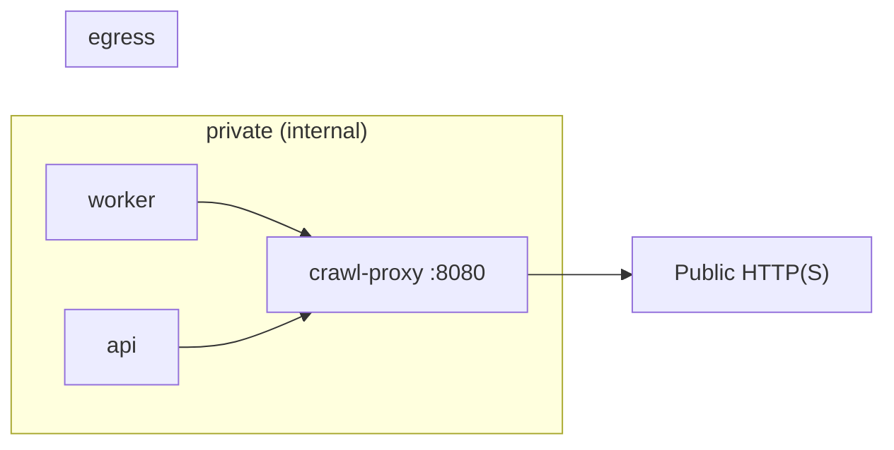

# Crawl egress and proxy runbook

Operational guide for the restricted crawl egress boundary introduced in Phase 3 Packet 4.

Related: [CRAWL_POLICY.md](../ingestion/CRAWL_POLICY.md) · [INGESTION_LIMITS.md](../ingestion/INGESTION_LIMITS.md)

## Topology



Only `crawl-proxy` joins the non-internal `egress` network. Worker and API remain on `private` without a public route.

## Health checks

```bash
docker compose exec crawl-proxy python -c "import urllib.request; print(urllib.request.urlopen('http://127.0.0.1:8080/health').read())"
```

Expected: `{"status":"live","egress":"restricted-fetch"}`

## Prove proxy-only egress

1. From `worker` container, direct public curl/wget must fail (no egress network).
2. From `worker`, `POST http://crawl-proxy:8080/fetch` with a validated pinned request succeeds for approved fixtures.
3. `tests/contract/test_crawl_ssrf.py` asserts worker Compose networks exclude `egress`.

## Failure routes

| Symptom | Likely cause | Action |
| --- | --- | --- |
| `missing crawl proxy url` | `CRAWL_PROXY_URL` unset on worker | Set to `http://crawl-proxy:8080` in Compose |
| `peer_ip_mismatch` | DNS rebinding or pin drift | Inspect `crawl_fetch_events`; deny host |
| `decompression_ratio_exceeded` | Compression bomb | Expected fail-closed; no retry broadening |
| `robots_disallow` | robots.txt denies path | Fail closed; admin re-approves scope if legitimate |
| `missing_or_expired_source_approval` | Approval revoked/expired | Owner/admin re-approve URL |

## Rollback

1. Stop enqueueing `website_crawl` jobs.
2. Revert `crawl-proxy` image to deny-by-default tag if fetch regression suspected.
3. Leave `web_snapshots` objects intact; mark failed runs in `web_crawl_runs`.

## Escalation

Security-sensitive SSRF bypass reports: treat as incident, block approval domain, preserve `crawl_fetch_events` and audit rows.
