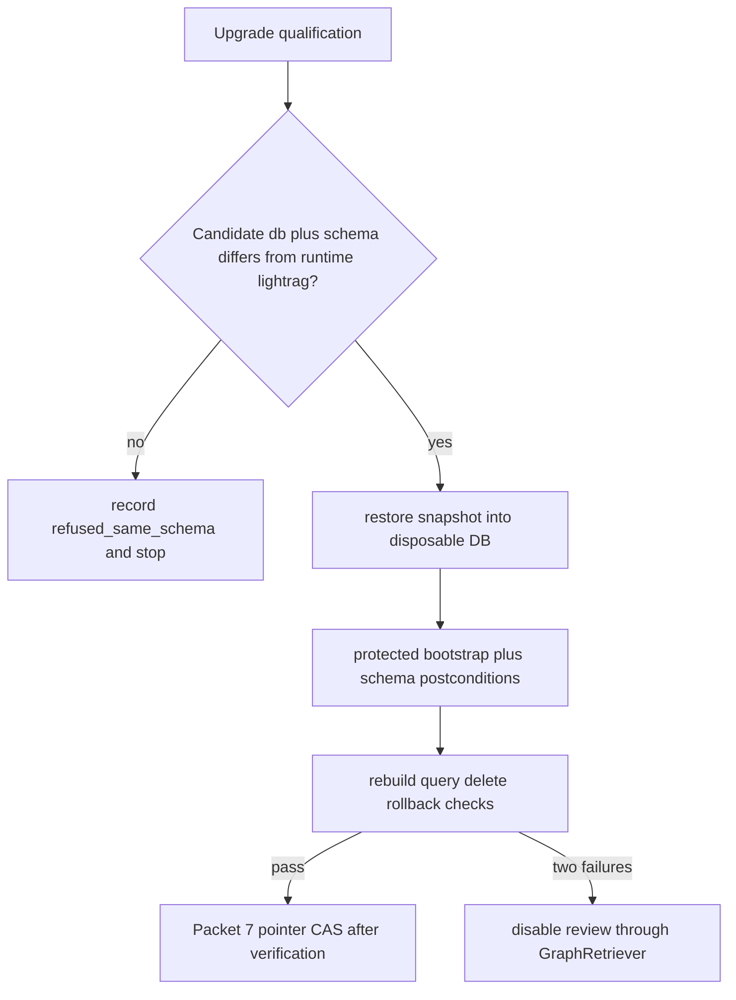

# LightRAG snapshot restore and graph pointer rollback

Qualify LightRAG package/schema upgrades on a restored isolated copy.
Never treat a second workspace in runtime schema `lightrag` as upgrade
proof. Snapshot/restore is the vendor schema rollback boundary. Pointer
rollback covers only application data compatible with the current schema.

Related: [WORKSPACE_LIFECYCLE.md](../graph/WORKSPACE_LIFECYCLE.md) ·
[lightrag-schema-bootstrap.md](./lightrag-schema-bootstrap.md) ·
[LIGHTRAG_CONTRACT.md](../graph/LIGHTRAG_CONTRACT.md) ·
[PROTECTED_MIGRATION_CREDENTIALS.md](../security/PROTECTED_MIGRATION_CREDENTIALS.md) ·
[phase-05 evidence](../development/phase-05-graphrag-evidence.md) ·
[docs index](../README.md)

## Prerequisites

| Item | Requirement |
| --- | --- |
| Pin | `lightrag-hku==1.5.6`, `PGTableGraphStorage` only, no AGE |
| Live schema | Runtime vendor schema `lightrag` on the application database |
| Disposable target | A **different database** (preferred) or a different schema environment |
| Forbidden proof | Second `graph_workspaces` row in the live `lightrag` schema |
| Credentials | Schema-admin / postgres DSN in the ops shell only. Never print it |
| Application pin | Homogeneous `text-embedding-3-large` / 1024. Do not mix embeddings |

Do not restore into the live application database. Do not re-enable
canonical deleted data. Do not hold the pointer transaction across restore
or rebuild.

## Isolation rule

Upgrade qualification is valid only when
`(candidate_database, candidate_schema) != (runtime_database, runtime_schema)`.



## Procedure

1. Take a production-sized dump of the vendor schema (and required
   extensions) using the reviewed backup tool. Do not log connection
   strings.
2. Confirm operator Postgres can create a disposable database.
   `--admin-dsn` is required when restoring a dump (no local fixture default).
3. Qualify isolation (must exit 0):

   `uv run python scripts/ops/restore_lightrag_upgrade_copy.py --candidate-database lightrag_upgrade_copy --runtime-database postgres --runtime-schema lightrag`

   The same command with `--candidate-database postgres --candidate-schema lightrag`
   must exit `2` (`upgrade_same_schema_insufficient`).
4. Restore the dump into the disposable database (not the live DB):

   `uv run python scripts/ops/restore_lightrag_upgrade_copy.py --candidate-database lightrag_upgrade_copy --dump-path <dump> --admin-dsn <ops dsn>`

   If `createdb` / `pg_restore` are missing locally, stop and restore on a
   host that has them. Missing tools are not same-schema proof.
5. Run protected bootstrap/migrations on the copy. Compare schema/data
   postconditions against the reviewed fingerprint. Then rebuild, query,
   delete, and rollback on the copy only.
6. Switch the live pointer only after those gates pass, using
   `app.switch_graph_active_workspace` with the expected generation.
   Homogeneous embeddings are required. Do not mix configs in place.

## Rollback

| Boundary | Action | Effect |
| --- | --- | --- |
| Vendor schema | Restore the last good dump into a disposable DB, qualify, then switch or disable | LightRAG tables return to the snapshotted schema |
| Application pointer | `app.switch_graph_active_workspace` back to a compatible workspace, or `app.disable_graph_workspace` | Query/inspection emit `graph_outage` until a verified workspace is active |
| Failed migration/rebuild | Do not continue Combined/inspection. Two consecutive failed qualifications open disable review | No silent provider substitution |
| Expand-only SQL | Do not DROP TABLE/COLUMN to roll back Packet 7 objects | Tombstones and maps stay filtered |

Pointer rollback cannot undo an incompatible vendor schema. If the live
`lightrag` schema already moved, restore the snapshot first.

## Failure modes

| Symptom | Likely cause | Action |
| --- | --- | --- |
| `upgrade_same_schema_insufficient` | Candidate is live `postgres.lightrag` | Use a disposable database |
| `stale_generation` | Pointer moved during rebuild | Reload generation; do not force mix |
| `in_place_mixed_embeddings_forbidden` | Target pin differs | Rebuild a homogeneous workspace |
| `deletion_cleanup_failed` | Vendor residue or timeout | Workspace is `quarantined`; keep canonical/Storage |
| `unfunded_rebuild` | Maintenance reserve exhausted | Canonical delete stays excluded; fund then rebuild |
| Restore tools missing | No `pg_restore` on the agent host | Run the restore on ops Postgres; keep the refuse test |

## Escalation

Engineering-lead when two consecutive upgrade qualifications fail, when
survival alerts stay below 0.80 for seven days, or when snapshot restore
cannot be proven on an isolated copy. Do not mark Phase 5 complete from
this runbook. Holdout stays sealed. Packet 8 owns eval/scaling.

## Verification

```powershell
uv run python scripts/ops/restore_lightrag_upgrade_copy.py --candidate-database postgres --candidate-schema lightrag --runtime-database postgres --runtime-schema lightrag
uv run python -m pytest tests/unit/test_graph_lifecycle.py tests/contract/test_graph_lifecycle.py -q
```

The first command must exit `2`. The tests must include
`test_same_schema_upgrade_is_recorded_as_refused`.

[docs index](../README.md)
