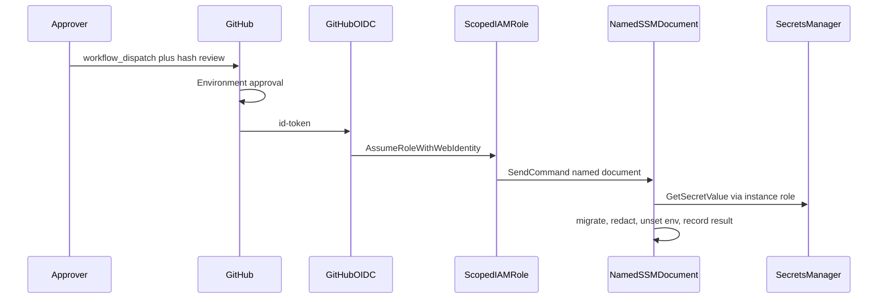

# Protected migration runbook

## Scope

Run an immutable expand-only migration against isolated staging (or, later,
production) through GitHub OIDC → a named SSM document → Secrets Manager.
GitHub never holds the database credential. Runtime API/worker processes
still must not load bootstrap secrets.

Live OIDC assume and SSM migrate are **Blocked** until AWS apply, GitHub
Environments, and secret values exist. This runbook is the procedure for that
later execution, not proof that it already ran.



## Prerequisites

- Packet 1 IaC applied so the staging instance, instance role, and OIDC
  provider exist.
- GitHub Environments `staging` and `production` exist with required
  reviewers. Deployment branches limited to `main` and tags.
- Environment variables (not secrets): `STAGING_OIDC_MIGRATE_ROLE_ARN`,
  `STAGING_INSTANCE_ID`, and the deploy/production analogs.
- Secrets Manager values for `smart-rag/staging/db` (and production when
  used) exist. Values are never committed.
- Immutable migration hash from
  `docs/deployment/phase-10/packet2-migration-hash.json` matches the
  checked-out `supabase/migrations/` tree.
- `uv run python scripts/ci/check_migrations.py` is clean. No contraction
  DDL in this release.
- Phase 9 freeze API id remains
  `sha256:a65f1aa43fbf6fd353257a75fa9462e79a5bb187741d75e36a0429216e3633ec`.

## Procedure (staging)

1. Confirm the Packet 2 gate is green locally:
   `uv run python scripts/ci/check_phase10_packet2.py`.
2. Open a GitHub `workflow_dispatch` on `staging-migrate.yml` with the
   reviewed hash.
3. Designated approver reviews hash, workflow ref, environment, and
   deny-by-construction trust (repo/environment/workflow).
4. After approval, the job assumes the staging migrate role via OIDC and
   sends `SmartRagStagingMigrate`.
5. Confirm SSM output records hash, operator, and result without a DSN or
   password.
6. Keep the old API slot on the expanded schema. Do not contract.

Production uses `production-migrate.yml` and `SmartRagProductionMigrate`
only after staging proof. That path stays Blocked in this packet.

## Rollback

Schema rollback is a reviewed **forward fix**, not a down-migration, unless
the change has a qualified reversible pre-data boundary. Restore remains the
database-plus-Storage drill in a later packet. Abort by not approving the
Environment; a running SSM command should be treated as an incident if it
prints secrets (revoke/rotate immediately).

## Verification

```powershell
uv run python scripts/ci/check_migrations.py
uv run python scripts/ci/check_phase10_packet2.py
```

Live verification (when no longer Blocked): GitHub Actions run URL, SSM
command id, migration hash equality, old-API smoke still Passed against the
expanded schema, and secret rotation age ≤90 days.

## Failure modes

| Symptom | Action |
| --- | --- |
| Wrong repo, missing environment, or production on staging role | Deny; do not broaden trust |
| `DROP TABLE` / incompatible DDL | Block; do not run SSM |
| AWS keys in a workflow | Revoke/rotate; delete the keys |
| Secret in logs | Rotate staging/production credentials immediately |
| Live assume or SendCommand unavailable | Keep classification Blocked; do not mark the packet complete |

## Escalation

Engineering lead for custody/OIDC failures. Security for exposure. Do not
fall back to long-lived GitHub AWS keys or `service_role` in Vercel.

## Related

- [PROTECTED_MIGRATION_CREDENTIALS.md](../security/PROTECTED_MIGRATION_CREDENTIALS.md)
- [ADR-expand-contract-migrations.md](../adr/ADR-expand-contract-migrations.md)
- [MANAGED_STAGING.md](../deployment/MANAGED_STAGING.md)
- [phase-10 evidence](../development/phase-10-managed-staging-evidence.md)
