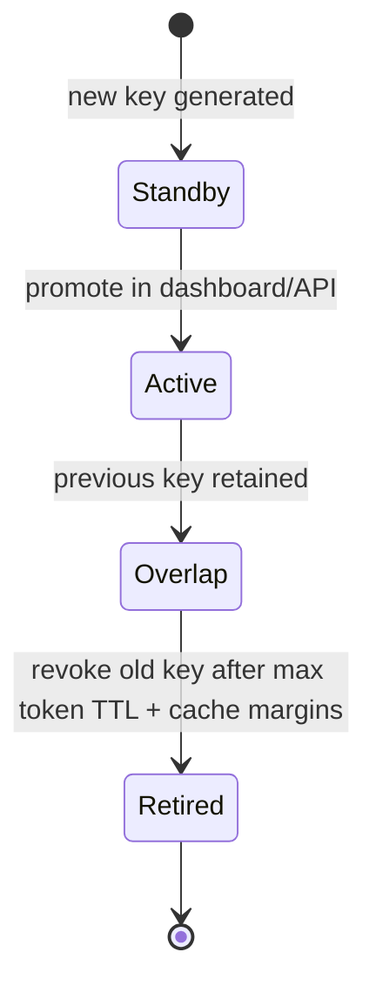

# Supabase JWKS signing-key rollover runbook

## Scope

Asymmetric Supabase access tokens (ES256/RS256) verify through JWKS at
`{SUPABASE_URL}/auth/v1/.well-known/jwks.json`. FastAPI caches JWKS for at most
**600 seconds** and refreshes **once** on unknown `kid`, then fails closed.

## Lifecycle (standby → active → retired)



During overlap, tokens signed with either active `kid` must verify. After
retirement, old tokens must fail closed.

## Cache margins

Total acceptance window for a retired key:

```text
retain_old_key_seconds >= jwt_expiry
                        + app_jwks_cache_seconds (<= 600)
                        + supabase_edge_cache_margin (managed: assume 600)
```

Local `jwt_expiry = 3600` in `supabase/config.toml`.

## Local vs managed

| Environment | Rollover API | Packet 4 gate |
| --- | --- | --- |
| Local CLI (`127.0.0.1:54321`) | Env `GOTRUE_JWT_KEYS` only | ES256 JWKS present; provider lifecycle proven on managed |
| Managed `qsjivtwtmlmtksufqjik` | `POST/PATCH …/config/auth/signing-keys` with `SUPABASE_ACCESS_TOKEN` | **Proven 2026-08-13** — see phase evidence; ops script `scripts/ops/prove_jwks_rollover.py` |

## Operator procedure (managed)

1. Confirm FastAPI `JWKS_CACHE_SECONDS` ≤ 600 and no HS256 verification path.
2. Generate/import standby key in Supabase dashboard (Auth → JWT settings).
3. Promote standby → active; confirm JWKS publishes **both** kids.
4. Wait at least `jwt_expiry + 1200` seconds while monitoring auth errors.
5. Revoke retired key; confirm old tokens fail and new tokens succeed.
6. Record timeline in phase evidence.

## Failure modes

| Symptom | Action |
| --- | --- |
| Unknown `kid` spike after refresh | Check Supabase Auth status; verify JWKS URL reachable |
| JWKS fetch errors | Fail closed (401/503); do not fall back to JWT secret |
| All tokens fail after rollover | Confirm issuer URL matches `SUPABASE_URL/auth/v1`. Local Docker may use the documented `127.0.0.1` / `host.docker.internal` `iss` pair only when `APP_ENV=local`. |

## Verification commands

```bash
# Local JWKS (expect ES256 key with kid)
Invoke-RestMethod http://127.0.0.1:54321/auth/v1/.well-known/jwks.json

# Managed JWKS probe (read-only)
Invoke-RestMethod https://qsjivtwtmlmtksufqjik.supabase.co/auth/v1/.well-known/jwks.json
```

## Related documents

- [IDENTITY_PROPAGATION.md](../security/IDENTITY_PROPAGATION.md)
- [CONFIGURATION.md](../development/CONFIGURATION.md)
- [ADR-privileged-auth-administration-boundary.md](../adr/ADR-privileged-auth-administration-boundary.md)
