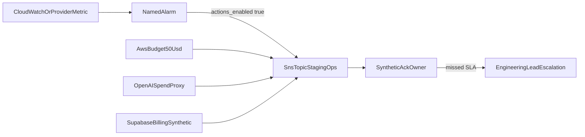

# Staging alert routing

Assign every operational and OpenAI/AWS/Supabase billing alarm an owner,
severity, notification route, acknowledgement target, escalation, and
linked response. Staging sends **synthetic** alarms only. There is
**no production email**. The committed route is SNS topic
`aws_sns_topic.staging_ops` (`${var.project_name}-ops`) with
`aws_sns_topic_policy.staging_ops` allowing `cloudwatch.amazonaws.com`
and `budgets.amazonaws.com` to `sns:Publish`. Live SNS
publish, acknowledgement, and escalation remain **Blocked** until Packet 1
apply. Do not subscribe production mailboxes.

Related: [MANAGED_STAGING.md](../deployment/MANAGED_STAGING.md) ·
[AUDIT_CHAIN.md](../security/AUDIT_CHAIN.md) ·
[05-database-connections.md](../architecture/05-database-connections.md) ·
[phase-10 evidence](../development/phase-10-managed-staging-evidence.md)



## Route contract

| Field | Staging value |
| --- | --- |
| Topic | `staging-ops` (`aws_sns_topic.staging_ops`) |
| Recipients | none in IaC; synthetic operators only after apply |
| Forbidden | production email, `subscriber_email_addresses`, email protocol |
| Ack | Critical 15 minutes; billing 60 minutes |
| Escalation | engineering-lead, then product-owner for spend stop |
| Envelope | keep QT-CAP-001-P9=8 / QT-CAP-002-P9=16 / QT-CAP-005-P8=15 |

## Named alarm matrix

Every row below is committed policy. Live delivery is Blocked.

| Alarm id | Owner | Severity | Route | Acknowledgement | Escalation | Response |
| --- | --- | --- | --- | --- | --- | --- |
| egress_denials | engineering-lead | high | staging-ops SNS | 15 min | eng-lead | Packet 3 deny logs; do not open origin |
| cpu | engineering-lead | high | staging-ops SNS | 15 min | eng-lead | 70% pause; sizing ladder |
| memory | engineering-lead | high | staging-ops SNS | 15 min | eng-lead | 70% pause; Valkey/ParadeDB caps |
| disk | engineering-lead | high | staging-ops SNS | 15 min | eng-lead | EBS headroom; do not destroy Object Lock |
| paradedb_fallback | engineering-lead | high | staging-ops SNS | 15 min | eng-lead | dense+term degrade; rebuild from Supabase |
| valkey | engineering-lead | high | staging-ops SNS | 15 min | eng-lead | fail-closed limits; no double admission |
| audit_anchor_gap | security | critical | staging-ops SNS | 15 min | security then eng-lead | stop unsigned export; HMAC is not KMS |
| ses_bounce | engineering-lead | medium | staging-ops SNS | 60 min | eng-lead | sandbox only; no production recipient |
| openai_spend | engineering-lead | high | staging-ops SNS | 60 min | product-owner | durable budget pause; proxy metric only |
| aws_monthly_budget | engineering-lead | high | staging-ops SNS | 60 min | product-owner | 50 USD MONTHLY COST; stop unbounded spend |
| aws_data_transfer | engineering-lead | medium | staging-ops SNS | 60 min | eng-lead | same 50 USD budget notification |
| supabase_compute | engineering-lead | high | staging-ops SNS | 60 min | eng-lead | Pro plan; live dashboard Blocked |
| supabase_storage | engineering-lead | medium | staging-ops SNS | 60 min | eng-lead | synthetic buckets only |
| supabase_egress | engineering-lead | medium | staging-ops SNS | 60 min | eng-lead | provider-egress deny-by-default |
| supabase_cpu | engineering-lead | high | staging-ops SNS | 15 min | eng-lead | 70% isolation; local 30<42 still holds |
| supabase_io | engineering-lead | high | staging-ops SNS | 15 min | eng-lead | pause HNSW/graph maintenance |
| supabase_connections | engineering-lead | high | staging-ops SNS | 15 min | eng-lead | reject replica without primary recheck |
| supabase_backup | engineering-lead | high | staging-ops SNS | 60 min | eng-lead | Packet 6 restore; not this packet |

## Procedure (staging synthetic)

1. Confirm `actions_enabled = true` and `alarm_actions` include
   `aws_sns_topic.staging_ops.arn`.
2. Trigger one synthetic metric or budget notification per named row.
   Do not use production data or production recipients.
3. Record acknowledgement owner, time, and runbook step. No secrets.
4. If acknowledgement misses the SLA, escalate to engineering-lead.
5. Spend alarms that would exceed the 50 USD envelope stop new work.

Live steps 2–5 are **Blocked** in this packet. The matrix above is the
owned route, not proof of delivery.

## Failure modes

| Symptom | Route |
| --- | --- |
| `actions_enabled = false` | Repair IaC; Packet 5 policy fail |
| Production SNS email | Remove; never subscribe |
| HMAC export `kms: true` | Failed; HMAC is not KMS |
| Replica without primary recheck | Failed; reject the endpoint |
| 10k/1M envelope claim | Failed; keep the signed reduce |
| Unbounded budget | Failed; keep 50 USD MONTHLY |

## Verification

```powershell
uv run python scripts/ci/check_phase10_packet5.py
```
