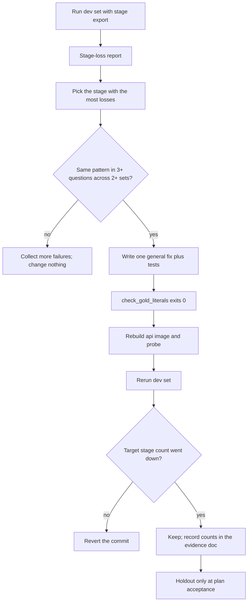

# Answer-quality repair loop

Every new private test set scored about 60%. Each repair added code that
matched the failed questions of that set (regexes holding gold answer
words). The next fresh set failed on different questions, so the score
stayed near 60%. This runbook is the only allowed way to change answer
quality: measure the losing stage, write one general fix, guard against
gold literals, rerun the sealed holdout only at plan acceptance.

## Prerequisites

- Compose stack up with `query_ready: true`.
- `api` image rebuilt from the current branch (see
  `.cursor/plans/general-answer-quality/00-rules-and-commands.md`).
- `.private-eval/eval-credentials.json` present.
- `OPERATOR_SUPABASE_DB_URL` set in `.env` or `.env.compose` (never print
  it).

## The loop



Run the current dev set with `--stage-export`. Attribute every gold fact
to the first stage that lost it. Fix only the stage with the most losses,
and only when the same pattern appears in at least three failed questions
across at least two different sets. The gold-literal guard must exit 0.
Rebuild the image, probe it, and rerun the same dev set. If the target
stage count did not drop, or strict passes drop by more than three,
revert. Keep the holdout sealed until plan acceptance.

## Stage definitions

Stages (the first stage that misses the fact wins):

- `ok`: the released answer holds the fact (same rule as the scorer).
- `1_ingestion`: no stored chunk of the run's document versions holds it.
- `2_retrieval`: no dense, BM25, term, fused, pool, or selected chunk
  holds it.
- `3_fusion_pool`: a candidate holds it; the rerank pool does not.
- `4_rerank_select`: the pool holds it; selected evidence does not.
- `5a_draft_missing`: selected evidence holds it; the generated draft
  does not.
- `5b_removed_after_draft`: the draft held it; the released answer does
  not.
- `5_unknown_no_checkpoint`: selected evidence holds it, no draft was
  found.

Removal causes for `5b_removed_after_draft`:

- `salvage_overwrite`: the release holds link families the draft did not.
- `refused_after_draft`: the release has no links or is refused.
- `trimmed_or_rewritten`: any other drop after a correct draft.

## Commands

Live run (replace `$run`):

```powershell
$run = "dev40-<packet>"
New-Item -ItemType Directory -Force ".private-eval/runs/$run" | Out-Null
uv run python scripts/run_company_ask.py `
  --gold .private-eval/dev40-2026-10-v1.json `
  --out ".private-eval/runs/$run/summary.json" `
  --credentials .private-eval/eval-credentials.json `
  --progress ".private-eval/runs/$run/progress.json" `
  --answers-out ".private-eval/runs/$run/answers.json" `
  --stage-export ".private-eval/runs/$run/stages.json"
```

Stage report:

```powershell
uv run python scripts/eval_stage_loss.py --run ".private-eval/runs/$run" --gold .private-eval/dev40-2026-10-v1.json --json-out ".private-eval/runs/$run/stage-loss.json"
```

Subset run (no `--ids` flag):

```powershell
.venv\Scripts\python.exe .private-eval/gold_subset.py --gold .private-eval/dev40-2026-10-v1.json --ids d01,d07 --out ".private-eval/runs/$run/gold.json"
```

Gold-literal guard:

```powershell
uv run python scripts/check_gold_literals.py
```

## Rules

Never add code, regexes, constants, prompt bullets, or test names that
mention a specific eval question, gold phrase, book page, book-specific
term, or eval set id. A retrieval or answer change is allowed only when
the stage report shows the same loss pattern in at least three failed
questions across at least two different sets, and the change works for
any document. Run the gold-literal guard before every commit that touches
`packages/` or `apps/`; it must exit 0. Tune and debug only on the
dev set. The sealed holdout runs only for the baseline and the final
acceptance; never read its per-question results. If a change does not
lower its target stage count on the dev set, revert it. Do not fix
forward with new special cases. Older tuned sets are not targets; do not
add code to win back their scores. Write a new dev set when the current
one has been used for more than three fix cycles; retire the holdout into
dev after the acceptance run.

## Writing a new question set

Private gold files live under `.private-eval/` and are never committed.
Each set is a JSON array of
`{"id","page","kind","prompt","facts":[{"id","canonical":[...]}]}`.
Use a prompt prefix copied from an existing private set (book title plus
comma) and include `Use only that document.` One question per page;
about 14 code, up to 12 table, the rest text, 40 total. Canonical phrases
are exact spans from the page dump (one source line or one table cell).
A phrase must not appear in older sets, must not appear in the prompt,
and must be on that page. Validate with
`.private-eval/validate_new_set.py` until `failures=0`. Seal a holdout
with a SHA-256 file and update `.private-eval/used-pages.txt`.

## Failure modes and troubleshooting

- Stale image: the probe prints `MISSING` for a committed packet. Rebuild
  `api` from the branch.
- `blocked=missing OPERATOR_SUPABASE_DB_URL`: set the URL in `.env` or
  `.env.compose` (never print it).
- Checkpoint query column error: drop the `ORDER BY checkpoint_id, idx`
  clause in `scripts/eval_stage_loss.py`.
- Many `5_unknown_no_checkpoint`: the run used a different database than
  the operator URL.
- Guard prints `skipped=no_private_gold`: expected in CI where
  `.private-eval/` is absent.

## Security

Private files stay under `.private-eval/`. Reports carry counts and
question ids only. Never print gold phrases, answer text, chunk text, or
`OPERATOR_SUPABASE_DB_URL`.

## Related

- [ADR-general-answer-quality.md](../adr/ADR-general-answer-quality.md)
- [GENERAL_ANSWER_QUALITY_2026-10.md](../evaluation/GENERAL_ANSWER_QUALITY_2026-10.md)
