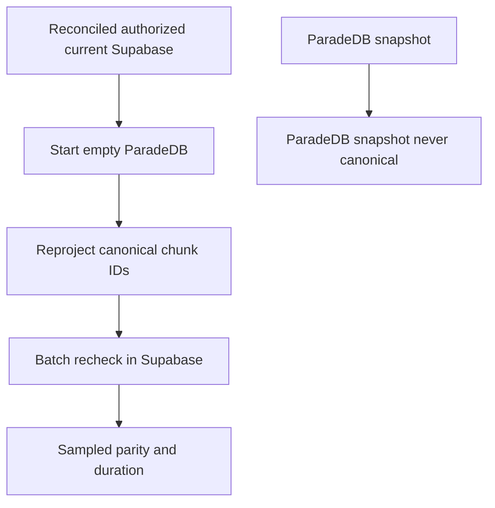

# Derived BM25 projection rebuild

Recreate the private ParadeDB/`pg_search` projection **only from reconciled
authorized current Supabase**. ParadeDB snapshot never canonical. Start from
an empty ParadeDB volume. Sampled parity and duration are recorded when a
rebuild actually runs. Phase 9
`docs/deployment/phase-09/candidate-packet6-rebuild.json` is supporting
derived-projection evidence (`paradedb_used_as_canonical: false`, volume
destroyed, authorized re-projection passed). A live empty rebuild on EC2
remains **Blocked**.

Related: [storage-db-reconciliation.md](./storage-db-reconciliation.md) ·
[instance-rebuild.md](./instance-rebuild.md) ·
[07-bm25-projection.md](../architecture/07-bm25-projection.md) ·
[MANAGED_STAGING.md](../deployment/MANAGED_STAGING.md) ·
[phase-10 evidence](../development/phase-10-managed-staging-evidence.md)



## Prerequisites

- [storage-db-reconciliation.md](./storage-db-reconciliation.md) completed.
  Rebuild only after reconciliation. Do not rebuild first.
- Supabase remains canonical. `restore_incomplete` versions stay excluded.
- Pinned ParadeDB image from the Phase 9 freeze. Host data is not canonical.
- Worker credentials can write the projection; reader credentials cannot DDL.
- Envelope stays QT-CAP-001-P9=8 / QT-CAP-002-P9=16 / QT-CAP-005-P8=15.

## Procedure

1. Confirm reconciliation finished and incomplete versions are excluded.
2. Destroy or start **empty ParadeDB**. Do not restore a ParadeDB snapshot
   as authority. An EBS snapshot may shorten recovery but never replaces
   this path.
3. Apply pinned bootstrap SQL (`arabic_norm_v1`, BM25 projection, search
   index) on the empty service.
4. Rebuild the projection **only from reconciled authorized current**
   Supabase rows. Scope is `authorized_current`.
5. Batch-recheck sampled IDs against Supabase ACL, current-version, and
   deletion state. Record sampled parity and duration when the drill runs.
6. Verify Hybrid degrades visibly if ParadeDB is killed; never serve BM25
   snippets as evidence.

## Rollback

Keep Hybrid on dense plus term if the rebuild fails. Leave the empty or
partial projection unpublished. Retry from reconciled Supabase. Do not
promote a ParadeDB snapshot as canonical.

## Failure modes

| Symptom | Action |
| --- | --- |
| Pre-reconciliation rebuild | Stop. Failed |
| ParadeDB snapshot treated as canonical | Failed |
| Stale ACL or deleted IDs in the projection | Failed; recheck and rebuild |
| Live EC2 empty rebuild not run | Keep P10-06-C live row Blocked; local derived projection may Pass |
| SQL stamped Hybrid Ready without worker rebuild | Failed |

## Verification

```powershell
uv run python scripts/ci/check_phase10_packet6.py
```

Confirm
`docs/deployment/phase-09/candidate-packet6-rebuild.json` still has
`paradedb_used_as_canonical: false`. Live EC2 duration is not invented.

## Escalation

Engineering lead for rebuild/parity failures. Do not size up from an
unmeasured EC2 rebuild. Keep the signed reduced envelope until Packet 5/6
live resources exist.
