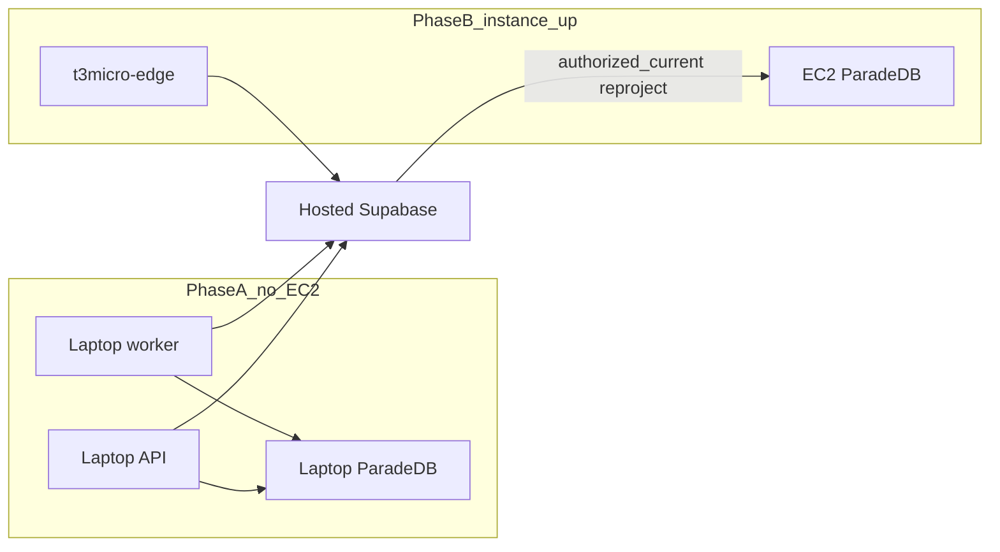

# Demo: laptop ingest, hosted Supabase, AWS ask later

**EC2 is not ready now.** Do not SSH, SSM, or `compose up` on AWS until the
operator says the instance is up. This is a demo procedure, not a
production-ready claim.

Canonical decision:
[ADR-demo-local-ingest-aws-ask.md](../adr/ADR-demo-local-ingest-aws-ask.md).
Related: [LANGSMITH_TRACING.md](../development/LANGSMITH_TRACING.md) ·
[CONFIGURATION.md](../development/CONFIGURATION.md) ·
[bm25-rebuild.md](./bm25-rebuild.md) ·
[MANAGED_STAGING.md](../deployment/MANAGED_STAGING.md) ·
[STAGING_COMPOSE.md](../deployment/STAGING_COMPOSE.md) ·
[07-bm25-projection.md](../architecture/07-bm25-projection.md)



## Demo corpus

Source dump `docs/datasets/MovieSummaries/plot_summaries.txt` is ~42k lines.
**Do not ingest it whole.** Each slice is **one `.txt` file** (one upload).

| File | Source lines | Eligibility | Pipelines |
| --- | --- | --- | --- |
| `plot_summaries.graph-200.txt` | 1–200 | company-visible, mark `graph_eligible` after promote | Hybrid + Graph |
| `plot_summaries.hybrid-800.txt` | 201–1000 (800 plots) | leave `graph_eligible=false` | Hybrid only |

Together: 1000 Hybrid plots, 200 Graph plots. Graph indexes the whole
version, so the 800-line file must never be graph-eligible. Slice files:
[DEMO_SLICES.md](../datasets/MovieSummaries/DEMO_SLICES.md). Regenerate
slices with:

```powershell
uv run python scripts/ops/cut_plot_summary_demo_slices.py
```

Ingest the 800-line file first or either order. Approximate OpenAI cost for
both uploads is about **$0.10–$0.30** (`text-embedding-3-large` plus
`gpt-4o-mini` extract on 200 plots, gleaning 0).

## Phase A — laptop ingest and ask

### Prerequisites

- Copy [`.env.hosted-ingest.example`](../../.env.hosted-ingest.example) to
  gitignored `.env.compose`. Fill hosted `SUPABASE_URL`, `app_runtime` DSNs
  (`API_SUPABASE_DB_URL`, `WORKER_SUPABASE_DB_URL`), live `OPENAI_API_KEY`,
  and LangSmith key. `APP_ENV=local`. `MOCK_MODEL_MODE=false`.
  `LANGSMITH_TRACING=true`. **Do not** set
  `SMART_RAG_SUBPROCESSOR_MATRIX_VERIFIED=true`.
- Runtime DSNs must be **`app_runtime`**, never `postgres`.
- FastAPI still forbids HS256. If login fails, fix hosted asymmetric keys.
- Laptop RAM for ClamAV + parser + worker. That cost stays off AWS.
- Local ParadeDB is the BM25 engine. Hosted Postgres has no `pg_search`.
  Do not copy that volume to AWS later.

### Two terminals (required)

Idle polls stay quiet. Start **one** host worker and tee stdout to a log,
then filter that file in two windows:

```powershell
New-Item -ItemType Directory -Force logs | Out-Null
uv run python scripts/ops/run_laptop_ingest_worker.py *>> logs\laptop-ingest-worker.log
```

```powershell
Get-Content -Wait logs\laptop-ingest-worker.log | Select-String '\[hybrid\]'
```

```powershell
Get-Content -Wait logs\laptop-ingest-worker.log | Select-String '\[graph\]'
```

Do not start a second worker, and do not use `docker compose logs worker`
(the Compose worker image cannot run the parser sandbox).

| Prefix | What must appear |
| --- | --- |
| `[hybrid]` | Both uploads: `scan` → `parse` → `embed_batch` → `bm25` → `hybrid_ready` |
| `[graph]` | **Only** the 200-line file: `lightrag_index` → `extract_batch` → `graph_ready` |

The 800-line file must **not** emit `[graph]` extract lines. Empty windows
after an upload fail the demo check. Messages are counts and reason codes
only (no plot text).

### LangSmith (required)

Open project `LANGSMITH_PROJECT` (default `smart-rag`). Filter
`ingestion.index` / `embedding.embed` for both files. The 200-line file must
also show parent `ingestion.graph` and child `model.lightrag_llm` extract
spans. Each successful extract span exposes input/cached/output/total token
counts and `estimated_cost_usd`; LangSmith can aggregate its wrapped OpenAI
child spans at trace level. The USD value is a standard-list-price estimate,
not the canonical provider invoice. Hide I/O stays forced. No plot text in
traces.

### Ingest order

1. Wire env (hosted `SUPABASE_URL` + `app_runtime` DSNs), then start
   laptop Compose **without** the distroless `worker` service. Publish
   ParadeDB/ClamAV/crawl-proxy with the Packet 8 overlay so the **host**
   worker can reach them and launch `smart-rag-parser-sandbox:local`:

   ```powershell
   uv run python scripts/ops/wire_hosted_ingest_env.py
   uv run python scripts/ops/wire_frontend_hosted_auth.py
   docker compose --env-file .env.compose --profile parser-build build parser-sandbox
   docker compose --env-file .env.compose -f docker-compose.yml -f docker-compose.packet8.yml up -d --build paradedb valkey-limits valkey-cache clamav crawl-proxy api
   uv run python scripts/ops/run_laptop_ingest_worker.py
   ```

   The host worker copies ``WORKER_SUPABASE_DB_URL`` onto ``LIGHTRAG_DB_URL``
   when that variable is unset, then ``SET ROLE app_lightrag``. Without that,
   hybrid ingest can reach `hybrid_ready` while the 200-line LightRAG job
   stays `pending` forever and LangSmith shows no `ingestion.graph` runs.
   Startup prints `lightrag_db_url_set=true` (never the DSN).

   Do not run `.\scripts\dev.ps1` for this demo (it starts local Docker
   Supabase). Filter logs from the host worker process, not `docker compose logs worker`.
2. Upload `plot_summaries.hybrid-800.txt` through the local UI. Leave
   `graph_eligible` false (upload default). Wait for `[hybrid]` through
   `hybrid_ready` (public status `graph_ineligible`).
3. Upload `plot_summaries.graph-200.txt`. After scan/promote sets
   `current_version_id`, mark eligibility **before** BM25 finalize:

   ```powershell
   $env:OPERATOR_SUPABASE_DB_URL = "<session URL that can SET ROLE postgres>"
   uv run python scripts/ops/mark_demo_graph_eligible.py <document_uuid>
   ```

   Do not point the API/worker DSN at `postgres`.
4. Confirm `[graph]` extract lines and LangSmith `ingestion.graph`.
5. Ask on the **laptop API** (`http://127.0.0.1:8000` or
   `NEXT_PUBLIC_API_BASE_URL=http://127.0.0.1:8000`). Hybrid uses local
   ParadeDB. Graph reads hosted tables. Do not wait on CloudFront.

## Phase B — when the instance is ready

Do **not** start worker/ClamAV/parser on `t3.micro`. Use the t3 overlay and
`--profile t3micro-edge` only. In-repo `SmartRagStagingDeploy` now matches
that command. **Do not** `aws ssm send-command` until the operator says the
host is up.

Fill EC2 ParadeDB from hosted Supabase only. RAM-safe one-shot:

1. Stop `t3micro-edge` (API/Caddy/proxies). Keep ParadeDB and Valkey up.
2. Reproject `authorized_current` with the worker image, no ingest stack:

   ```bash
   printf '%s' '{"rebuild_scope":"authorized_current"}' | docker compose \
     -f docker-compose.staging.yml -f docker-compose.t3micro.yml \
     --env-file /opt/smart-rag/.env --profile demo-reproject \
     run --rm -T bm25-reproject
   ```

3. Start `--profile t3micro-edge` again.

Do not publish ParadeDB `5432`. Do not point the laptop worker at AWS
ParadeDB. Do not copy a laptop dump. Do not enable LangSmith on the EC2 API
for ingest (there is no ingest worker there).

## Failure modes

| Symptom | Action |
| --- | --- |
| Empty `[hybrid]` / `[graph]` windows | Tracing/progress not on the laptop worker; restart worker with the hosted-ingest env |
| LangSmith has no `ingestion.*` trees | `LANGSMITH_TRACING` was false on the worker, or mock mode hid live gateway spans |
| `lightrag_llm_openai_not_configured` | Worker is stale. Stop it, update the live adapter, run `uv run python scripts/ops/reset_demo_graph_extract.py`, then start exactly one worker. |
| Graph extract on the 800-line file | File was marked graph-eligible; do not upload a combined 1000-line eligible file |
| HS256 login failure | Fix hosted JWKS; do not enable HS256 in FastAPI |
| `postgres` DSN on API/worker | Switch to `app_runtime` |
| ParadeDB dump copied to EC2 | Discard; reproject from hosted Supabase |

## Verification

```powershell
uv run pytest tests/unit/test_ingest_progress.py tests/unit/test_ingest_trace.py tests/unit/test_demo_plot_slices.py tests/contract/test_demo_plot_slices.py tests/contract/test_staging_deploy_t3micro.py tests/contract/test_demo_reproject_profile.py tests/unit/test_langsmith_tracing.py tests/unit/test_openai_lightrag.py -q
```

Live LangSmith trees and TTY prefixes after a real upload remain **unverified**
until Phase A is run with operator keys.

## Rollback

Set `LANGSMITH_TRACING=false` and `MOCK_MODEL_MODE=true`, restart the laptop
worker, and stop using hosted `SUPABASE_URL` interpolation (Compose falls
back to local GoTrue). Phase B: do not send SSM; leave the instance untouched.
