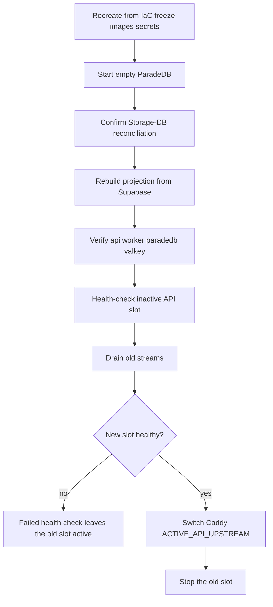

# EC2 instance rebuild and blue/green drain

Recreate EC2 services from reviewed IaC, Phase 9 freeze images, and secrets.
Start **empty ParadeDB**. Rebuild the projection from reconciled Supabase.
Verify api, worker, paradedb, and valkey health. Host data is not canonical.
Approved availability targets remain RTO ≤ **4 hours** and RPO ≤ **24 hours**
(Pro PITR intended). Those values are targets, not measurements. A timed
instance rebuild was not run. Live CloudFront, Vercel, and SSM drain stay
**Blocked**. This runbook is the topology contract, not proof that a live
switch already happened.

Related: [storage-db-reconciliation.md](./storage-db-reconciliation.md) ·
[bm25-rebuild.md](./bm25-rebuild.md) ·
[PROTECTED_MIGRATION.md](./PROTECTED_MIGRATION.md) ·
[origin-secret-rotation.md](./origin-secret-rotation.md) ·
[MANAGED_STAGING.md](../deployment/MANAGED_STAGING.md) ·
[AVAILABILITY_AND_ISOLATION_TRIGGERS.md](../architecture/AVAILABILITY_AND_ISOLATION_TRIGGERS.md) ·
[phase-10 evidence](../development/phase-10-managed-staging-evidence.md)



## Prerequisites

- Packet 1 IaC reviewed under `infra/ec2/`. Live apply is Blocked here.
- Phase 9 freeze API image remains
  `sha256:a65f1aa43fbf6fd353257a75fa9462e79a5bb187741d75e36a0429216e3633ec`.
- Staging Compose defines `api-blue` and `api-green`. Caddy proxies
  `{$ACTIVE_API_UPSTREAM}`.
- Secrets live in Secrets Manager placeholders. Values are never committed
  or logged.
- Envelope stays QT-CAP-001-P9=8 / QT-CAP-002-P9=16 / QT-CAP-005-P8=15.

## Instance rebuild procedure (when no longer Blocked)

1. Recreate from IaC, encrypted EBS, Phase 9 freeze images, and secrets.
   IMDSv2 hop limit 1. SSM-only. No public SSH.
2. Start **empty ParadeDB**. Host disks and snapshots are not canonical.
3. Confirm Storage/database reconciliation. Then rebuild the BM25
   projection from Supabase ([bm25-rebuild.md](./bm25-rebuild.md)).
4. Verify health: api (active slot), worker, paradedb, valkey-limits,
   valkey-cache.
5. Record elapsed time only from a real drill. Do not invent RTO/RPO hours.

## Caddy switch and drain (documented, not claimed live)

Compose already has `api-blue` / `api-green`. The intended same-host
sequence is:

1. Start and health-check the inactive slot.
2. Drain old streams on the active slot.
3. Switch Caddy `ACTIVE_API_UPSTREAM` to the healthy new slot.
4. Only then stop the old slot.
5. A **failed health check leaves the old slot active**.

Do not claim a live switch, live Vercel/API deploy order, or live failed
SSM deploy from this packet. Application old-API/new-schema smoke remains
supporting evidence from
`docs/deployment/phase-09/candidate-old-api-new-schema-smoke.json`
(Passed, prior digest
`sha256:1d9f569b54c6012c4e9b1087979b409a9e2517ac9cce7c1f81d8917d9870f3d7`,
freeze restored). Schema rollback is a reviewed forward fix, not a
down-migration or destructive `DROP TABLE` contraction.

## Rollback

Keep the previous healthy API slot. Restore `ACTIVE_API_UPSTREAM` to that
slot. Do not contract the schema. Use a reviewed forward fix if the
expansion must be corrected. Instance rebuild rollback is recreate-from-IaC
again; host data remains non-canonical.

## Failure modes

| Symptom | Action |
| --- | --- |
| New slot fails health | Leave the old slot active |
| Invented RTO/RPO hours | Failed. Keep targets, not measurements |
| ParadeDB snapshot used as authority | Failed |
| Destructive contract DDL with the old slot | Failed; requalify |
| Live drain not executed | Keep P10-06-E Blocked overall |

## Verification

```powershell
uv run python scripts/ci/check_phase10_packet6.py
uv run python scripts/ci/check_migrations.py
```

Live verification (when no longer Blocked): timed recreate, health of api/
worker/paradedb/valkey, Caddy upstream switch audit, failed-slot leaving
the old active, both frontend/API deploy orders. No secrets.

## Escalation

Engineering lead for RTO/RPO misses (opens the multi-host ADR path).
Security for secret exposure during rebuild. Do not mark Packet 6 complete
while live instance rebuild and drain remain Blocked.
