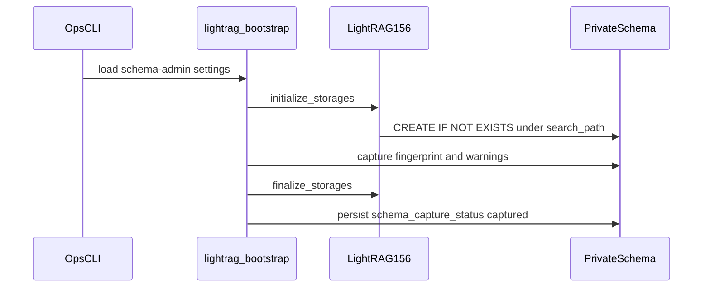

# LightRAG private-schema bootstrap runbook

Protected `initialize_storages` against schema `lightrag`, warning capture,
fingerprint check, and finalize. This is not Graph Ready and does not run on
API or worker startup.

Related: [ADAPTER_LIFECYCLE.md](../graph/ADAPTER_LIFECYCLE.md) ·
[ADR-lightrag-runtime-attach-without-ddl.md](../adr/ADR-lightrag-runtime-attach-without-ddl.md) ·
[LIGHTRAG_CONTRACT.md](../graph/LIGHTRAG_CONTRACT.md) ·
[CONFIGURATION.md](../development/CONFIGURATION.md) ·
[phase-05 evidence](../development/phase-05-graphrag-evidence.md) ·
[PROTECTED_MIGRATION_CREDENTIALS.md](../security/PROTECTED_MIGRATION_CREDENTIALS.md)

## Prerequisites

| Item | Requirement |
| --- | --- |
| Pin | `lightrag-hku==1.5.6`, engine `PGTableGraphStorage` only, no AGE |
| Migrations | `20260816090000_lightrag_vendor_pgtable_v1.sql` and `20260816090100_graph_workspace_pointer_lease_v1.sql` applied |
| Schema-admin DSN | `LIGHTRAG_SCHEMA_ADMIN_DSN` loaded only through `LightRagSchemaAdminSettings` |
| Runtime DSN | Must **not** be present on this command. Never reuse `service_role` |
| Search path | Vendor init uses `lightrag,extensions,public` |
| Pool | Bootstrap uses cap 2–4. `POSTGRES_CONNECTION_RETRIES=0` |
| Workspace env | `POSTGRES_WORKSPACE` unset. Constructor workspace only |
| Mock models | Default `MOCK_MODEL_MODE=true` for local bootstrap |

Do not print database passwords. Do not hand-edit vendor rows.

## Procedure



1. Confirm operator Postgres is reachable (`OPERATOR_SUPABASE_DB_URL` or
   the schema-admin DSN). Do not log the DSN.
2. Apply reviewed migrations as the migration role if objects are missing. Expand-only: no DROP TABLE/COLUMN/TYPE.
3. Export `LIGHTRAG_SCHEMA_ADMIN_DSN` in the ops shell only. Do not put it in Backend/Worker/Agent settings.
4. Run:

   `uv run python scripts/ops/bootstrap_lightrag_schema.py --repeat`

5. Confirm the printed table count matches the reviewed fixture
   `tests/fixtures/lightrag/schema_fingerprint_v1.json` (14 tables including
   `schema_capture_status`). Confirm `capture_status = captured` and pin
   `1.5.6`.
6. Treat any fatal initialize warning (`incomplete migration`, `failed to`,
   AGE, missing vector type, public vendor tables) as failure even if the
   process returned.

## Rollback

This release is expand-only. Do not DROP vendor tables to roll back.

| Action | Effect |
| --- | --- |
| Unset `LIGHTRAG_DB_URL` on API/worker | Adapter stays unconfigured; no Graph queries |
| Stop using schema-admin DSN | No further `initialize_storages` |
| Leave additive tables in place | Packet 3+ can resume after a reviewed fix |
| Do not grant CREATE to `app_lightrag` | Runtime must stay DML-only |

## Verification

| Check | Expected |
| --- | --- |
| Repeat bootstrap | Stable fingerprint SHA-256 |
| `SET ROLE app_lightrag; CREATE TABLE ...` | `InsufficientPrivilege` |
| `SET ROLE anon` / `authenticated` SELECT vendor table | `InsufficientPrivilege` |
| `public` tables named `lightrag_%` | none |
| AGE extension | absent |
| API/worker startup | Never calls bootstrap initialize |
| Import scan | `lightrag` only in adapter/bootstrap modules |

Commands (no passwords in output):

```powershell
uv run python scripts/ci/check_migrations.py
uv run python -m pytest tests/contract/test_lightrag_bootstrap.py tests/unit/test_lightrag_adapter.py tests/unit/test_lightrag_pin.py -q
```

## Escalation

| Condition | Owner |
| --- | --- |
| Fingerprint drift vs reviewed fixture | engineering-lead; halt Packet 3 |
| Runtime attach requires CREATE | reject pin path; do not grant DDL to `app_lightrag` |
| Fatal initialize warning on repeat | treat as incomplete migration; do not mark captured |
| Connection cap would exceed 4 per process | stop; see [05-database-connections.md](../architecture/05-database-connections.md) |
| AGE / `PGGraphStorage` appears | fail closed immediately |

[docs index](../README.md) · [runbook backlog](./README.md)
