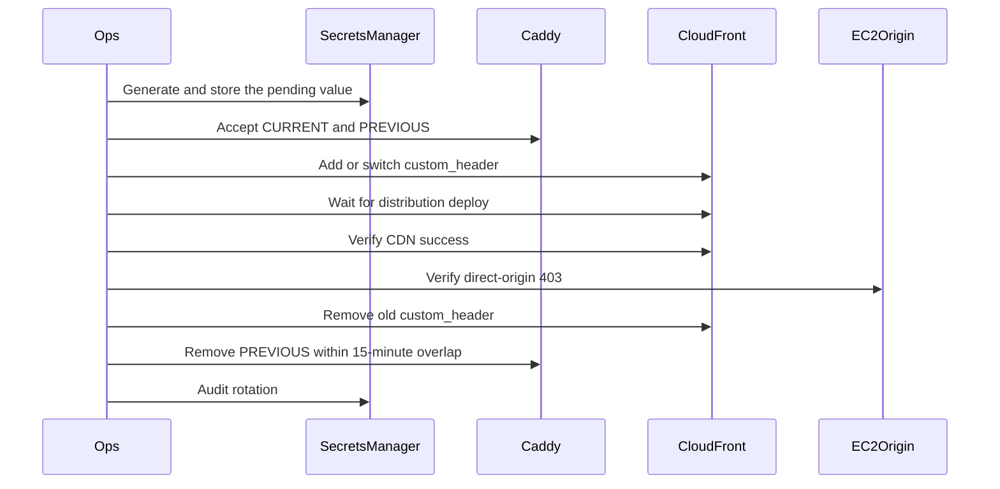

# Origin-secret dual rotation runbook

## Scope

Rotate the random CloudFront origin header **name and value** at least every
90 days and after suspected exposure. Caddy must accept the current and
previous values during a maximum **15-minute overlap**. Abort or rollback
keeps at least one valid value. Direct-origin requests without a matching
header stay 403. Header **values are never committed**.

Live rotation is **Blocked** until Packet 1 apply produces a CloudFront
distribution and EC2 origin. This runbook is the topology contract, not
proof that rotation already ran.



## Prerequisites

- Packet 3 origin policy still Passed: Caddy 403 default, CloudFront
  `custom_header`, prefix-list origin SG, 90-second timeouts.
- Secrets Manager placeholders `smart-rag/staging/origin-header-*` exist.
  Values are never logged or committed.
- Staging Compose requires
  `ORIGIN_HEADER_VALUE_CURRENT` and `ORIGIN_HEADER_VALUE_PREVIOUS`.
- `uv run python scripts/ci/check_phase10_packet4.py` is green locally.

## Procedure (staging)

1. Generate and store the pending value (new random name and value) in
   Secrets Manager. Do not print it.
2. Make Caddy accept old and new:
   `ORIGIN_HEADER_VALUE_CURRENT` plus `ORIGIN_HEADER_VALUE_PREVIOUS`.
3. Add and switch the CloudFront `custom_header` to the pending pair.
4. Wait for distribution deployment (`Deployed`).
5. Verify CDN success with the new header and direct-origin rejection
   (missing header, wrong secret, direct IP, direct hostname).
6. Remove the old CloudFront header once the new distribution is serving.
7. Remove old Caddy acceptance after a maximum 15-minute overlap.
8. Record the audit: operator, start/end, overlap minutes, CDN result,
   direct-origin 403s. No secret values.

Abort or rollback keeps at least one valid value. Never leave Caddy or
CloudFront with zero accepted secrets. Every rotation is audited.

## Rollback

If CloudFront deploy fails or CDN requests 403 after the switch:

1. Keep Caddy CURRENT and PREVIOUS.
2. Point CloudFront `custom_header` back at the still-valid previous pair.
3. Wait for distribution deployment.
4. Verify CDN success and direct-origin 403.
5. Stop. Do not remove the remaining valid Caddy value.

## Failure modes

| Symptom | Action |
| --- | --- |
| Overlap longer than 15 minutes | Restore/stop; treat as exposure window |
| Zero valid secrets | Restore from Secrets Manager; incident |
| Direct origin 200 | Stop; Packet 3 origin policy has drifted |
| Secret in logs or Git | Rotate immediately; revoke the exposed value |
| Live distribution missing | Keep classification Blocked; do not mark Passed |

## Verification

```powershell
uv run python scripts/ci/check_phase10_packet4.py
```

Policy checks: `overlap_minutes <= 15`; Caddy has CURRENT and PREVIOUS;
CloudFront `custom_header` present; this rollback path is documented.
Live rotation stays Blocked without a CloudFront audit artifact.

## Related

- [MANAGED_STAGING.md](../deployment/MANAGED_STAGING.md)
- [STREAMING_TIMEOUTS.md](../deployment/STREAMING_TIMEOUTS.md)
- [SUPABASE_JWKS_ROLLOVER.md](./SUPABASE_JWKS_ROLLOVER.md)
- [phase-10 evidence](../development/phase-10-managed-staging-evidence.md)
