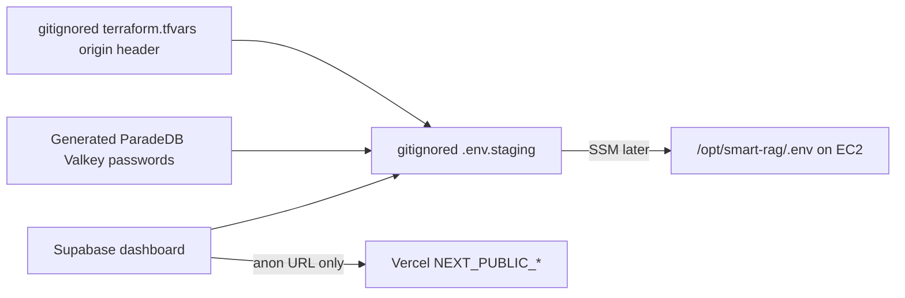

# Phase 10 staging secrets collection

Collect credentials into gitignored files. Do **not** paste secrets into
chat, commit them, or put them in Vercel except the three public keys.
AWS Free plan, hosted Supabase Free, and live `t3.micro` are accepted for
now; expand the instance later before starting the full Compose stack.



## Already on this workstation (do not re-paste)

| Item | Where it lives | Chat |
| --- | --- | --- |
| AWS IAM user `Muna` | `%USERPROFILE%\.aws\credentials` profile `Nagdy-iam` | never |
| Hosted project URL | `https://qsjivtwtmlmtksufqjik.supabase.co` | public |
| `SUPABASE_ANON_KEY`, `SUPABASE_ACCESS_TOKEN`, OpenAI, LangSmith | repo `.env` (gitignored) | never |

## Database URLs (operator completed 2026-08-19)

Transaction (6543) and session (5432) pooler URIs are in gitignored
`infra/ec2/.env.staging`. They were copied from the repo `.env` after
the dashboard paste. A workstation `SELECT 1` probe on both ports
succeeded (Postgres 17.6; `pg_search` absent). Do not paste the URIs
into chat or git.

If you must replace them, open
[Supabase project settings](https://supabase.com/dashboard/project/qsjivtwtmlmtksufqjik/settings/database)
and overwrite the two keys in `.env.staging` only. Use the `postgres`
or pooler user. Do not put `service_role` in Compose or Vercel.

Vercel public env (operator completed 2026-08-19): project
`smart-rag-staging` on team `nagdy8888s-projects`. Only
`NEXT_PUBLIC_API_BASE_URL` (CloudFront
`https://dzm8yijuajwge.cloudfront.net`), `NEXT_PUBLIC_SUPABASE_URL`,
and `NEXT_PUBLIC_SUPABASE_ANON_KEY`. Never `service_role`. Working URL:
`https://smart-rag-staging-nagdy8888s-projects.vercel.app`. GitHub App is still
not installed on `Nagdy8888/Demo_Project_3`, so later git-linked
deploys need [Vercel GitHub App](https://github.com/apps/vercel).

Optional later:

- Google OAuth client id/secret only if Packet 5 live Auth is in scope.
- `OPENAI_API_KEY` is already local. Keep `MOCK_MODEL_MODE=true` until
  you explicitly turn mocks off.

## ParadeDB and Valkey

These are **not** cloud API keys. Generate long random passwords into
`.env.staging`. They stay on the private Docker network. Do not publish
host ports.

## t3.micro host

ParadeDB and both Valkey services run on EC2 `t3.micro`, not the
workstation. Default Compose is the staging file plus
`docker-compose.t3micro.yml`. After you place `.env` via Secrets Manager
`smart-rag/staging/compose-env`, start with:

```bash
docker compose -f docker-compose.staging.yml -f docker-compose.t3micro.yml --env-file /opt/smart-rag/.env up -d
```

Do not put the env file body in `ssm:SendCommand` parameters. API/Caddy
need `--profile t3micro-edge`. Worker/ClamAV/parser stay off.

## Verification

```powershell
# Names only; do not print values
Select-String -Path infra/ec2/.env.staging -Pattern '^[A-Z0-9_]+=' | ForEach-Object { $_.Line.Split('=')[0] }
```

Missing `STAGING_SUPABASE_TRANSACTION_URL` or
`STAGING_SUPABASE_SESSION_URL` blocks API/worker start.

## Rollback / escalation

Delete leaked keys in the AWS IAM and Supabase dashboards. Rotate origin
headers with [origin-secret-rotation.md](./origin-secret-rotation.md).
Escalate to eng-lead if a secret appeared in git or chat.
