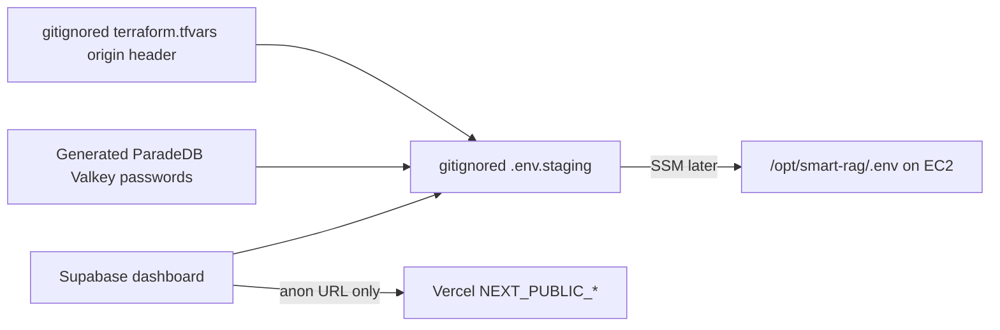

# Phase 10 staging secrets collection

Collect credentials into gitignored files. Do **not** paste secrets into
chat, commit them, or put them in Vercel except the three public keys.
AWS Free plan, hosted Supabase Free, and live `t3.micro` are accepted for
now; expand the instance later before starting the full Compose stack.



## Already on this workstation (do not re-paste)

| Item | Where it lives | Chat |
| --- | --- | --- |
| AWS IAM user `Muna` | `%USERPROFILE%\.aws\credentials` profile `Nagdy-iam` | never |
| Hosted project URL | `https://qsjivtwtmlmtksufqjik.supabase.co` | public |
| `SUPABASE_ANON_KEY`, `SUPABASE_ACCESS_TOKEN`, OpenAI, LangSmith | repo `.env` (gitignored) | never |

## You still add (Dashboard → gitignored file)

Open [Supabase project settings](https://supabase.com/dashboard/project/qsjivtwtmlmtksufqjik/settings/database).

1. Copy **Transaction pooler** URI (port **6543**) into
   `STAGING_SUPABASE_TRANSACTION_URL` in `infra/ec2/.env.staging`.
2. Copy **Session** URI (port **5432**) into
   `STAGING_SUPABASE_SESSION_URL`.
3. Use the `postgres` or pooler user from the dashboard. Do not put
   `service_role` in Compose or Vercel.

Optional later:

- Vercel: only `NEXT_PUBLIC_API_BASE_URL` (CloudFront
  `https://dzm8yijuajwge.cloudfront.net`), `NEXT_PUBLIC_SUPABASE_URL`,
  `NEXT_PUBLIC_SUPABASE_ANON_KEY`. Never `service_role`.
- Google OAuth client id/secret only if Packet 5 live Auth is in scope.
- `OPENAI_API_KEY` is already local. Keep `MOCK_MODEL_MODE=true` until
  you explicitly turn mocks off.

## ParadeDB and Valkey

These are **not** cloud API keys. Generate long random passwords into
`.env.staging`. They stay on the private Docker network. Do not publish
host ports.

## t3.micro limit

Do not `docker compose up` the full staging file on 916Mi RAM. After you
expand the instance, copy `.env.staging` with SSM and start the stack.
Freeze images must be in ECR first.

## Verification

```powershell
# Names only; do not print values
Select-String -Path infra/ec2/.env.staging -Pattern '^[A-Z0-9_]+=' | ForEach-Object { $_.Line.Split('=')[0] }
```

Missing `STAGING_SUPABASE_TRANSACTION_URL` or
`STAGING_SUPABASE_SESSION_URL` blocks API/worker start even on a larger
host.

## Rollback / escalation

Delete leaked keys in the AWS IAM and Supabase dashboards. Rotate origin
headers with [origin-secret-rotation.md](./origin-secret-rotation.md).
Escalate to eng-lead if a secret appeared in git or chat.
