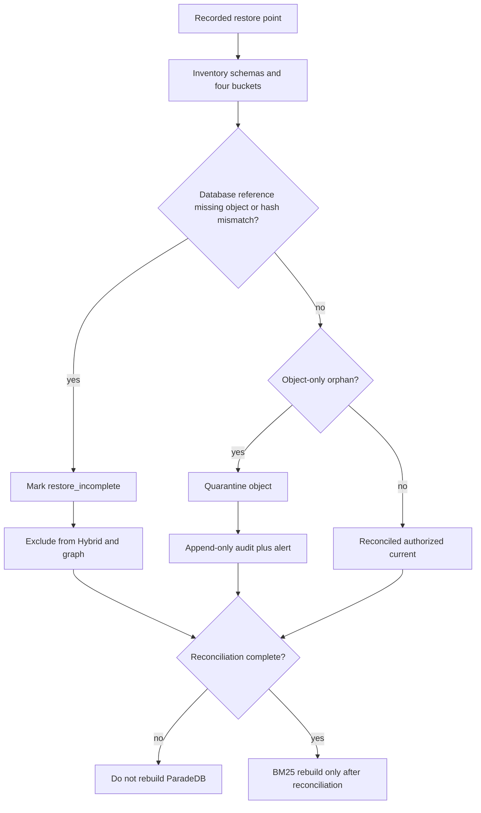

# Storage and database restore reconciliation

Reconcile managed Supabase application schemas with every durable Storage
bucket after a recorded restore point, **before** any ParadeDB rebuild.
Missing objects and hash mismatches mark the version `restore_incomplete`
and exclude it from Hybrid and graph. Object-only orphans are quarantined
with an append-only audit event and an alert. Live managed PITR plus
four-bucket restore remains **Blocked** until an isolated staging project
exists. Do not invent orphan counts. Do not restore production. Do not
overwrite the live local application database from this packet.

Related: [bm25-rebuild.md](./bm25-rebuild.md) ·
[instance-rebuild.md](./instance-rebuild.md) ·
[GRAPH_SNAPSHOT_RESTORE_ROLLBACK.md](./GRAPH_SNAPSHOT_RESTORE_ROLLBACK.md) ·
[MANAGED_STAGING.md](../deployment/MANAGED_STAGING.md) ·
[phase-10 evidence](../development/phase-10-managed-staging-evidence.md)



## Prerequisites

- Isolated staging Supabase Pro with PITR intended for QT-AVL-003 (RPO ≤24h).
  Live PITR is Blocked in this packet.
- Durable buckets exist: `documents-quarantine`, `documents-originals`,
  `web-snapshots`, `table-artifacts`.
- Phase 9 supporting inventory
  `docs/deployment/phase-09/candidate-packet6-restore.json` remains
  `live_database_overwritten: false`. `restore_returncode: 1` is
  `pg_restore` warnings, **not** a managed PITR Pass.
- Synthetic or redacted data only. Production corpus and production users
  are forbidden.
- `uv run python scripts/ci/check_phase10_packet6.py` is the local gate.

## Procedure (staging, when no longer Blocked)

1. Record the recovery point and inventory application schemas, LightRAG
   private tables, mappings, BM25 outbox/index versions, and all four
   buckets. Do not print DSNs or tokens.
2. Restore the database into an isolated staging project. Never restore
   production. Never overwrite the live local application database.
3. Restore every durable Storage bucket to the same recorded point.
4. For each database reference with a **missing object** or **hash
   mismatch**, mark the version `restore_incomplete`, exclude it from
   Hybrid and graph, write an append-only audit event, and alert.
5. For each **object-only orphan**, quarantine the object, write an
   append-only audit event, and alert. Do not index orphans.
6. Rebuild ParadeDB **only after reconciliation** completes. See
   [bm25-rebuild.md](./bm25-rebuild.md).

## Rollback

Stop the drill. Keep incomplete versions excluded. Leave quarantined
orphans quarantined. Do not reverse marks with a destructive contract
migration. A later reviewed forward fix may clear `restore_incomplete`
only after the object is restored and the hash matches.

## Failure modes

| Symptom | Action |
| --- | --- |
| Missing required bucket | Stop. Restore the bucket before rebuild |
| Hash mismatch hidden | Failed. Mark `restore_incomplete` and exclude |
| Orphan counted without a live drill | Failed. Do not invent orphan counts |
| Rebuild started first | Failed. Rebuild only after reconciliation |
| Local dump labeled managed PITR | Failed. Keep P10-06-A Blocked |
| Live database overwritten | Failed. Restore only a disposable or isolated target |

## Verification

```powershell
uv run python scripts/ci/check_phase10_packet6.py
uv run python -m pytest tests/unit/test_phase10_packet6.py tests/contract/test_phase10_packet6.py -q
```

Live verification (when no longer Blocked): staging project id, PITR
recovery point, four-bucket object inventory, adversarial missing/hash/
orphan report with real counts, and exclusion from Hybrid/graph. No
secrets in the artifact.

## Escalation

Engineering lead for restore/reconciliation failures. Security if
production data or the live local database was touched. Do not proceed to
Packet 7 while P10-06-A or P10-06-B is Blocked or Failed.
