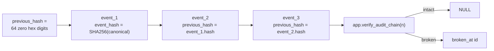

# Audit hash chain

Append-only `app.audit_events` rows form a SHA-256 hash chain. Local tamper
detection is real; external anchoring is deferred to Phase 10.

## Chain construction



On each `INSERT` (including `app.append_audit_event`):

1. `app.redact_audit_payload` replaces keys containing `password`, `token`,
   `secret`, or `raw_ip` with `[REDACTED]`.
2. `chain_seq` is assigned from `app.audit_events_chain_seq` (monotonic insert
   order; avoids UUID/`created_at` races).
3. `previous_hash` is the latest prior `event_hash` by `chain_seq`, or genesis.
4. `event_hash` is `encode(digest(canonical_json, 'sha256'), 'hex')` via
   `pgcrypto` (`extensions` schema).

Canonical JSON is built by `app.audit_event_canonical_material` over event
fields, redacted payload, `previous_hash`, and `created_at`.

## Mutation controls

| Operation | Result |
| --- | --- |
| `UPDATE` / `DELETE` on `app.audit_events` | Blocked by `audit_events_block_*` triggers |
| Direct table DML by `app_audit_writer` | Revoked; must use `append_audit_event` |
| Hash / previous_hash mutation (superuser, triggers disabled) | Detected by `app.verify_audit_chain` |
| Reordered `previous_hash` links | Detected by `app.verify_audit_chain` |

## API surface

| Function | Privilege | Notes |
| --- | --- | --- |
| `app.append_audit_event(...)` | `SECURITY DEFINER`; `EXECUTE` for `app_api`, `app_audit_writer` | Fixed `search_path`; PUBLIC revoked |
| `app.verify_audit_chain(limit_n)` | `SECURITY DEFINER`; `EXECUTE` for `app_api` | Returns first broken `id` or `NULL` |
| `app.redact_audit_payload(jsonb)` | internal helper | PUBLIC revoked |

Python mirror for redaction/helpers:
`packages/core/src/smart_rag_core/security/audit_chain.py` (SQL remains
authoritative for insert hashing).

## Phase 10 anchoring (deferred)

Periodic export of chain heads to KMS-signed / Object Lock storage is **not**
implemented. `app.audit_chain_anchors` exists as a schema placeholder from Packet 2;
no production anchoring job runs in Phase 2.

## Verification

```powershell
uv run pytest tests/contract/test_audit_chain.py -q
```

Related: [PROTECTED_MIGRATION_CREDENTIALS.md](./PROTECTED_MIGRATION_CREDENTIALS.md) ·
[05-database-connections.md](../architecture/05-database-connections.md)
