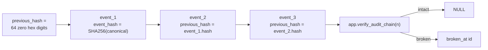

# Audit hash chain

Append-only `app.audit_events` rows form a SHA-256 hash chain. Local tamper
detection is real; external anchoring is deferred to Phase 10.

## Chain construction



On each `INSERT` (including `app.append_audit_event`):

1. `app.redact_audit_payload` replaces keys containing `password`, `token`,
   `secret`, or `raw_ip` with `[REDACTED]`.
2. `chain_seq` is assigned from `app.audit_events_chain_seq` (monotonic insert
   order; avoids UUID/`created_at` races).
3. `previous_hash` is the latest prior `event_hash` by `chain_seq`, or genesis.
4. `event_hash` is `encode(digest(canonical_json, 'sha256'), 'hex')` via
   `pgcrypto` (`extensions` schema).

Canonical JSON is built by `app.audit_event_canonical_material` over event
fields, redacted payload, `previous_hash`, and `created_at`.

## Mutation controls

| Operation | Result |
| --- | --- |
| `UPDATE` / `DELETE` on `app.audit_events` | Blocked by `audit_events_block_*` triggers |
| Direct table DML by `app_audit_writer` | Revoked; must use `append_audit_event` |
| Hash / previous_hash mutation (superuser, triggers disabled) | Detected by `app.verify_audit_chain` |
| Reordered `previous_hash` links | Detected by `app.verify_audit_chain` |

## API surface

| Function | Privilege | Notes |
| --- | --- | --- |
| `app.append_audit_event(...)` | `SECURITY DEFINER`; `EXECUTE` for `app_api`, `app_audit_writer` | Fixed `search_path`; PUBLIC revoked |
| `app.authorize_restricted_read(...)` | `SECURITY DEFINER`; `EXECUTE` for `app_api` only | Revalidates typed context, ACL, restricted visibility, and current version; atomically appends purpose/resource/session metadata |
| `app.record_run_restricted_evidence(...)` | `SECURITY DEFINER`; `EXECUTE` for `app_api` only | Same content-minimized chain for evidence included in a completed run; stores actor, version, run, citation, purpose; no passage text |
| `app.verify_audit_chain(limit_n)` | `SECURITY DEFINER`; `EXECUTE` for `app_api` | Returns first broken `id` or `NULL`. Scans the **oldest** `n` events (`ORDER BY chain_seq ASC LIMIT n`), not the newest. Operators and tests must pass `n >= count(*)` to cover later tampers. Default `n` is 1000. |
| `app.redact_audit_payload(jsonb)` | internal helper | PUBLIC revoked |

Restricted evidence, preview, and download admission creates both an
`audit_events` chain row and an append-only `restricted_read_events` row in one
transaction. Allowed purposes are exactly `evidence`, `preview`, and `download`.
Download admission requires a future signed-URL expiry; non-download surfaces
must not provide one. Stored data is limited to actor/document/version IDs,
purpose, session ID, expiry, and access-surface metadata. Passage text, preview
content, object bytes, raw tokens, and URLs are never persisted in either row.
Denied/stale/forged/non-current calls roll back without an audit success event.

Python mirror for redaction/helpers:
`packages/core/src/smart_rag_core/security/audit_chain.py` (SQL remains
authoritative for insert hashing).

## Phase 10 anchoring

Periodic export of chain heads to KMS-signed / S3 Object Lock storage is
**IaC-ready and live-Blocked**. Packet 5 committed
`infra/ec2/kms_s3_audit.tf` (hashicorp/aws ~> 5.100): rotating
`ENCRYPT_DECRYPT` KMS key, Object Lock **GOVERNANCE** 7 years on a new
bucket, SSE-KMS, public access blocked. Live `PutObject` / `GetObject` of
a KMS-signed chain head is **Blocked** (no apply, expired or missing AWS
session). Local HMAC export in
`packages/core/src/smart_rag_core/security/audit_export.py` still writes
`kms: false`, `s3_object_lock: false`, `phase_10_blocker: true`. Treating
HMAC as KMS is **Failed**.

`app.audit_chain_anchors` remains the schema placeholder; the exporter job
is a later principal and is not granted on `aws_iam_role.staging_instance`.

## Verification

```powershell
uv run pytest tests/contract/test_audit_chain.py -q
uv run python scripts/ci/check_phase10_packet5.py
```

Related: [PROTECTED_MIGRATION_CREDENTIALS.md](./PROTECTED_MIGRATION_CREDENTIALS.md) ·
[05-database-connections.md](../architecture/05-database-connections.md) ·
[alert-routing.md](../runbooks/alert-routing.md) ·
[ADMINISTRATION.md](../frontend/ADMINISTRATION.md)
