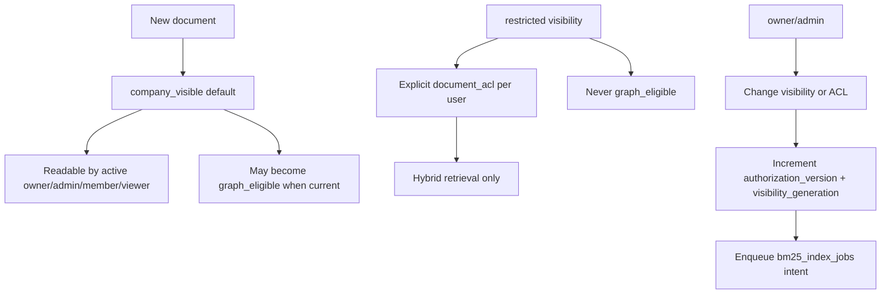

# Authorization model

Smart RAG v1 authorization is **server-derived**, **fail-closed**, and **monotonic**. Browser JWTs never reach canonical evidence tables directly; FastAPI resolves membership and passes typed RPC context.

## Role matrix

| Role | Documents | ACL admin | Conversations | Tools | Upload (Phase 5) |
| --- | --- | --- | --- | --- | --- |
| owner | read/write all | grant/revoke/visibility | own + audit all | read + configure | ordinary authenticated session |
| admin | read/write all | grant/revoke/visibility | own + audit all | read + configure | ordinary authenticated session |
| member | read per visibility/ACL | **deny** | creator-private | read per permission | deny unless `upload_enabled` |
| member (upload_enabled) | read per visibility/ACL | **deny** | creator-private | read per permission | ordinary authenticated session |
| viewer | read per visibility/ACL | **deny** | creator-private | read per permission | deny |
| disabled | deny | deny | deny | deny | deny |

Roles live in **`app.profiles.role` only**. `user_metadata` is never used for authorization.

## Document visibility (v1)

- **`company_visible`**: default for new uploads; readable by every active company role.
- **`restricted`**: Hybrid-only; requires an active row in `app.document_acl` for the caller.
- **Groups / role-wide restricted grants**: deferred.
- **`documents.current_version_id`**: single visibility pointer; non-current versions are never evidence.

Only owner/admin may grant, revoke, or flip visibility. Upload capability does **not** imply ACL administration.

## Authorization snapshot

`app.company_settings.authorization_version` increments atomically when:

- profile role, disablement, upload capability, or MFA enrollment changes;
- document visibility, deletion, or graph eligibility changes;
- `document_acl` rows change.

Document rows also carry `visibility_generation` for BM25 projection invalidation. FastAPI passes the live snapshot to approved RPCs; stale or forged snapshots return **zero rows**.

## Runtime database roles

| Role | Scope | Notes |
| --- | --- | --- |
| `anon` / `authenticated` | Auth (+ Storage in Packet 5) | **No** direct `app` table grants |
| `app_api` | EXECUTE RPCs + health view | transaction pool; no canonical writes |
| `app_worker` | jobs + ingestion tables | no conversation reads |
| `app_checkpointer` | `langgraph` schema | session/direct pool |
| `app_lightrag` | `lightrag` schema | session/direct pool |
| `app_audit_writer` | append-only audit insert | no UPDATE/DELETE |
| `postgres` (migration) | DDL/bootstrap | not available to runtime containers |
| ParadeDB bootstrap/writer/reader | private BM25 service | documented in [07-bm25-projection.md](../architecture/07-bm25-projection.md) |

Runtime roles are **NOLOGIN** locally; passwords live outside git. Production uses pooler credentials per role.

## RLS policy summary

| Table | authenticated (when granted in Packet 4+) | app_api | app_worker |
| --- | --- | --- | --- |
| profiles | own row; admin reads all | SELECT for RPC validation | deny |
| documents | visibility + ACL | SELECT for RPC reads | ALL |
| document_acl | grantee + admin | SELECT | deny |
| conversations | creator-private; admin audit | SELECT for RPC | **deny** |
| messages | via conversation policy | deny | deny |
| runs | creator-private; admin audit | deny | deny |
| audit_events | deny direct | deny | deny |
| langgraph.* | deny | deny | deny |
| lightrag.* | deny | deny | deny |

Packet 3 **revokes** all `app`/`private`/`langgraph`/`lightrag` grants from `anon` and `authenticated`. Policies exist for Packet 4 Auth wiring but are unreachable until explicit grants return for approved paths.

## Approved RPCs (Packet 3)

| Function | Args | Behavior |
| --- | --- | --- |
| `app.list_visible_documents` | caller_user_id, caller_role, authorization_version | Zero rows when context invalid; ACL-aware listing; bounded to 50 |
| `app.list_visible_documents_page` | caller context, limit, keyset cursor | Default 50, max 200, `created_at,id` cursor |
| `app.list_user_conversations` | caller_user_id, caller_role, authorization_version | Creator-private; owner/admin audit; bounded to 50 |
| `app.list_user_conversations_page` | caller context, limit, keyset cursor | Default 50, max 200, `created_at,id` cursor |
| `app.get_version_ingestion_status` | caller context, version_id | DEFINER ACL status. Empty set when unauthorized (HTTP 404) |
| `app.delete_visible_document` | caller context, document_id | Owner/admin tombstone wrapping `exclude_version_from_retrieval`. Unreadable ids return NULL |
| `app.find_visible_document_by_content_hash` | caller context, content_hash | Oldest ACL-visible non-deleted document with that version hash. `SECURITY DEFINER`. NULL when none. Finalize returns HTTP 409 `duplicate_content` before quota is consumed |
| `app.update_document_title` | caller context, document_id, title | Owner/admin rename. `SECURITY INVOKER`. Unreadable or deleted ids return NULL. Empty or over-long titles raise `documents:invalid_title`. Calls `app.sync_document_title_search_terms`. Does not delete copies |
| `app.sync_document_title_search_terms` | document_id, title | Inserts the current title onto representative chunks of the current version. `SECURITY DEFINER` with fixed `search_path`. `EXECUTE` for `app_api` and `app_worker`. Does not re-parse or replace chunk ids |
| `app.list_run_citations` | caller context, run_id | Creator-only. ACL + current-version recheck nulls `chunk_id` when unavailable |
| `app.list_run_citations_v2` | caller context, run_id | Creator-only. Same recheck as v1; overlays authorized page/title/section plus printed `page_label` onto provenance; omits passage text |
| `app.list_run_citations_v3` | caller context, run_id | Creator-only. Company branch copies v2 ACL/current-version recheck and locator stripping. Web branch returns url/title/`content_hash` plus `source_kind=web`; never excerpt, span, HTML, or query text |
| `app.admit_query_run_v3` | caller context, conversation, key, hash, family, scope | Creator-only. Persists `auto`/`company_documents`/`general_knowledge`/`web`. Calls `admit_query_run` once. v2 stays callable |
| `app.load_query_run_runtime_v3` / `app.get_query_run_v3` | caller context, run_id | Creator-only wrappers of v2 including persisted `requested_search_scope` |
| `app.begin_web_research_operation` / `app.mark_web_research_operation_sent` / `app.complete_web_research_operation` | caller context, run/operation | Creator-owned run. Same key+hash replays; different hash conflicts; `sent` without a terminal is ambiguous and must not auto-repeat |
| `app.insert_web_source` / `app.insert_web_citation` | caller context, run, source/citation | Creator-owned run. Caps 6 sources / 12 citations. URL policy, SHA-256 hash, and exact span containment. Cross-run sources are `not_found` |
| `app.accept_invitation` | token_hash, user_id, email, assurance_level | Refuses demotion; privileged/upload upgrades revoke sessions. `assurance_level` is ignored |
| `app.validate_caller_context` | caller_user_id, caller_role, authorization_version | Boolean membership + snapshot check |
| `private.set_document_acl` | caller context, document, grantee, grant/revoke | Idempotent owner/admin-only ACL mutation with audit |
| `app.set_document_visibility` | caller context, document, visibility | Owner/admin-only flip; restricted downgrade clears graph eligibility |
| `app.append_audit_event` | event metadata | **SECURITY DEFINER** single insert path for `app_audit_writer` (fixed `search_path`) |
| `app.create_eval_quiz_case` | caller context, optional run, labels, gold IDs, idempotency | Owner/admin draft. Question comes from a caller-owned completed run when `source_run_id` is set. Holdout rejected. Capacity 60. |
| `app.list_eval_quiz_case_summaries` | caller context, split, status, keyset | Owner/admin summaries without questions, answers, facts, or excerpts |
| `app.get_eval_quiz_case` | caller context, case_id | Owner/admin detail. Missing/expired IDs raise `eval_quiz:not_found` |
| `app.patch_eval_quiz_case` / `app.replace_eval_quiz_gold` | caller context, case_id, row_version | CAS edits. Reset approval. Gold locators are server-derived |
| `app.approve_eval_quiz_case` / `app.reject_eval_quiz_case` / `app.delete_eval_quiz_case` | caller context, case_id, row_version | Named-human review or immediate delete. Content-free audit |
| `app.count_eval_quiz_case_status` / `app.purge_expired_eval_quiz_cases` | caller context | Counts only; bounded 365-day purge |
| `app.enqueue_eval_exam` | caller context, split, idempotency, hashes | Owner/admin. Hidden evaluation conversation. One active exam. Holdout rejected |
| `app.claim_eval_exam` / `app.heartbeat_eval_exam` / `app.reclaim_eval_exam` | caller context, lease | `FOR UPDATE SKIP LOCKED` claim; expired lease reclaimable; live lease not |
| `app.persist_eval_exam_case_result` | caller context, counts | Idempotent count-only result. Duplicate does not increment progress |
| `app.finalize_eval_exam` / `app.cancel_eval_exam` | caller context | Immutable successful report; partial/failed never become latest |
| `app.get_eval_exam_run` / `app.get_latest_eval_exam_report` / `app.get_latest_eval_exam_report_for_split` / `app.list_eval_exam_report_cases` / `app.purge_expired_eval_exam_runs` | caller context | Status/report counts only; 365-day purge; latest is split-isolated |

Read RPCs that filter with caller context may be `SECURITY INVOKER`
(Hybrid retrieval) or `SECURITY DEFINER` (status, citation GET, paginated
lists, document delete) with a fixed search path. Mutating RPCs that must
cross the deliberately
minimal `app_api` table grants use `SECURITY DEFINER`, a fixed search path,
schema-qualified objects, live typed-context validation, and explicit
`REVOKE EXECUTE FROM PUBLIC, anon, authenticated`. The ACL mutation function
lives in the unexposed `private` schema.

## Negative guarantees

- Forged caller role or stale `authorization_version` → zero protected rows.
- Restricted document without ACL → hidden from members/viewers, including ingestion status GET (404, not 403).
- Only an owner may invite `owner`. Invitation accept refuses role/upload demotion.
- Self-update on `app.profiles` cannot change `role`, `upload_enabled`, `mfa_enrolled`, or `disabled_at`.
- Restricted / non-current / deleted documents cannot enqueue normal graph index jobs.
- `app_audit_writer` cannot UPDATE or DELETE audit rows (trigger + grants).
- `app_worker` cannot SELECT conversations.
- `app_api` cannot INSERT/UPDATE canonical tables directly.
- `app_api`, `anon`, `authenticated`, and `PUBLIC` cannot INSERT/UPDATE/DELETE
  `app.eval_quiz_cases` or `app.eval_quiz_gold_chunks`. Quiz mutations go through
  `SECURITY DEFINER` RPCs with `validate_caller_context` and owner/admin checks.
  HTTP (P06-29) wraps those RPCs and never falls back to `.private-eval/`.
- `app_api`, `anon`, `authenticated`, and `PUBLIC` cannot INSERT/UPDATE/DELETE
  `app.eval_exam_runs`, `app.eval_exam_case_results`, or
  `app.eval_exam_reports`. Successful reports reject UPDATE. `app_worker`
  still cannot SELECT chat conversations. Evaluation conversations are hidden
  from browser list/get/messages/title RPCs.
- Member, upload-capable member, viewer, disabled, forged, missing, and stale
  contexts cannot mutate ACLs.
- The local/test PDF evaluation workspace (`PDF_EVAL_WORKSPACE_ENABLED`) is
  owner/admin only, uses `app_api`, and is forbidden in staging and production.
  Holdout custody paths are never listed. P06-27 authorizes hosted quiz
  tables with the same role gate, 365-day retention, and no holdout split.
  Admin Recall@10 is **All required gold chunks in the production Hybrid
  top 10**. Citation overlap is not that metric. Exam start/cancel are
  `COST_MUTATION` and never score inside the HTTP request.
- Reusing one physical connection across transactions cannot make a retained
  `request.jwt.claims` GUC override the next call's typed RPC arguments.

## Related documents

- [IDENTITY_PROPAGATION.md](./IDENTITY_PROPAGATION.md)
- [Phase 2 evidence](../development/phase-02-identity-data-evidence.md)
- [Data dictionary](../architecture/08-data-dictionary.md)
