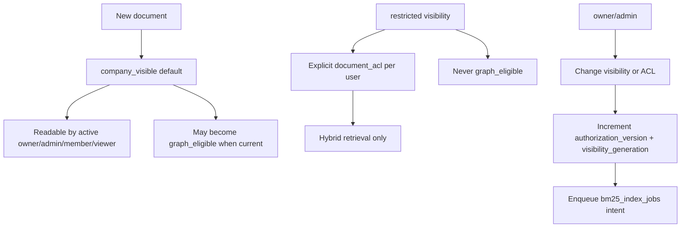

# Authorization model

Smart RAG v1 authorization is **server-derived**, **fail-closed**, and **monotonic**. Browser JWTs never reach canonical evidence tables directly; FastAPI resolves membership and passes typed RPC context.

## Role matrix

| Role | Documents | ACL admin | Conversations | Tools | Upload (Phase 5) |
| --- | --- | --- | --- | --- | --- |
| owner | read/write all | grant/revoke/visibility | own + audit all | read + configure | with MFA |
| admin | read/write all | grant/revoke/visibility | own + audit all | read + configure | with MFA |
| member | read per visibility/ACL | **deny** | creator-private | read per permission | optional + MFA |
| member (upload_enabled) | read per visibility/ACL | **deny** | creator-private | read per permission | with MFA |
| viewer | read per visibility/ACL | **deny** | creator-private | read per permission | deny |
| disabled | deny | deny | deny | deny | deny |

Roles live in **`app.profiles.role` only**. `user_metadata` is never used for authorization.

## Document visibility (v1)

- **`company_visible`**: default for new uploads; readable by every active company role.
- **`restricted`**: Hybrid-only; requires an active row in `app.document_acl` for the caller.
- **Groups / role-wide restricted grants**: deferred.
- **`documents.current_version_id`**: single visibility pointer; non-current versions are never evidence.

Only owner/admin may grant, revoke, or flip visibility. Upload capability does **not** imply ACL administration.

## Authorization snapshot

`app.company_settings.authorization_version` increments atomically when:

- profile role, disablement, upload capability, or MFA enrollment changes;
- document visibility, deletion, or graph eligibility changes;
- `document_acl` rows change.

Document rows also carry `visibility_generation` for BM25 projection invalidation. FastAPI passes the live snapshot to approved RPCs; stale or forged snapshots return **zero rows**.

## Runtime database roles

| Role | Scope | Notes |
| --- | --- | --- |
| `anon` / `authenticated` | Auth (+ Storage in Packet 5) | **No** direct `app` table grants |
| `app_api` | EXECUTE RPCs + health view | transaction pool; no canonical writes |
| `app_worker` | jobs + ingestion tables | no conversation reads |
| `app_checkpointer` | `langgraph` schema | session/direct pool |
| `app_lightrag` | `lightrag` schema | session/direct pool |
| `app_audit_writer` | append-only audit insert | no UPDATE/DELETE |
| `postgres` (migration) | DDL/bootstrap | not available to runtime containers |
| ParadeDB bootstrap/writer/reader | private BM25 service | documented in [07-bm25-projection.md](../architecture/07-bm25-projection.md) |

Runtime roles are **NOLOGIN** locally; passwords live outside git. Production uses pooler credentials per role.

## RLS policy summary

| Table | authenticated (when granted in Packet 4+) | app_api | app_worker |
| --- | --- | --- | --- |
| profiles | own row; admin reads all | SELECT for RPC validation | deny |
| documents | visibility + ACL | SELECT for RPC reads | ALL |
| document_acl | grantee + admin | SELECT | deny |
| conversations | creator-private; admin audit | SELECT for RPC | **deny** |
| messages | via conversation policy | deny | deny |
| runs | creator-private; admin audit | deny | deny |
| audit_events | deny direct | deny | deny |
| langgraph.* | deny | deny | deny |
| lightrag.* | deny | deny | deny |

Packet 3 **revokes** all `app`/`private`/`langgraph`/`lightrag` grants from `anon` and `authenticated`. Policies exist for Packet 4 Auth wiring but are unreachable until explicit grants return for approved paths.

## Approved RPCs (Packet 3)

| Function | Args | Behavior |
| --- | --- | --- |
| `app.list_visible_documents` | caller_user_id, caller_role, authorization_version | Zero rows when context invalid; ACL-aware listing |
| `app.list_user_conversations` | caller_user_id, caller_role, authorization_version | Creator-private; owner/admin audit |
| `app.validate_caller_context` | caller_user_id, caller_role, authorization_version | Boolean membership + snapshot check |
| `app.append_audit_event` | event metadata | **SECURITY DEFINER** single insert path for `app_audit_writer` (fixed `search_path`) |

All RPCs use `SECURITY INVOKER`, fixed `search_path`, and `REVOKE EXECUTE FROM PUBLIC, anon, authenticated`.

## Negative guarantees

- Forged caller role or stale `authorization_version` → zero protected rows.
- Restricted document without ACL → hidden from members/viewers.
- Restricted / non-current / deleted documents cannot enqueue normal graph index jobs.
- `app_audit_writer` cannot UPDATE or DELETE audit rows (trigger + grants).
- `app_worker` cannot SELECT conversations.
- `app_api` cannot INSERT/UPDATE canonical tables directly.

## Related documents

- [IDENTITY_PROPAGATION.md](./IDENTITY_PROPAGATION.md)
- [Phase 2 evidence](../development/phase-02-identity-data-evidence.md)
- [Data dictionary](../architecture/08-data-dictionary.md)
